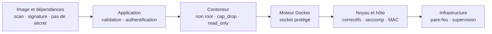
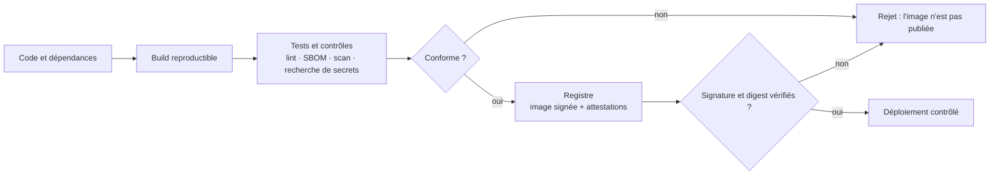

# Sécurité des images

> **En une phrase.** La sécurité d'un conteneur commence **avant** son exécution : une image transporte du code et des dépendances qu'on n'a pas écrits, et il faut savoir d'où elle vient, ce qu'elle contient, comment la corriger et ce qu'elle ne doit surtout pas contenir.

---

## 1. Synthèse

### Raisonner en frontières, pas en syntaxe

Un conteneur n'est pas une machine virtuelle miniature : il a une vue isolée de nombreux objets Linux, mais il **partage le noyau de l'hôte** (voir [Isolation d'un conteneur](Isolation-des-conteneurs.md)). Trois conséquences :

1. une vulnérabilité du noyau peut concerner **plusieurs conteneurs** à la fois ;
2. une mauvaise configuration peut **élargir** leurs accès ;
3. une application compromise reste **un processus à contrôler**.

L'isolation réduit les interactions possibles ; elle n'annule pas le risque de compromission. Une démarche de sécurité commence donc par **ce qu'on protège** et **contre quoi**, pas par la syntaxe d'un fichier YAML.

### Les actifs à protéger

| Actif | Ce que coûte sa compromission |
|---|---|
| Données applicatives | lecture, corruption ou effacement |
| Secrets (mots de passe, jetons, clés) | usurpation d'identité, accès latéral vers d'autres systèmes |
| Hôte Docker | contrôle possible de tous les autres services de la machine |
| Registre et images | distribution de code altéré à tous ceux qui tirent l'image |
| Disponibilité | saturation des ressources, interruption de service |

### Quatre familles d'attaque

| Famille | Exemples | Où se joue la protection |
|---|---|---|
| **Chaîne d'approvisionnement** | image ou dépendance vulnérable, provenance trompeuse | cette page |
| **Application** | injection SQL, exécution de code à distance, authentification faible | le code et ses tests |
| **Configuration** | privilèges excessifs, ports exposés, secrets accessibles | [Identités et privilèges](Identites-et-privileges.md), [Secrets, fichiers, réseau](Secrets-fichiers-reseau-ressources.md) |
| **Infrastructure** | socket du démon, noyau, ressources partagées, stockage de l'hôte | idem, plus le durcissement de l'hôte |

Ces protections **se complètent sans se remplacer** : une configuration Docker restrictive ne corrige pas une injection SQL.

### Défense en profondeur

On empile des protections indépendantes, une par niveau, pour qu'une faille à un niveau ne suffise pas à tout compromettre.

| Niveau | Exemple de protection propre à ce niveau |
|---|---|
| Image et dépendances | base maintenue, scan, signature, aucun secret |
| Application | validation des entrées, requêtes préparées, authentification |
| Conteneur | utilisateur non root, capabilities réduites, système de fichiers en lecture seule |
| Moteur Docker | accès au socket restreint, configuration du démon |
| Noyau et hôte | correctifs, seccomp, AppArmor ou SELinux |
| Infrastructure | pare-feu, segmentation réseau, supervision |

Exemple : si une application web est compromise, un utilisateur non privilégié et un système de fichiers en lecture seule **limitent ce que l'attaquant peut faire**, sans réparer la faille initiale.

### Le vocabulaire du risque

| Notion | Définition | Exemple |
|---|---|---|
| **Menace** | ce qui pourrait exploiter une faiblesse | accès non autorisé aux données d'un service |
| **Scénario** | le chemin concret de l'attaque | un attaquant exécute une commande à travers l'application web |
| **Vulnérabilité** | faiblesse exploitable d'un logiciel ou d'une configuration | une CVE de l'image, une injection dans le code PHP |
| **Impact** | ce que permettrait la réussite du scénario | lecture de secrets, écriture sur un volume, rebond vers un autre service |
| **Risque** | probabilité du scénario × gravité de l'impact | un service exposé à Internet et lancé en root : risque élevé |
| **Mesure** | ce qui réduit la probabilité ou l'impact | processus non privilégié, permissions de fichiers, secrets ciblés, réseau restreint, supervision |

La question utile n'est pas « mon conteneur est-il sécurisé ? », mais **« que permettrait cette compromission précise ? »**.

### L'image, premier maillon

| Étape | Question | À retenir |
|---|---|---|
| **Contenu** | Qu'y a-t-il dans l'image ? | bibliothèques, interpréteur, outils système, certificats, composants tiers, métadonnées. Une faille peut venir d'une **dépendance transitive** (la dépendance d'une dépendance), même si le code métier est correct |
| **Provenance** | Qui la produit ? | producteur et dépôt réel, historique de maintenance, politique de mises à jour, architectures, documentation. Le nombre de téléchargements ne prouve rien |
| **Identification** | Est-ce bien le même contenu ? | un **tag** (`mariadb:11.4`) est une étiquette réaffectable ; un **digest** (`mariadb@sha256:…`) désigne un contenu précis (voir [Versionner et publier une image](Versionner-et-publier-une-image.md)) |
| **Minimalisme** | Que peut-on retirer ? | moins de paquets, c'est moins d'exécutables pour un intrus et moins de mises à jour ; mais petit ne veut pas dire sûr |
| **Inventaire** | Quels composants, quelles versions ? | le **SBOM** (*Software Bill of Materials*, nomenclature logicielle) les liste ; un **analyseur** les confronte aux bases de **CVE** (*Common Vulnerabilities and Exposures*, identifiants publics des failles connues) |
| **Correction** | Comment réparer ? | on **reconstruit et redéploie** l'image ; on ne corrige jamais un conteneur à la main |
| **Secrets** | Qu'est-ce qui ne doit pas y être ? | aucun mot de passe ni jeton dans `ENV`, `ARG` ou un fichier copié |

La **surface d'attaque** d'une image dépend de ce qui y est présent, et surtout de ce qui peut y être **exécuté ou atteint**.

### Quatre contrôles, quatre preuves différentes

| Contrôle | Question à laquelle il répond | Ce qu'il ne dit pas |
|---|---|---|
| **Digest** | « Est-ce exactement le même contenu ? » | si ce contenu est sain |
| **Signature** | « Quelle identité a signé cet artefact ? » | si le code est exempt de failles |
| **Provenance de build** (attestation) | « Comment et à partir de quoi a-t-il été construit ? » | si les sources étaient saines |
| **Scan de vulnérabilités** | « Quels problèmes **connus** sont détectés ? » | ce qui n'est pas encore connu ou pas détectable |

> [!IMPORTANT]
> **Les pièges à retenir**
> 1. **Populaire ne veut pas dire fiable.** Un registre public est un lieu de distribution, pas une garantie de confiance.
> 2. **Épingler un digest fige le contenu, pas sa qualité.** La version épinglée peut contenir des failles et vieillir : il faut la mettre à jour volontairement.
> 3. **Un scan sans alerte ne prouve pas l'absence de vulnérabilité**, et une signature authentique ne garantit pas un code sans faille.
> 4. **Un secret écrit dans une couche y reste**, même supprimé dans une couche suivante, et voyage avec chaque copie de l'image.
> 5. **On ne patche pas un conteneur** : on corrige l'image, on la reconstruit, on la teste, on la redéploie.

---

## 2. Cas d'usage classiques

### Cas 1 : examiner une image avant de l'adopter (provenance)

**Besoin.** Choisir une image MariaDB pour une application, sans se fier au seul nom.

```bash
docker buildx imagetools inspect mariadb:11.4          # index, plateformes, digests
docker image pull mariadb:11.4
docker image inspect -f '{{json .Config.Labels}}' mariadb:11.4   # labels OCI : source, version, date
docker image history mariadb:11.4                       # couches et commandes de construction
```

**Ce qu'on observe.** Sur un poste de test, l'index `mariadb:11.4` couvrait quatre architectures (amd64, arm64/v8, ppc64le, s390x). Les labels OCI indiquaient le dépôt source (`github.com/MariaDB/mariadb-docker`), la version réelle (11.4.13), la date de création et la base (`ubuntu:noble`).
**À retenir.** Une image « officielle » de Docker Hub est maintenue par un processus identifié ; une image d'un compte inconnu au nom ressemblant ne l'est pas. On vérifie le producteur, la fréquence des mises à jour et le lien vers les sources, pas le compteur de téléchargements.

### Cas 2 : épingler une image par son digest

**Besoin.** Garantir que la production exécute exactement l'image testée.

```yaml
services:
  db:
    image: mariadb:11.4@sha256:250e1609e93c...   # digest complet de l'index testé
```

**Ce qu'on observe.** Le tag seul (`mariadb:11.4`) désignera une autre construction à la prochaine version corrective ou à la prochaine mise à jour de la base Ubuntu, sans que le fichier change. Avec le digest, le tirage échoue plutôt que de prendre un autre contenu.
**Le piège réel.** Pour une image multi-plateforme, le digest de l'**index** n'est pas celui du **manifeste** d'une plateforme. Sur le poste de test, le manifeste amd64 commençait par `33a6…` et le manifeste arm64 par `2839…`, sous le même index. On compare toujours des objets du même niveau.
**À retenir.** Épingler, c'est s'engager à mettre à jour : un outil comme Renovate ou Dependabot propose les nouveaux digests, qu'on valide après tests.

### Cas 3 : lire un rapport de scan sans paniquer ni s'endormir

**Besoin.** Savoir si une image de base contient des failles connues.

```bash
trivy image --severity HIGH,CRITICAL php:8.4-apache     # analyseur libre très répandu
docker scout cves php:8.4-apache                        # alternative intégrée à Docker, si le plugin est installé
```

**Ce qu'on observe.** Une liste de CVE par paquet, avec la version installée, la version corrigée si elle existe, et une gravité.
**Comment l'interpréter.** Pour chaque ligne importante, quatre questions :

| Question | Si oui | Si non |
|---|---|---|
| Le composant est-il réellement présent et utilisé ? | continuer | faux positif probable, à documenter |
| Un correctif existe-t-il ? | mettre à jour la base, reconstruire | mitiger en attendant (désactiver la fonction, filtrer l'accès) |
| La fonctionnalité vulnérable est-elle atteignable ? | priorité haute | priorité plus basse |
| Décision ? | **corriger**, **mitiger** ou **accepter**, en écrivant pourquoi | |

**À retenir.** Un rapport vide signifie « rien de connu par cette base de données, aujourd'hui », pas « image sûre ».

### Cas 4 : produire un SBOM et une provenance au moment du build

**Besoin.** Publier une image accompagnée de son inventaire et de la preuve de sa construction.

```bash
docker buildx build --sbom=true --provenance=mode=max \
  -t registre.exemple.fr/app:1.2.0 --push .
docker buildx imagetools inspect registre.exemple.fr/app:1.2.0   # montre les attestations attachées
```

**Ce qu'on observe.** BuildKit attache à l'image des **attestations** : la liste des paquets (SBOM) et la description du build (sources, Dockerfile, paramètres).
**Un effet surprenant, constaté sur un poste de test.** Reconstruire la même image entièrement depuis le cache a quand même changé son identifiant local. L'identifiant affiché était le digest de l'**index**, qui inclut l'attestation de provenance régénérée à chaque build. Même contenu exécutable, digest différent : encore une raison de comparer des objets du même niveau.

### Cas 5 : le secret qui reste dans une couche

**Besoin.** Le build doit télécharger une dépendance privée avec un jeton.

```dockerfile
# À éviter : la valeur est écrite dans la configuration de l'image
ENV API_TOKEN=valeur-secrete

# À éviter aussi : le fichier reste dans la couche du COPY, même supprimé ensuite
COPY token.txt /tmp/token.txt
RUN outil-de-telechargement --token-file /tmp/token.txt && rm /tmp/token.txt
```

```bash
docker image inspect -f '{{.Config.Env}}' mon-image     # la variable apparaît en clair
docker image history --no-trunc mon-image                # les ARG et commandes apparaissent aussi
```

**La bonne pratique.** Un montage de secret BuildKit, présent seulement pendant l'instruction `RUN` :

```dockerfile
# syntax=docker/dockerfile:1
RUN --mount=type=secret,id=token \
    test -s /run/secrets/token && \
    outil-de-telechargement --token-file /run/secrets/token
```

```bash
docker build --secret id=token,src=./token.txt -t mon-image .
```

**Ce qu'on observe.** Le secret est fourni au build mais ne devient pas un fichier de l'image finale : ni `docker image inspect`, ni `docker image history`, ni une recherche dans un conteneur jetable ne le retrouvent. Sur un poste de test, une recherche `grep -F -f` des deux mots de passe de l'application dans la configuration, l'historique et les répertoires de l'image n'a donné **aucune occurrence**.
**À retenir.** `ENV`, `ARG` et les fichiers copiés laissent des traces dans l'image ou ses métadonnées, et une image poussée ne se « dé-publie » pas. Le contexte de build et le `.dockerignore` sont traités dans [Contexte de build, cache et .dockerignore](Contexte-de-build-et-cache.md).

### Cas 6 : corriger une CVE de l'image de base

**Besoin.** Le scan signale une faille corrigée dans une nouvelle version de la base.

```bash
# À éviter : modification manuelle, perdue à la prochaine recréation et impossible à tracer
docker exec web apt-get upgrade -y

# Le bon cycle : reconstruire, tester, redéployer
docker build --pull --no-cache -t registre.exemple.fr/app:1.2.1 .
trivy image registre.exemple.fr/app:1.2.1
docker push registre.exemple.fr/app:1.2.1
# puis mettre à jour le tag (ou le digest) dans compose.yaml
docker compose up -d
```

**Ce qu'on observe.** `--pull` force la récupération de la base à jour et `--no-cache` réexécute les `RUN` d'installation, dont la clé de cache ne voit pas les nouveaux paquets publiés. Le conteneur est **recréé** depuis la nouvelle image.
**À retenir.** La sécurité des images appartient au **cycle de livraison logiciel** : correction, reconstruction, vérification, redéploiement.

### Cas 7 : retirer les outils de compilation de l'image finale

**Besoin.** Une application compilée n'a pas besoin du compilateur pour tourner.

```dockerfile
# syntax=docker/dockerfile:1
FROM golang:1.23 AS build
WORKDIR /src
COPY . .
RUN CGO_ENABLED=0 go build -o /app .

FROM gcr.io/distroless/static-debian12:nonroot
COPY --from=build /app /app
ENTRYPOINT ["/app"]
```

**Ce qu'on observe.** L'image finale ne contient ni shell, ni gestionnaire de paquets, ni compilateur : un intrus a très peu d'outils à sa disposition, et le scan a peu de paquets à signaler.
**La nuance.** Une image minimale (`alpine`, `distroless`) n'est pas automatiquement plus sûre : il faut que ses correctifs soient publiés rapidement, qu'elle soit compatible avec l'application (Alpine utilise musl et non glibc) et qu'on voie encore ses dépendances. L'absence de shell complique aussi le diagnostic. La construction multi-étapes est détaillée dans [Écrire un Dockerfile](Ecrire-un-Dockerfile.md).

---

## 3. Idées de schémas

### Schéma A : l'iceberg de l'image

Ce que le développeur écrit est une toute petite partie de ce qui s'exécute. Chiffres relevés sur une image Apache/PHP réelle (`docker image history`) :

```
              ┌──────────────┐
  visible     │ code PHP     │  20 kB      ← ce qu'on a écrit
 ─ ─ ─ ─ ─ ─ ─┼──────────────┼─ ─ ─ ─ ─ ─ ─ ─ ─ ─ ─ ─ ─ ─ ─ ─ ─ ─
              │ PHP, Apache  │  59 MB + 366 MB   ← hérité de php:8.4-apache
  immergé     │ paquets      │
              ├──────────────┤
              │ Debian trixie│  88 MB    ← hérité de la base
              └──────────────┘
   Chaque couche immergée a ses propres CVE, ses propres mises à jour.
```

### Schéma B : défense en profondeur



À dessiner comme des remparts successifs : une flèche rouge « attaque » franchit le premier et s'arrête au deuxième ou au troisième.

### Schéma C : une chaîne CI/CD avec des portes



L'objectif est d'**empêcher** qu'un artefact non conforme atteigne l'exploitation, pas seulement de produire un rapport après déploiement.

### Schéma D : quatre questions autour d'une image

Une image au centre, quatre bulles autour, chacune avec son outil et sa question : **digest** (« même contenu ? »), **signature** (« qui l'a signée ? »), **provenance** (« comment construite ? »), **scan** (« failles connues ? »). Sous chaque bulle, en gris, ce qu'elle ne prouve pas.

---

## 4. Script de motion design : « Le voyage d'une image » (environ 70 s)

Style : fond sombre, une image représentée comme une pile de briques colorées, une porte de contrôle par étape. Vert pour ce qui passe, rouge pour ce qui est bloqué.

| Séq. | Durée | À l'écran | Animation | Texte à l'écran |
|---|---|---|---|---|
| 1 | 0-8 s | Une petite brique « code » posée sur une haute pile de briques grises « dépendances » | La caméra descend le long de la pile, qui paraît sans fin | « Ce qu'on écrit est la partie visible. Le reste, on l'hérite. » |
| 2 | 8-16 s | Deux images côte à côte : « officielle » et « copie au nom proche », chacune avec un compteur de téléchargements géant | Les compteurs tournent ; une loupe se pose sur l'étiquette du producteur et révèle « inconnu » pour la copie | « Populaire ne veut pas dire fiable. On vérifie qui la produit. » |
| 3 | 16-25 s | Une étiquette `mariadb:11.4` attachée à une pile ; elle se décroche et va se coller sur une autre pile | Puis une empreinte `sha256` s'imprime directement dans la pile et ne bouge plus | « Un tag se déplace. Un digest désigne un contenu. » |
| 4 | 25-35 s | Un scanner balaie la pile de briques | Trois briques s'allument en rouge avec un badge « CVE » ; l'une porte « correctif disponible », une autre « non atteignable » | « Scanner, puis interpréter : présent ? corrigé ? atteignable ? » |
| 5 | 35-44 s | Un développeur tape `ENV API_TOKEN=…` ; une brique dorée « secret » s'insère dans la pile | Une main tente de retirer la brique dorée par-dessus (`rm`) : elle reste visible au travers, comme sous une vitre | « Un secret écrit dans une couche y reste. » |
| 6 | 44-52 s | La même scène avec un tunnel `--mount=type=secret` | La brique dorée traverse le tunnel pendant le build puis disparaît ; la pile finale n'en garde aucune trace | « Le secret sert au build, il ne devient pas une couche. » |
| 7 | 52-62 s | Une chaîne de portes : build, scan, signature, registre, déploiement | Une image non conforme est arrêtée à la porte « scan » (flash rouge) ; l'autre passe toutes les portes et reçoit un sceau « signée » | « Bloquer avant le déploiement, pas constater après. » |
| 8 | 62-70 s | Un conteneur en marche avec une clé à molette « apt upgrade » barrée ; à côté, une flèche circulaire « reconstruire, tester, redéployer » | La flèche tourne, l'ancien conteneur s'efface, un nouveau apparaît | « On ne répare pas un conteneur. On remplace l'image. » |

**Conseil de réalisation.** La séquence 5 porte l'idée la plus contre-intuitive : montrer que la suppression **ajoute** une couche par-dessus sans effacer celle du dessous (une vitre qui recouvre la brique dorée) la rend évidente. Garder le même jeu de couleurs que les schémas pour que la vidéo et la page se répondent.

---

## 5. Vérifier soi-même

```bash
# 1. Provenance et identité
docker buildx imagetools inspect nginx:1.27            # index et digests par plateforme
docker image pull nginx:1.27
docker image inspect -f '{{json .Config.Labels}}' nginx:1.27

# 2. Ce que l'image hérite
docker image history nginx:1.27                        # les couches de la base, en bas

# 3. Un secret mal placé, puis bien placé
mkdir -p /tmp/lab-secret && cd /tmp/lab-secret
echo "valeur-secrete" > token.txt
printf 'FROM alpine:3.20\nENV API_TOKEN=valeur-secrete\n' > Dockerfile.mauvais
docker build -q -f Dockerfile.mauvais -t lab:mauvais .
docker image inspect -f '{{.Config.Env}}' lab:mauvais  # le secret est visible

printf '# syntax=docker/dockerfile:1\nFROM alpine:3.20\nRUN --mount=type=secret,id=token test -s /run/secrets/token\n' > Dockerfile.bon
docker build -q -f Dockerfile.bon --secret id=token,src=./token.txt -t lab:bon .
docker image inspect -f '{{.Config.Env}}' lab:bon      # aucune trace
docker run --rm lab:bon sh -c 'cat /run/secrets/token 2>/dev/null || echo absent'   # absent de l'image

# 4. Nettoyage
docker image rm lab:mauvais lab:bon
```

Pour aller plus loin, installer un analyseur (Trivy, ou Docker Scout) et comparer le rapport de `nginx:1.27` à celui de `nginx:1.27-alpine`.

## Voir aussi

- [Accueil du wiki](../README.md)
- Page précédente : [Démarré n'est pas disponible : healthchecks et diagnostic](Demarre-n-est-pas-disponible.md)
- Page suivante : [Identités, privilèges et capabilities](Identites-et-privileges.md)
- Pages liées : [Versionner et publier une image](Versionner-et-publier-une-image.md) · [Contexte de build, cache et .dockerignore](Contexte-de-build-et-cache.md)
