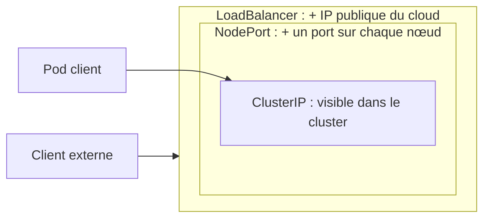

# Service et Ingress

<p class="lead">Les pods sont jetables et changent d'adresse à chaque remplacement. Un <strong>Service</strong> leur donne un nom et une IP stables dans le cluster ; un <strong>Ingress</strong> ouvre la porte HTTP depuis l'extérieur et aiguille les requêtes par nom d'hôte et par chemin.</p>

{ .hero }

## L'essentiel en 30 secondes

<div class="grid cards" markdown>

-   :material-ip-network-outline:{ .lg .middle } __Service · un nom stable__

    ---

    Une IP virtuelle et un nom DNS fixes devant les pods choisis par leurs **labels**. Par défaut (ClusterIP), joignable seulement dans le cluster.

-   :material-format-list-checks:{ .lg .middle } __EndpointSlice · les pods prêts__

    ---

    La liste, tenue à jour toute seule, des IP des pods **prêts** derrière un Service. Un pod qui démarre n'y figure pas.

-   :material-door-open:{ .lg .middle } __NodePort, LoadBalancer · sortir__

    ---

    Un port ouvert sur chaque nœud, ou une IP publique fournie par le cloud.

-   :material-sign-direction:{ .lg .middle } __Ingress · aiguiller le HTTP__

    ---

    Des règles « tel hôte, tel chemin, vers tel Service », appliquées par un **contrôleur**. Sans contrôleur, rien ne se passe.

</div>

!!! warning "À retenir"

    Un Service choisit ses pods par leurs **labels**, et seulement s'ils sont **prêts**. Une faute de frappe dans le sélecteur ne provoque aucune erreur : le Service existe, son EndpointSlice est vide, et les connexions échouent.

## :material-ip-network-outline: Un nom stable devant des pods jetables

Le Service porte un **sélecteur** ; le contrôleur d'EndpointSlice y inscrit les IP des pods qui ont ces labels et sont prêts ; sur chaque nœud, **kube-proxy** traduit ces listes en règles réseau (iptables ou nftables). L'IP du Service est donc **virtuelle** : aucune interface ne la porte.

```yaml
apiVersion: v1
kind: Service
metadata: { name: db }
spec:                         # pas de type : ClusterIP
  selector: { app: db }       # doit correspondre aux labels du pod
  ports: [{ port: 5432, targetPort: 5432 }]
```

???+ example "En vrai : le Service db et son EndpointSlice"

    

    Deux adresses à ne pas confondre : celle du Service (`10.108.31.244`, fixe) et celle du pod (`10.244.0.17`, jetable). L'EndpointSlice fait le lien.

???+ example "En vrai : le pod change, le Service reste"

    

    Le nouveau pod reçoit `10.244.0.20`. Le Service garde `10.108.31.244` : les pods web, qui visent `db:5432`, ne voient rien.

???+ example "En vrai : on parle au Service par son nom"

    

    L'application ne connaît que `DB_HOST=db`. Le message d'erreur (un défaut de la base, expliqué dans [De Compose à Kubernetes](De-Compose-a-Kubernetes.md)) montre où la connexion est partie : vers l'IP du Service. Réponse JSON repliée à la largeur du terminal.

| Nom utilisé | Depuis | Résout vers |
|---|---|---|
| `db` | un pod du **même** namespace | le Service `db` de ce namespace |
| `db.appli` | n'importe quel namespace | le Service `db` du namespace `appli` |
| `db.appli.svc.cluster.local` | partout (nom complet) | idem |

Chaque pod reçoit dans son `/etc/resolv.conf` l'adresse du Service `kube-dns` et des suffixes de recherche : c'est ce qui permet d'écrire simplement `db`. C'est l'équivalent du DNS interne d'un réseau Compose (voir [Réseaux Docker et publication de ports](Reseaux-et-ports.md)).

## :material-door-open: Sortir du cluster : les types de Service

| Type | Joignable depuis | Comment |
|---|---|---|
| **ClusterIP** (défaut) | l'intérieur du cluster | une IP virtuelle |
| **NodePort** | l'extérieur, par `IP_du_nœud:port` | ClusterIP **+** un port de 30000 à 32767 sur **chaque** nœud |
| **LoadBalancer** | l'extérieur, par une IP dédiée | NodePort **+** un répartiteur créé par le fournisseur cloud |



???+ example "En vrai : un NodePort qui répartit sur deux pods"

    

    `minikube service --url` bloque avec le driver Docker sous Linux : comme l'IP du nœud est joignable, on vise directement `192.168.49.2:30198`. L'application renvoie le nom du pod qui répond : les deux alternent. Seules les réponses réussies sont gardées ici (les premières échouaient pendant le redémarrage de la base) et la version de PostgreSQL est abrégée.

??? note "Les quatre « ports » à ne pas confondre"

    | Champ | Où | Signification |
    |---|---|---|
    | `containerPort` | dans le pod | le port d'écoute de l'application (surtout **documentaire**) |
    | `targetPort` | dans le Service | le port des pods vers lequel le Service envoie le trafic |
    | `port` | dans le Service | le port du Service lui-même, celui des clients (`db:5432`) |
    | `nodePort` | Service NodePort | le port ouvert sur chaque nœud (choisi automatiquement si on ne le fixe pas) |

??? note "LoadBalancer sur Minikube, headless et ExternalName"

    `kubectl expose deployment web --name web-lb --type LoadBalancer --port 80 --target-port 5000` : dans le cloud, le fournisseur crée un répartiteur et l'adresse apparaît dans `EXTERNAL-IP`. Sur Minikube, elle reste `<pending>` jusqu'à ce que `minikube tunnel`, laissé ouvert, joue ce rôle. Un LoadBalancer **par application** coûte cher : le schéma courant est **un seul** LoadBalancer devant le contrôleur d'Ingress.

    Deux variantes existent : le Service **headless** (`clusterIP: None`), dont le nom renvoie directement les IP des pods, et **ExternalName**, simple alias DNS vers un nom extérieur.

## :material-sign-direction: Ingress : un seul point d'entrée HTTP

Un Ingress est un objet **déclaratif** : hôte, chemin, Service cible, certificat TLS éventuel. Le **contrôleur d'Ingress** (Traefik, NGINX, HAProxy…), lui-même une application du cluster exposée par un NodePort ou un LoadBalancer, lit ces règles et reçoit le trafic.

```yaml
apiVersion: networking.k8s.io/v1
kind: Ingress
metadata: { name: web-ing }
spec:
  ingressClassName: traefik          # quel contrôleur applique la règle (nginx sur Minikube)
  rules:
    - host: web.local
      http:
        paths:
          - path: /
            pathType: Prefix         # Prefix, Exact ou ImplementationSpecific
            backend: { service: { name: web-svc, port: { number: 80 } } }
```

???+ example "En vrai : le principe d'un contrôleur d'Ingress, reproduit sous Docker"

    

    Démonstration du **mécanisme** hors Kubernetes : un seul point d'entrée, des règles par nom d'hôte, un 404 quand aucune ne correspond. Un vrai contrôleur fait la même chose, mais lit ses règles dans les objets Ingress au lieu d'un fichier.

??? note "Sur Minikube"

    ```bash
    minikube addons enable ingress
    kubectl get pods -n ingress-nginx                 # le contrôleur doit être Running
    kubectl get ingressclass                          # nginx
    kubectl apply -f web-ing.yaml                     # avec ingressClassName: nginx
    curl -H "Host: web.local" http://$(minikube ip)/
    ```

    Pour un navigateur, ajouter `IP_du_nœud web.local` dans le fichier `hosts` du poste. Le TLS se déclare dans `spec.tls` avec un Secret ; en production, **cert-manager** obtient et renouvelle les certificats.

!!! info "Une API figée"

    L'API Ingress n'évolue plus : son successeur est l'**API Gateway** (`Gateway`, `HTTPRoute`). Le projet ingress-nginx, celui de l'addon Minikube, a été mis à la retraite (annonce en novembre 2025, plus aucun correctif, même de sécurité, depuis mars 2026) : bien pour apprendre, à éviter pour un nouveau projet. L'annotation `kubernetes.io/ingress.class` est dépréciée au profit de `spec.ingressClassName`, et un Ingress ne vise que des Services de **son** namespace.

## :material-stethoscope: Tester et diagnostiquer

`kubectl port-forward` ouvre un **tunnel** entre un port du poste et un pod, via l'API Server. Parfait pour vérifier qu'une application répond, inutile pour servir des utilisateurs : il s'arrête avec le terminal et ne répartit pas la charge.

???+ example "En vrai : un pod testé sans rien exposer"

    

    Le tunnel n'écoute que sur `127.0.0.1`. `port-forward svc/web` marche aussi, mais choisit **un seul** pod : pas de répartition.

???+ danger "Le Service existe, mais rien ne répond"

    | Ce qu'on voit | Cause | Correction |
    |---|---|---|
    | EndpointSlice vide, pods `1/1` | le sélecteur ne correspond pas aux labels | aligner `selector` et `template.metadata.labels` |
    | EndpointSlice vide, pods `0/1` | la sonde de disponibilité échoue (voir [Démarré n'est pas disponible](Demarre-n-est-pas-disponible.md)) | lire `kubectl describe pod` |
    | EndpointSlice rempli, connexion refusée | `targetPort` ne correspond pas au port d'écoute | aligner `targetPort` |
    | `db` ne résout pas, `db.appli` oui | le client est dans un **autre namespace** | utiliser le nom qualifié |

    ```bash
    kubectl get endpointslices -n appli -l kubernetes.io/service-name=web   # ENDPOINTS vide ?
    kubectl get svc web -n appli -o jsonpath='{.spec.selector}'; echo      # le sélecteur
    kubectl get pods -n appli --show-labels                                 # les labels réels
    ```

## :material-flask-outline: À toi de jouer

```bash
kubectl create namespace labsvc
kubectl create deployment web -n labsvc --image=nginx:1.27 --replicas=3   # pose le label app=web
kubectl expose deployment web -n labsvc --port=80                         # Service ClusterIP "web"
kubectl get svc,endpointslices -n labsvc                                  # 1 ClusterIP, 3 IP de pods
kubectl run client -n labsvc -it --rm --restart=Never --image=busybox:1.36 -- wget -qO- http://web
kubectl scale deployment web -n labsvc --replicas=1
kubectl get endpointslices -n labsvc                                      # plus qu'une IP
kubectl port-forward -n labsvc svc/web 8080:80 &                          # puis : curl http://localhost:8080
kubectl delete namespace labsvc
```

??? abstract "Pour les créateurs : script de motion design (70 s)"

    Fond sombre, formes plates. Blanc pour la requête, violet pour l'Ingress, bleu pour le Service, vert pour les pods, gris pour l'annuaire DNS.

    | Séq. | Durée | À l'écran | Animation | Texte à l'écran |
    |---|---|---|---|---|
    | 1 | 0-7 s | Trois pods verts étiquetés avec leurs IP (`10.244.0.17`, `.18`, `.19`) | Un pod disparaît, un autre apparaît avec une IP différente `.21` | « Les pods sont jetables. Leurs adresses changent. » |
    | 2 | 7-15 s | Un rectangle bleu « Service web » se pose devant les pods, avec une IP fixe | Des fils partent du Service vers chaque pod portant le label `app: web` ; un pod sans ce label reste sans fil | « Le Service choisit ses pods par leurs labels et garde une adresse fixe. » |
    | 3 | 15-23 s | Une petite fiche « EndpointSlice » accrochée au Service, listant les IP | Un pod passe en orange « pas prêt » : sa ligne est barrée dans la fiche et son fil se coupe | « Seuls les pods prêts reçoivent du trafic. » |
    | 4 | 23-31 s | Un pod client à gauche demande « db ? » à une bulle grise CoreDNS | La bulle répond par l'IP du Service ; la requête part vers le Service puis vers un pod | « À l'intérieur, on parle aux Services par leur nom. » |
    | 5 | 31-40 s | Le cadre du cluster apparaît ; à l'extérieur, un navigateur `web.local` | La requête blanche bute sur le bord du cadre (ClusterIP, refusée) | « Un ClusterIP n'est pas joignable de l'extérieur. » |
    | 6 | 40-50 s | Une porte violette « Contrôleur d'Ingress » s'ouvre dans le bord du cadre, avec un panneau de règles | La requête entre, le panneau s'allume sur la ligne `web.local /` et une flèche la dirige vers le Service web | « L'Ingress lit l'hôte et le chemin, puis choisit le Service. » |
    | 7 | 50-60 s | Trois requêtes successives | Le Service les répartit tour à tour sur les trois pods, qui clignotent chacun leur tour | « Le Service répartit la charge entre les pods. » |
    | 8 | 60-70 s | Récapitulatif horizontal : navigateur, Ingress, Service, EndpointSlice, pods | Chaque étiquette s'allume de gauche à droite | « Entrer, choisir, trouver, répondre. » |

    La séquence 3 est la plus importante : montrer qu'un pod non prêt **reste vivant** mais perd son fil vers le Service, pour distinguer « retiré du trafic » et « redémarré ». Dans la séquence 6, deux lignes de règles suffisent : `web.local /` et `api.local /`.

??? info "Pour les créateurs : analogies et idées de schémas"

    | Objet | Analogie |
    |---|---|
    | **Service** | le standard téléphonique : le numéro ne change pas quand les employés changent |
    | **EndpointSlice** | l'annuaire interne du standard |
    | **CoreDNS** | l'annuaire public |
    | **Ingress** | le panneau d'accueil à l'entrée du bâtiment |
    | **Contrôleur d'Ingress** | l'hôte d'accueil qui lit le panneau et oriente les visiteurs |

    - **Le Service suit les pods** : diagramme de séquence où le pod db `10.244.0.17` est supprimé, le ReplicaSet crée `10.244.0.21`, l'EndpointSlice est mis à jour, et le pod web se reconnecte à la même adresse `db:5432`.
    - **Anatomie d'un nom DNS** : `db.appli.svc.cluster.local` découpé en quatre étiquettes colorées (Service, namespace, type d'objet, domaine du cluster), avec en dessous « même namespace : `db` », « autre namespace : `db.appli` », « nom complet : toujours valide ».
