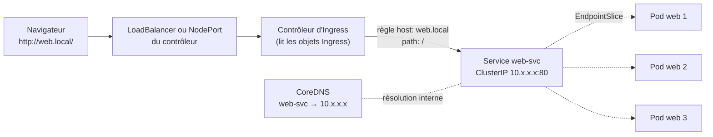
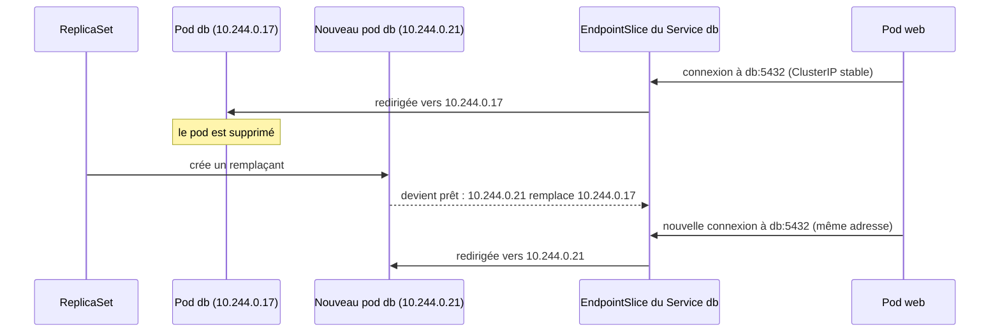

# Service et Ingress

> **En une phrase.** Les pods naissent et meurent avec des adresses IP qui changent : un **Service** leur donne un nom et une adresse stables à l'intérieur du cluster, et un **Ingress** ouvre la porte HTTP depuis l'extérieur en aiguillant les requêtes par nom d'hôte et par chemin.

---

## 1. Synthèse

### Le problème à résoudre

Un pod est **jetable** (voir [Pod, Deployment, ReplicaSet](Pod-Deployment-ReplicaSet.md)) : quand il est remplacé, le nouveau pod reçoit une **autre IP**. Une application qui viserait directement `10.244.0.17` perdrait sa base au premier redémarrage. Il faut donc un intermédiaire stable : c'est le rôle du Service, l'équivalent du nom de service sur le réseau d'un projet Compose (voir [Réseaux Docker et publication de ports](Reseaux-et-ports.md)).

### Le modèle mental : le trajet d'une requête

```
  navigateur ──► Contrôleur d'Ingress ──► Service ──► EndpointSlice ──► pod A
  (web.local)    (lit les règles          (IP et nom    (liste des IP     pod B
                  des objets Ingress)      stables)      des pods prêts)  pod C
     HTTP            couche 7 :              couche 4 : répartition
                 hôte, chemin, TLS          TCP/UDP entre les pods
```

| Objet | Rôle | Analogie |
|---|---|---|
| **Service** | une IP virtuelle et un nom DNS **stables** devant un groupe de pods choisis par leurs **labels** | le standard téléphonique d'une entreprise : le numéro ne change pas quand les employés changent |
| **EndpointSlice** | la liste, tenue à jour automatiquement, des IP des pods **prêts** derrière un Service | l'annuaire interne du standard |
| **CoreDNS** | traduit le nom du Service en son IP virtuelle | l'annuaire public |
| **Ingress** | des **règles HTTP(S)** : tel hôte, tel chemin, vers tel Service | le panneau d'accueil à l'entrée du bâtiment |
| **Contrôleur d'Ingress** | le programme (Traefik, NGINX, HAProxy…) qui **applique** ces règles et reçoit réellement le trafic | l'hôte d'accueil qui lit le panneau et oriente les visiteurs |

### Les types de Service

| Type | Joignable depuis | Comment | Usage typique |
|---|---|---|---|
| **ClusterIP** (par défaut) | l'intérieur du cluster seulement | une IP virtuelle prise dans la plage des Services | une base de données, une API interne |
| **NodePort** | l'extérieur, par `IP_du_nœud:port` | ClusterIP **+** un port ouvert sur **chaque** nœud, entre 30000 et 32767 | tests, cluster local, derrière un répartiteur externe |
| **LoadBalancer** | l'extérieur, par une IP publique dédiée | NodePort **+** un répartiteur de charge créé par le fournisseur cloud | exposer un service en production dans le cloud |

Les trois types s'**emboîtent** : un LoadBalancer contient un NodePort, qui contient un ClusterIP. Deux variantes existent aussi : le Service **headless** (`clusterIP: None`), dont le nom DNS renvoie directement les IP des pods, et le type **ExternalName**, qui n'est qu'un alias DNS vers un nom extérieur.

### Les quatre « ports » à ne pas confondre

| Champ | Où | Signification |
|---|---|---|
| `containerPort` | dans le pod | le port sur lequel l'application écoute (surtout **documentaire**) |
| `targetPort` | dans le Service | le port des pods vers lequel le Service envoie le trafic |
| `port` | dans le Service | le port du Service lui-même, celui qu'utilisent les clients (`db:5432`) |
| `nodePort` | dans un Service NodePort | le port ouvert sur chaque nœud (choisi automatiquement si on ne le fixe pas) |

### Comment le Service trouve ses pods

1. Le Service porte un **sélecteur** (`selector: { app: web }`).
2. Le contrôleur d'EndpointSlice cherche les pods qui ont ces labels **et** qui sont **prêts** (sonde de disponibilité réussie, voir [Démarré n'est pas disponible](Demarre-n-est-pas-disponible.md)).
3. Il écrit leurs IP dans un ou plusieurs objets **EndpointSlice**, mis à jour à chaque création, suppression ou changement d'état de pod.
4. Sur chaque nœud, **kube-proxy** traduit ces listes en règles réseau (iptables ou nftables) : un paquet envoyé à l'IP du Service est redirigé vers l'un des pods.

L'IP d'un Service est donc **virtuelle** : aucune interface ne la porte, elle n'existe que dans ces règles.

### Le DNS des Services

| Nom utilisé | Depuis | Résout vers |
|---|---|---|
| `db` | un pod du **même** namespace | le Service `db` de ce namespace |
| `db.appli` | n'importe quel namespace | le Service `db` du namespace `appli` |
| `db.appli.svc.cluster.local` | partout (nom complet) | idem |

CoreDNS tourne en pods dans `kube-system`, derrière un Service nommé `kube-dns`. Chaque pod reçoit dans son `/etc/resolv.conf` l'adresse de ce Service et une liste de suffixes de recherche, ce qui permet d'écrire simplement `db`.

### L'Ingress en 4 lignes

- C'est un objet **déclaratif** de règles HTTP(S) : hôte (`web.local`), chemin (`/`, `/api`), Service et port cibles, certificat TLS éventuel.
- **Sans contrôleur d'Ingress installé, un objet Ingress ne fait rien.** Le contrôleur est lui-même une application du cluster (un Deployment exposé par un Service NodePort ou LoadBalancer).
- `spec.ingressClassName` dit quel contrôleur doit appliquer la règle (`traefik`, `nginx`…).
- Un seul point d'entrée sert plusieurs applications : `app.exemple.fr` vers un Service, `api.exemple.fr` vers un autre.

### `kubectl port-forward` : pour tester, pas pour exposer

`kubectl port-forward` ouvre un **tunnel** entre un port du poste et un pod (ou un Service), en passant par l'API Server. Pratique pour vérifier qu'une application répond, il s'arrête avec le terminal, ne répartit pas la charge et n'est pas fait pour servir des utilisateurs.

> [!IMPORTANT]
> **Les pièges à retenir**
> 1. **Le sélecteur doit correspondre exactement aux labels des pods.** Une faute de frappe ne provoque aucune erreur : le Service existe, mais son EndpointSlice est vide et les connexions échouent.
> 2. **Un pod non prêt sort du Service.** C'est voulu : la sonde de disponibilité est ce qui empêche d'envoyer du trafic à une base qui démarre encore.
> 3. **Un ClusterIP n'est pas joignable depuis l'extérieur du cluster**, ni depuis le poste de travail. Pour un test, utiliser `port-forward` ; pour un vrai accès, un NodePort, un LoadBalancer ou un Ingress.
> 4. **Un Ingress sans contrôleur reste lettre morte**, et il ne vise que des Services de **son propre namespace**.
> 5. **L'annotation `kubernetes.io/ingress.class` est dépréciée** : on la trouve encore dans d'anciens exemples, il faut utiliser `spec.ingressClassName`.

---

## 2. Cas d'usage classiques

### Cas 1 : joindre une base de données par un nom stable (ClusterIP)

**Besoin.** Des pods web doivent joindre PostgreSQL, dont le pod peut être remplacé à tout moment.

```yaml
apiVersion: v1
kind: Service
metadata:
  name: db
spec:                 # pas de type : ClusterIP par défaut
  selector:
    app: db           # doit correspondre aux labels du pod PostgreSQL
  ports:
    - port: 5432
      targetPort: 5432
```

```bash
kubectl apply -n appli -f db-svc.yaml
kubectl get svc -n appli
kubectl get endpointslices -n appli -l kubernetes.io/service-name=db
```

**Ce qu'on observe** (poste de test) :

```
NAME   TYPE        CLUSTER-IP      EXTERNAL-IP   PORT(S)    AGE
db     ClusterIP   10.108.31.244   <none>        5432/TCP   0s

NAME       ADDRESSTYPE   PORTS   ENDPOINTS     AGE
db-ccp5l   IPv4          5432    10.244.0.17   1s
```

Le Service a une IP virtuelle `10.108.31.244` qui ne changera plus. L'EndpointSlice pointe sur l'IP réelle du pod, `10.244.0.17`. Quand le pod est recréé, seule cette seconde adresse change, automatiquement. Les pods web se connectent simplement à `db:5432`.
**À retenir.** Le nom du Service remplace le nom de service de Compose ; CoreDNS joue le rôle du DNS interne de Docker.

### Cas 2 : exposer une application sur un cluster local (NodePort)

**Besoin.** Accéder depuis le poste à une application web à deux réplicas, sur un cluster Minikube.

```yaml
apiVersion: v1
kind: Service
metadata:
  name: web
spec:
  type: NodePort
  selector:
    app: web
  ports:
    - port: 5000        # port du Service dans le cluster
      targetPort: 5000  # port de l'application dans les pods
```

```bash
kubectl get svc web -n appli
minikube ip                                  # IP du nœud
curl http://$(minikube ip):30198/            # le NodePort attribué
```

**Ce qu'on observe.** `PORT(S)` affiche `5000:30198/TCP` : le port 30198 est ouvert sur le nœud et mène au port 5000 des pods. En répétant la requête, l'application (qui renvoie le nom du pod qui répond) alterne entre `web-659c875dc-xmpqj` et `web-659c875dc-scht7` : le Service **répartit la charge**.
**Le piège réel.** `minikube service web --url` ne rend pas la main avec le driver Docker sous Linux : Minikube ouvre un tunnel et affiche `Because you are using a Docker driver on linux, the terminal needs to be open to run it.` Comme l'IP du nœud (`192.168.49.2`) est joignable depuis la machine, viser directement `IP_du_nœud:NodePort` évite ce blocage.

### Cas 3 : tester un pod sans rien exposer (port-forward)

**Besoin.** Vérifier en dix secondes qu'un pod sert bien sa page, sans créer de Service.

```bash
kubectl port-forward pod/demo-web 8080:80 &
curl -s http://localhost:8080
kill %1                                      # fermer le tunnel
```

**Ce qu'on observe.**

```
Forwarding from 127.0.0.1:8080 -> 80
Forwarding from [::1]:8080 -> 80
<h1>Bienvenue sur votre premier conteneur Docker !</h1>
```

**À retenir.** Le tunnel n'écoute que sur `127.0.0.1` du poste et passe par l'API Server. `kubectl port-forward svc/web 8080:5000` fonctionne aussi, mais choisit **un seul** pod derrière le Service : pas de répartition. C'est un outil de diagnostic, pas une exposition.

### Cas 4 : diagnostiquer un Service qui ne répond pas

**Symptôme.** Le Service existe, a une ClusterIP, mais les connexions échouent ou expirent.

```bash
kubectl get endpointslices -n appli -l kubernetes.io/service-name=web   # ENDPOINTS vide ?
kubectl get svc web -n appli -o jsonpath='{.spec.selector}'; echo      # le sélecteur
kubectl get pods -n appli --show-labels                                 # les labels réels
kubectl get pods -n appli                                               # READY 0/1 ?
```

**Les trois causes classiques.**

| Ce qu'on voit | Cause | Correction |
|---|---|---|
| EndpointSlice vide, pods `1/1` | le sélecteur ne correspond pas aux labels | aligner `selector` et `template.metadata.labels` |
| EndpointSlice vide, pods `0/1` | la sonde de disponibilité échoue | lire `kubectl describe pod`, corriger l'application ou la sonde |
| EndpointSlice rempli, connexion refusée | `targetPort` ne correspond pas au port d'écoute | aligner `targetPort` sur le port réel de l'application |

### Cas 5 : vérifier la résolution DNS depuis l'intérieur

```bash
kubectl run dns-test -n appli -it --rm --restart=Never --image=busybox:1.36 -- \
  sh -c 'cat /etc/resolv.conf; nslookup db; nslookup kubernetes.default'
```

**Ce qu'on observe.** `resolv.conf` contient `search appli.svc.cluster.local svc.cluster.local cluster.local` et l'adresse du Service `kube-dns` (souvent `10.96.0.10` sur Minikube). `nslookup db` renvoie la ClusterIP du Service `db`, et `kubernetes.default` celle de l'API Server.
**À retenir.** Si `db` ne résout pas mais `db.appli` oui, le client tourne dans un **autre namespace**.

### Cas 6 : publier plusieurs applications derrière un seul point d'entrée (Ingress)

**Besoin.** Servir `web.local` par HTTP sur le port 80, avec des règles d'hôte et de chemin, au lieu d'un NodePort par application.

Le manifeste de référence du cours associe un Service ClusterIP et un Ingress :

```yaml
apiVersion: v1
kind: Service
metadata:
  name: web-svc
spec:
  type: ClusterIP
  selector: { app: web }
  ports:
    - port: 80
      targetPort: 80
---
apiVersion: networking.k8s.io/v1
kind: Ingress
metadata:
  name: web-ing
spec:
  ingressClassName: traefik     # forme actuelle de l'ancienne annotation kubernetes.io/ingress.class
  rules:
    - host: web.local
      http:
        paths:
          - path: /
            pathType: Prefix    # Prefix, Exact ou ImplementationSpecific
            backend:
              service:
                name: web-svc
                port:
                  number: 80
```

Sur Minikube, le contrôleur fourni par l'addon `ingress` est NGINX, de classe `nginx` : il faut donc remplacer `traefik` par `nginx`.

```bash
minikube addons enable ingress
kubectl get pods -n ingress-nginx                      # le contrôleur doit être Running
kubectl get ingressclass                               # nginx
kubectl apply -f web-ing.yaml
kubectl get ingress web-ing                            # ADDRESS se remplit après quelques secondes
curl -H "Host: web.local" http://$(minikube ip)/
```

**Ce qu'on observe.** La requête arrive au contrôleur, qui lit l'en-tête `Host`, trouve la règle `web.local` et la transmet au Service `web-svc`. Sans l'en-tête, le contrôleur répond `404` : aucune règle ne correspond. Pour tester avec un navigateur, ajouter `IP_du_nœud web.local` dans le fichier `hosts` du poste.
**À retenir.** Le TLS se déclare dans `spec.tls` avec un Secret contenant le certificat ; en production, **cert-manager** obtient et renouvelle ces certificats.

> [!NOTE]
> L'API Ingress est **figée** : elle n'évolue plus. Son successeur est l'**API Gateway** (objets `Gateway` et `HTTPRoute`), plus riche et mieux découpée entre équipes. De plus, le projet communautaire ingress-nginx, celui de l'addon Minikube, a été mis à la retraite par Kubernetes (annonce en novembre 2025, plus aucun correctif, même de sécurité, depuis mars 2026) : il convient pour apprendre, mais un nouveau projet choisira un autre contrôleur ou l'API Gateway.

### Cas 7 : obtenir une IP externe (LoadBalancer)

```bash
kubectl expose deployment web -n appli --name web-lb --type LoadBalancer --port 80 --target-port 5000
kubectl get svc web-lb -n appli          # EXTERNAL-IP : <pending>
minikube tunnel                          # dans un autre terminal, à laisser ouvert
```

**Ce qu'on observe.** Dans le cloud, le fournisseur crée un répartiteur de charge et l'adresse apparaît dans `EXTERNAL-IP`. Sur Minikube, rien ne le fait : l'adresse reste `<pending>` jusqu'à ce que `minikube tunnel` joue ce rôle.
**À retenir.** Un LoadBalancer **par application** coûte cher dans le cloud. Le schéma courant est **un seul** LoadBalancer devant le contrôleur d'Ingress, qui répartit ensuite vers toutes les applications.

---

## 3. Idées de schémas

### Schéma A : le trajet complet d'une requête



### Schéma B : les trois types emboîtés

Trois rectangles concentriques. Au centre, **ClusterIP** (vert, « visible dans le cluster »). Autour, **NodePort** (orange, « + un port sur chaque nœud, 30000 à 32767 »). À l'extérieur, **LoadBalancer** (rouge, « + une IP publique fournie par le cloud »). Une flèche « client interne » touche le centre ; une flèche « client externe » traverse les trois couches.

### Schéma C : le Service suit les pods sans changer d'adresse



### Schéma D : anatomie d'un nom DNS de Service

Le nom `db.appli.svc.cluster.local` découpé en quatre étiquettes colorées : `db` (nom du Service), `appli` (namespace), `svc` (type d'objet), `cluster.local` (domaine du cluster). En dessous, trois flèches : « depuis le même namespace : `db` suffit », « depuis un autre namespace : `db.appli` », « nom complet : toujours valide ».

---

## 4. Script de motion design : « Le voyage d'une requête » (environ 70 s)

Style : fond sombre, formes plates. Une couleur par objet : blanc pour la requête, violet pour l'Ingress, bleu pour le Service, vert pour les pods, gris pour l'annuaire DNS.

| Séq. | Durée | À l'écran | Animation | Texte à l'écran |
|---|---|---|---|---|
| 1 | 0-7 s | Trois pods verts étiquetés avec leurs IP (`10.244.0.17`, `.18`, `.19`) | Un pod disparaît, un autre apparaît avec une IP différente `.21` | « Les pods sont jetables. Leurs adresses changent. » |
| 2 | 7-15 s | Un rectangle bleu « Service web » se pose devant les pods, avec une IP fixe | Des fils partent du Service vers chaque pod portant le label `app: web` ; un pod sans ce label reste sans fil | « Le Service choisit ses pods par leurs labels et garde une adresse fixe. » |
| 3 | 15-23 s | Une petite fiche « EndpointSlice » accrochée au Service, listant les IP | Un pod passe en orange « pas prêt » : sa ligne est barrée dans la fiche et son fil se coupe | « Seuls les pods prêts reçoivent du trafic. » |
| 4 | 23-31 s | Un pod client à gauche demande « db ? » à une bulle grise CoreDNS | La bulle répond par l'IP du Service ; la requête part vers le Service puis vers un pod | « À l'intérieur, on parle aux Services par leur nom. » |
| 5 | 31-40 s | Le cadre du cluster apparaît ; à l'extérieur, un navigateur `web.local` | La requête blanche bute sur le bord du cadre (ClusterIP, refusée) | « Un ClusterIP n'est pas joignable de l'extérieur. » |
| 6 | 40-50 s | Une porte violette « Contrôleur d'Ingress » s'ouvre dans le bord du cadre, avec un panneau de règles | La requête entre, le panneau s'allume sur la ligne `web.local /` et une flèche la dirige vers le Service web | « L'Ingress lit l'hôte et le chemin, puis choisit le Service. » |
| 7 | 50-60 s | Trois requêtes successives | Le Service les répartit tour à tour sur les trois pods, qui clignotent chacun leur tour | « Le Service répartit la charge entre les pods. » |
| 8 | 60-70 s | Récapitulatif horizontal : navigateur, Ingress, Service, EndpointSlice, pods | Chaque étiquette s'allume de gauche à droite | « Entrer, choisir, trouver, répondre. » |

**Conseil de réalisation.** La séquence 3 est la plus importante : montrer qu'un pod non prêt **reste vivant** mais perd son fil vers le Service, pour bien distinguer « retiré du trafic » et « redémarré ». Dans la séquence 6, garder le panneau de règles lisible (deux lignes suffisent : `web.local /` et `api.local /`).

---

## 5. Vérifier soi-même

```bash
kubectl create namespace labsvc
kubectl create deployment web -n labsvc --image=nginx:1.27 --replicas=3   # pose le label app=web
kubectl expose deployment web -n labsvc --port=80 --target-port=80        # Service ClusterIP "web"
kubectl get svc,endpointslices -n labsvc                                  # 1 ClusterIP, 3 IP de pods
kubectl run client -n labsvc -it --rm --restart=Never --image=busybox:1.36 -- wget -qO- http://web  # nom court
kubectl scale deployment web -n labsvc --replicas=1
kubectl get endpointslices -n labsvc                                      # plus qu'une IP
kubectl port-forward -n labsvc svc/web 8080:80 &                          # puis : curl http://localhost:8080
kubectl delete namespace labsvc
```

## Voir aussi

- [Accueil du wiki](../README.md)
- Page précédente : [Pod, Deployment, ReplicaSet](Pod-Deployment-ReplicaSet.md)
- Page suivante : [De Compose aux manifestes Kubernetes](De-Compose-a-Kubernetes.md)
- Pour le réseau côté Docker : [Réseaux Docker et publication de ports](Reseaux-et-ports.md)
- Pour la différence entre démarré et prêt : [Démarré n'est pas disponible](Demarre-n-est-pas-disponible.md)
