# Service et Ingress

<p class="lead">Les pods sont jetables et changent d'adresse à chaque remplacement. Un <strong>Service</strong> leur donne un nom et une IP stables dans le cluster ; un <strong>Ingress</strong> ouvre la porte HTTP depuis l'extérieur et aiguille les requêtes par nom d'hôte et par chemin.</p>

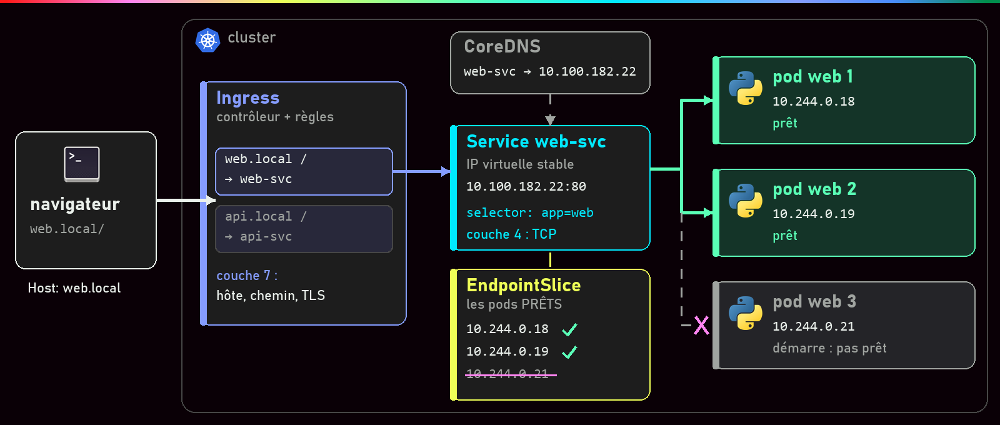{ .hero }

!!! abstract "Dans cette page"

    **Tu vas comprendre :**

    - pourquoi on ne parle jamais directement à un pod, mais à un Service qui garde la même adresse ;
    - comment rendre une application joignable depuis l'extérieur du cluster ;
    - comment un Ingress envoie `web.local` vers une application et `api.local` vers une autre, derrière une seule porte.

    **Prérequis :** [Pod, Deployment, ReplicaSet](Pod-Deployment-ReplicaSet.md) et [Réseaux Docker et publication de ports](Reseaux-et-ports.md). **Durée :** 40 min. **Niveau :** intermédiaire.

!!! quote "En clair"

    Pense au **standard téléphonique** d'une entreprise. Les employés (les pods) arrivent, partent, changent de bureau ; le numéro du standard (le Service), lui, ne change jamais, et il passe l'appel à un employé disponible. L'**Ingress**, c'est l'accueil à l'entrée du bâtiment : il lit le nom de la société demandée et indique le bon étage. Limite de l'image : le standard ne comprend pas ce qu'on lui dit, il transmet seulement ; seul l'accueil (l'Ingress) lit la demande, ici l'adresse web.

    { .anim }

## L'essentiel en 30 secondes

<div class="grid cards" markdown>

-   :material-ip-network-outline:{ .lg .middle } __Service · un nom stable__

    ---

    Une adresse et un nom fixes devant les pods choisis par leurs **étiquettes** (labels). Par défaut (ClusterIP), joignable seulement dans le cluster.

-   :material-format-list-checks:{ .lg .middle } __EndpointSlice · les pods prêts__

    ---

    La liste, tenue à jour toute seule, des adresses des pods **prêts** derrière un Service. Un pod qui démarre n'y figure pas encore.

-   :material-door-open:{ .lg .middle } __NodePort, LoadBalancer · sortir__

    ---

    Un port ouvert sur chaque machine du cluster, ou une adresse publique fournie par l'hébergeur cloud.

-   :material-sign-direction:{ .lg .middle } __Ingress · aiguiller le web__

    ---

    Des règles « tel site, tel chemin, vers tel Service », appliquées par un **contrôleur**. Sans contrôleur installé, rien ne se passe.

</div>

!!! warning "À retenir"

    Un Service choisit ses pods par leurs **labels**, et seulement s'ils sont **prêts**. Une faute de frappe dans le sélecteur ne provoque aucune erreur : le Service existe, sa liste de pods est vide, et les connexions échouent.

## :material-ip-network-outline: Un nom stable devant des pods jetables

!!! quote "En clair"

    Un pod remplacé, c'est un nouvel employé avec un nouveau bureau. Personne ne retient les numéros de bureau : on appelle le standard, qui tient à jour la liste de qui est présent.

    { .anim }

Trois pièces travaillent ensemble :

1. Le Service porte un **sélecteur**, par exemple `app: db` : « je m'occupe des pods qui portent l'étiquette `app: db` ».
2. Kubernetes inscrit dans un **EndpointSlice** (la liste des adresses derrière un Service) les IP des pods qui ont cette étiquette **et** sont prêts.
3. Sur chaque nœud (chaque machine du cluster), un programme nommé **kube-proxy** traduit ces listes en règles réseau du noyau Linux (iptables ou nftables).

L'adresse du Service est donc **virtuelle** : aucune carte réseau ne la porte, ce sont les règles qui redirigent le trafic vers un vrai pod. Voici le Service de la base de données de l'application du cours :

```yaml
apiVersion: v1          # (1)!
kind: Service           # (2)!
metadata:
  name: db              # (3)!
spec:                   # (4)!
  selector:
    app: db             # (5)!
  ports:
    - port: 5432        # (6)!
      targetPort: 5432  # (7)!
```

1. La version de l'API Kubernetes qui décrit cet objet. Les Services font partie du groupe de base, `v1`.
2. Le type d'objet que l'on crée.
3. Le nom du Service. C'est aussi son **nom DNS** : les autres pods écriront simplement `db` pour le joindre.
4. `spec` décrit ce qu'on veut. Aucun `type` n'est indiqué : c'est donc le type par défaut, `ClusterIP`, visible seulement depuis l'intérieur du cluster.
5. Le sélecteur : le trafic part vers les pods qui portent l'étiquette `app: db`. Elle doit être **identique** à celle posée par le Deployment de la base.
6. `port` : le port du Service, celui que les clients appellent (`db:5432`).
7. `targetPort` : le port sur lequel l'application écoute **dans** le pod. Ici les deux sont égaux, mais ils peuvent être différents.

???+ example "En vrai : le Service db et son EndpointSlice"

    **Ce qu'on fait :** on regarde l'adresse du pod de la base, on crée le Service `db`, puis on affiche le Service et sa liste de pods.

    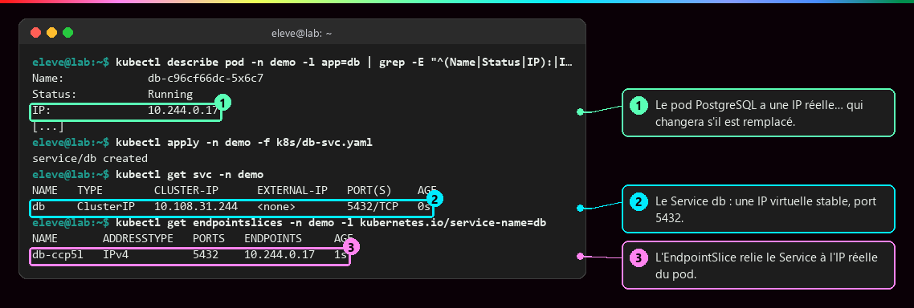

    **Ce qu'il faut regarder :**

    - ① le pod PostgreSQL a une adresse réelle, `10.244.0.17`. Elle est **jetable** : un nouveau pod en recevra une autre.
    - ② le Service `db` a sa propre adresse, `10.108.31.244`, et le port 5432. Celle-ci est **fixe**.
    - ③ l'EndpointSlice fait le lien entre les deux : derrière le Service, il y a le pod `10.244.0.17`.

???+ example "En vrai : le pod change, le Service reste"

    **Ce qu'on fait :** on force le remplacement du pod de la base (`rollout restart`), puis on compare les adresses.

    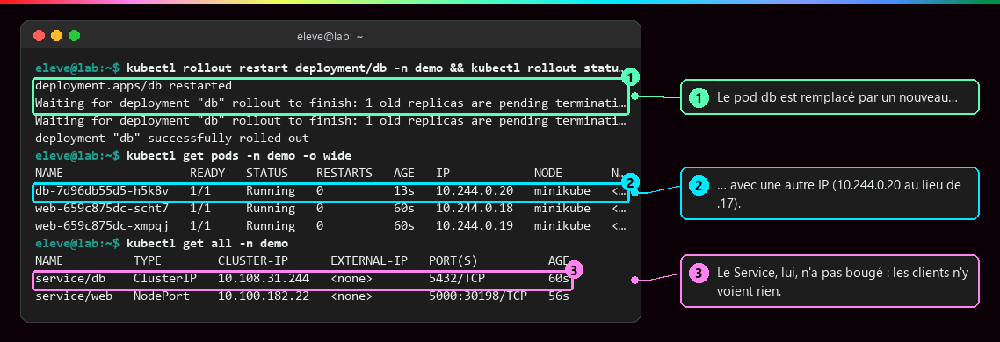

    **Ce qu'il faut regarder :**

    - ① Kubernetes remplace l'ancien pod par un nouveau.
    - ② le nouveau pod reçoit une autre adresse : `10.244.0.20` au lieu de `.17`.
    - ③ le Service garde `10.108.31.244`. Les pods web, qui visent `db:5432`, ne voient aucune différence.

???+ example "En vrai : on parle au Service par son nom"

    **Ce qu'on fait :** on donne à l'application le seul nom `db`, puis on regarde qui traduit ce nom en adresse. Le message d'erreur vient d'un défaut de la base, expliqué dans [De Compose à Kubernetes](De-Compose-a-Kubernetes.md) ; ici, il sert seulement à montrer **où** la connexion est partie. La réponse JSON est repliée à la largeur du terminal.

    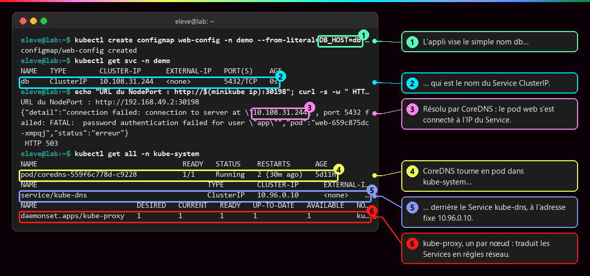

    **Ce qu'il faut regarder :**

    - ① l'application ne connaît que `DB_HOST=db`, un simple nom.
    - ② `db` est le nom du Service ClusterIP.
    - ③ le pod web s'est bien connecté à `10.108.31.244`, l'adresse du Service : le nom a été traduit.
    - ④ et ⑤ c'est **CoreDNS**, l'annuaire du cluster, qui fait cette traduction. Il tourne lui-même en pod, derrière le Service `kube-dns` à l'adresse fixe `10.96.0.10`.
    - ⑥ `kube-proxy` tourne en un exemplaire par nœud : c'est lui qui transforme les Services en règles réseau.

Quel nom écrire ? Cela dépend d'où part l'appel. Un **namespace Kubernetes** est un espace de travail qui regroupe des objets (rien à voir avec les namespaces Linux de l'isolation) :

| Nom utilisé | Depuis | Résout vers |
|---|---|---|
| `db` | un pod du **même** namespace | le Service `db` de ce namespace |
| `db.appli` | n'importe quel namespace | le Service `db` du namespace `appli` |
| `db.appli.svc.cluster.local` | partout (nom complet) | idem |

Chaque pod reçoit dans son fichier `/etc/resolv.conf` l'adresse du Service `kube-dns` et des suffixes de recherche : c'est ce qui permet d'écrire simplement `db`. C'est l'équivalent du DNS interne d'un réseau Compose (voir [Réseaux Docker et publication de ports](Reseaux-et-ports.md)).

## :material-door-open: Sortir du cluster : les types de Service

!!! quote "En clair"

    ClusterIP, c'est une **ligne interne** : seuls les collègues peuvent appeler. NodePort ajoute un **numéro direct** sur chaque machine du cluster. LoadBalancer **loue un numéro public** à l'hébergeur cloud, qui renvoie les appels vers ces machines.

    { .anim }

| Type | Joignable depuis | Comment |
|---|---|---|
| **ClusterIP** (défaut) | l'intérieur du cluster | une IP virtuelle |
| **NodePort** | l'extérieur, par `IP_du_nœud:port` | ClusterIP **+** un port de 30000 à 32767 sur **chaque** nœud |
| **LoadBalancer** | l'extérieur, par une IP dédiée | NodePort **+** un répartiteur de charge créé par le fournisseur cloud |

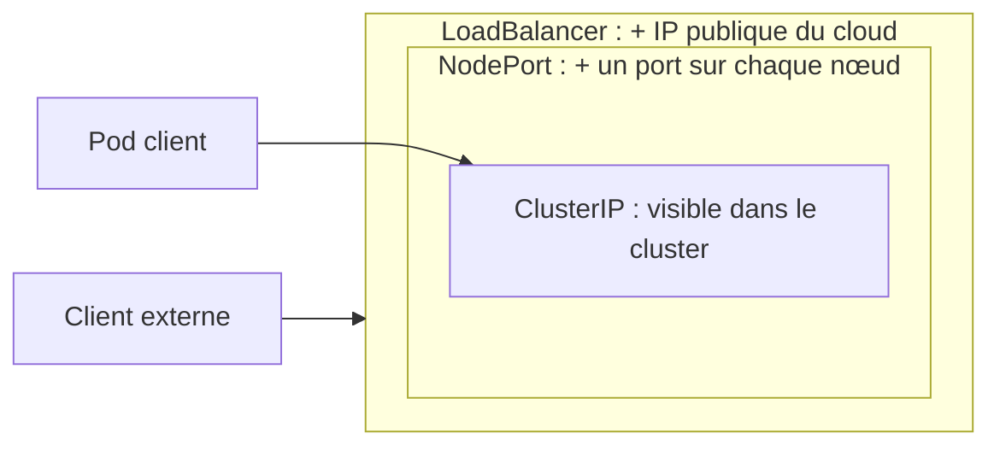

Chaque type **contient** le précédent. Voici le Service de l'application web, ouvert vers l'extérieur :

```yaml
apiVersion: v1
kind: Service
metadata:
  name: web
spec:
  type: NodePort        # (1)!
  selector:
    app: web            # (2)!
  ports:
    - port: 5000        # (3)!
      targetPort: 5000  # (4)!
```

1. `NodePort` : en plus de l'adresse interne, Kubernetes ouvre un port entre 30000 et 32767 sur chaque nœud. On peut le fixer avec une clé `nodePort` ; sinon il est tiré au hasard (ici, 30198).
2. Les pods visés : ceux qui portent l'étiquette `app: web`.
3. Le port du Service à l'intérieur du cluster.
4. Le port d'écoute de l'application Flask dans le pod.

???+ example "En vrai : un NodePort qui répartit sur deux pods"

    **Ce qu'on fait :** deux pods web tournent derrière le Service `web` de type NodePort. On l'appelle six fois depuis le poste, en visant directement l'adresse du nœud. Seules les réponses réussies sont gardées ici (les premières échouaient pendant le redémarrage de la base) et la version de PostgreSQL est abrégée.

    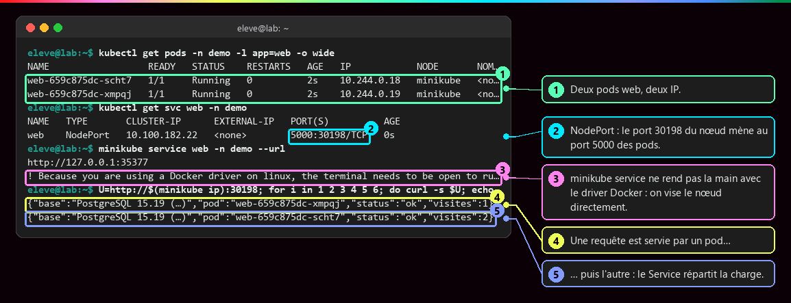

    **Ce qu'il faut regarder :**

    - ① deux pods web, deux adresses différentes.
    - ② `5000:30198` : le port 30198 du nœud mène au port 5000 des pods.
    - ③ `minikube service --url` ne rend pas la main avec le driver Docker sous Linux. Comme l'adresse du nœud est joignable depuis le poste, on vise directement `192.168.49.2:30198`.
    - ④ et ⑤ l'application renvoie le nom du pod qui a répondu : une fois l'un, une fois l'autre. Le Service **répartit la charge**.

??? note "Les quatre « ports » à ne pas confondre"

    | Champ | Où | Signification |
    |---|---|---|
    | `containerPort` | dans le pod | le port d'écoute de l'application (surtout **documentaire**) |
    | `targetPort` | dans le Service | le port des pods vers lequel le Service envoie le trafic |
    | `port` | dans le Service | le port du Service lui-même, celui des clients (`db:5432`) |
    | `nodePort` | Service NodePort | le port ouvert sur chaque nœud (choisi automatiquement si on ne le fixe pas) |

## :material-sign-direction: Ingress : un seul point d'entrée HTTP

!!! quote "En clair"

    L'objet **Ingress** est le **panneau** à l'accueil : « Société A, 3ᵉ étage ; Société B, 5ᵉ étage ». Le **contrôleur d'Ingress** est la personne à l'accueil qui lit le panneau et oriente les visiteurs. Un panneau sans personne pour le lire ne sert à rien.

    { .anim }

Un Ingress est un objet **déclaratif** : on y écrit le nom du site, le chemin, le Service cible et, si besoin, un certificat TLS. Le **contrôleur d'Ingress** (Traefik, NGINX, HAProxy…) est lui-même une application du cluster, exposée par un NodePort ou un LoadBalancer : c'est lui qui reçoit le trafic et applique ces règles.

```yaml
apiVersion: networking.k8s.io/v1   # (1)!
kind: Ingress
metadata:
  name: web-ing
spec:
  ingressClassName: traefik        # (2)!
  rules:
    - host: web.local              # (3)!
      http:
        paths:
          - path: /                # (4)!
            pathType: Prefix       # (5)!
            backend:
              service:
                name: web-svc      # (6)!
                port:
                  number: 80       # (7)!
```

1. Les Ingress appartiennent au groupe d'API `networking.k8s.io`, en version `v1`.
2. Quel contrôleur doit appliquer cette règle. Sur Minikube, avec l'addon ingress, ce sera `nginx`.
3. Le nom de site demandé par le navigateur (l'en-tête `Host` de la requête HTTP).
4. Le chemin de l'adresse : `/` couvre tout le site.
5. Comment comparer le chemin : `Prefix` (tout ce qui commence par `/`), `Exact` (ce chemin seulement) ou `ImplementationSpecific` (au choix du contrôleur).
6. Le Service qui recevra la requête. Il doit être dans le **même namespace** que l'Ingress.
7. Le port de ce Service (son `port`, pas le `targetPort` des pods).

???+ example "En vrai : le principe d'un contrôleur d'Ingress, reproduit sous Docker"

    **Ce qu'on fait :** sans Kubernetes, un nginx joue le rôle du contrôleur, devant deux applications. Ses règles disent : `web.local` vers l'appli web, `api.local` vers l'appli api, tout le reste en 404. On l'interroge trois fois à la même adresse. Un vrai contrôleur fait la même chose, mais lit ses règles dans les objets Ingress au lieu d'un fichier.

    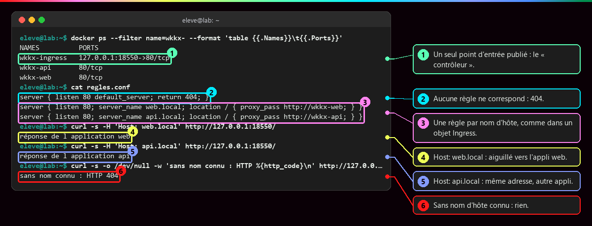

    **Ce qu'il faut regarder :**

    - ① un seul conteneur est publié sur le poste : le « contrôleur ». Les deux applications n'ont aucun port publié.
    - ② la règle par défaut : si aucun nom ne correspond, réponse 404.
    - ③ une règle par nom de site, comme dans un objet Ingress.
    - ④ et ⑤ même adresse, même port, mais un nom différent dans l'en-tête `Host` : ce n'est pas la même application qui répond.
    - ⑥ sans nom de site connu : 404.

## :material-stethoscope: Tester et diagnostiquer

`kubectl port-forward` ouvre un **tunnel** entre un port de ton poste et un pod, en passant par l'API de Kubernetes. Parfait pour vérifier qu'une application répond ; inutile pour servir de vrais utilisateurs, car il s'arrête avec le terminal et ne répartit pas la charge.

```bash
kubectl port-forward pod/demo-web 8080:80   # (1)!
```

1. `pod/demo-web` : le pod visé (on peut aussi écrire `svc/web` pour un Service). `8080:80` : le port 8080 de ton poste mène au port 80 du pod, dans le même ordre que `-p` chez Docker. La commande reste active tant que tu ne l'arrêtes pas (++ctrl+c++).

???+ example "En vrai : un pod testé sans rien exposer"

    **Ce qu'on fait :** on lance un pod seul, sans Service, on ouvre un tunnel vers lui et on l'appelle depuis le poste.

    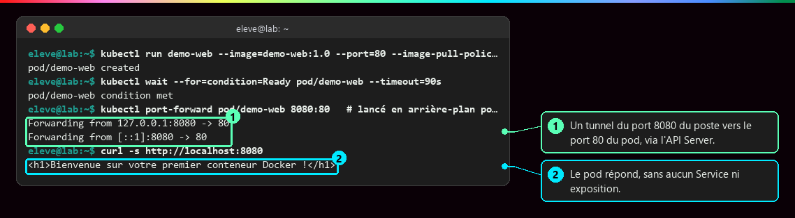

    **Ce qu'il faut regarder :**

    - ① le tunnel est ouvert, du port 8080 du poste vers le port 80 du pod. Il n'écoute que sur `127.0.0.1` : personne d'autre sur le réseau ne peut s'en servir.
    - ② le pod répond, alors qu'aucun Service ne l'expose. `port-forward svc/web` marche aussi, mais choisit **un seul** pod : pas de répartition.

???+ danger "Le Service existe, mais rien ne répond"

    | Ce qu'on voit | Cause | Correction |
    |---|---|---|
    | EndpointSlice vide, pods `1/1` | le sélecteur ne correspond pas aux labels | aligner `selector` et `template.metadata.labels` |
    | EndpointSlice vide, pods `0/1` | la sonde de disponibilité échoue (voir [Démarré n'est pas disponible](Demarre-n-est-pas-disponible.md)) | lire `kubectl describe pod` |
    | EndpointSlice rempli, connexion refusée | `targetPort` ne correspond pas au port d'écoute | aligner `targetPort` |
    | `db` ne résout pas, `db.appli` oui | le client est dans un **autre namespace** | utiliser le nom qualifié |

    ```bash
    kubectl get endpointslices -n appli -l kubernetes.io/service-name=web   # (1)!
    kubectl get svc web -n appli -o jsonpath='{.spec.selector}'; echo      # (2)!
    kubectl get pods -n appli --show-labels                                 # (3)!
    ```

    1. La liste des pods derrière le Service `web`. Colonne `ENDPOINTS` vide (`<unset>`) : aucun pod retenu.
    2. Le sélecteur du Service, seul (`-o jsonpath` extrait un champ précis de l'objet).
    3. Les étiquettes réelles des pods, à comparer avec le sélecteur.

## :material-flask-outline: À toi de jouer

Six étapes, environ 10 minutes. Il te faut un cluster qui tourne : `minikube start --driver=docker`, puis `kubectl get nodes` doit afficher `Ready`. Tu vas lancer trois pods nginx, les mettre derrière un Service et regarder la liste de pods suivre tes changements. Pas de cluster ? Fais la variante Docker en bas de section.

**Étape 1 · Lancer trois pods et leur Service**

```bash
kubectl create namespace labsvc                                            # (1)!
kubectl create deployment web -n labsvc --image=nginx:stable --replicas=3  # (2)!
kubectl expose deployment web -n labsvc --port=80                          # (3)!
```

1. Crée un espace de travail à part, `labsvc`, qu'on supprimera d'un coup à la fin.
2. Un Deployment `web` de trois pods nginx. `kubectl create deployment` pose tout seul l'étiquette `app=web` sur les pods.
3. Crée un Service ClusterIP nommé `web` (comme le Deployment), dont le sélecteur reprend l'étiquette `app=web`. `--port=80` : le port du Service ; le `targetPort` prend la même valeur.

Tu dois voir une confirmation par objet, qui se termine par `created` (ou `exposed` pour le Service).

**Étape 2 · Regarder le Service et sa liste de pods**

```bash
kubectl get pods -n labsvc                 # (1)!
kubectl get svc,endpointslices -n labsvc   # (2)!
```

1. Attends que les trois pods soient `1/1 Running` avant de continuer.
2. Affiche les Services et les EndpointSlices du namespace en une seule commande.

Tu dois voir un Service `web` de type `ClusterIP` avec une adresse en `10.x.x.x`, et un EndpointSlice qui liste **trois** adresses en `10.244.0.x`, séparées par des virgules. Comme tu as demandé deux types d'objets d'un coup, chaque nom est précédé de son type (`service/web`). Pour comparer, voici la sortie réelle de cette vérification sur la base de l'application du cours, faite en deux commandes séparées (un seul pod, port 5432) :

```text
NAME   TYPE        CLUSTER-IP      EXTERNAL-IP   PORT(S)    AGE
db     ClusterIP   10.108.31.244   <none>        5432/TCP   0s
NAME       ADDRESSTYPE   PORTS   ENDPOINTS     AGE
db-ccp5l   IPv4          5432    10.244.0.17   1s
```

**Étape 3 · Appeler le Service par son nom, depuis un pod**

```bash
kubectl run client -n labsvc -it --rm --restart=Never --image=busybox:1.37 -- wget -qO- http://web   # (1)!
```

1. `run client` crée un pod jetable nommé `client`. `-it` affiche sa sortie dans ton terminal ; `--rm` le supprime à la fin ; `--restart=Never` en fait un simple pod, sans Deployment. Après `--`, la commande lancée dans le pod : télécharger la page `http://web` et l'afficher.

Tu dois voir la page HTML d'accueil de nginx. Elle contient ces deux lignes (sortie réelle de la même image, appelée par son nom depuis busybox) :

```text
<title>Welcome to nginx!</title>
<h1>Welcome to nginx!</h1>
```

Puis un message confirme la suppression du pod `client`. Le nom `web` a suffi : CoreDNS l'a traduit en adresse du Service.

**Étape 4 · Retirer des pods et regarder la liste suivre**

```bash
kubectl scale deployment web -n labsvc --replicas=1   # (1)!
kubectl get svc,endpointslices -n labsvc              # (2)!
```

1. On demande un seul pod au lieu de trois : Kubernetes en arrête deux.
2. Même commande qu'à l'étape 2, pour comparer.

Tu dois voir un EndpointSlice qui ne liste plus qu'**une** adresse, et un Service dont l'adresse n'a **pas changé** depuis l'étape 2.

**Étape 5 · Tester depuis ton poste avec un tunnel**

```bash
kubectl port-forward -n labsvc svc/web 8080:80 &   # (1)!
curl -s http://localhost:8080 | grep '<title>'      # (2)!
```

1. Ouvre le tunnel. Le `&` final le laisse tourner en arrière-plan pour te rendre la main.
2. Appelle le port 8080 de ton poste et ne garde que la ligne du titre.

Tu dois voir (sorties réelles : le tunnel annonce ses deux adresses d'écoute, puis nginx répond) :

```text
Forwarding from 127.0.0.1:8080 -> 80
Forwarding from [::1]:8080 -> 80
<title>Welcome to nginx!</title>
```

Une ligne `Handling connection for 8080` peut s'intercaler : c'est le tunnel qui signale chaque connexion.

**Étape 6 · Faire le ménage**

```bash
kill %1                            # (1)!
kubectl delete namespace labsvc    # (2)!
```

1. Arrête le tunnel lancé en arrière-plan à l'étape 5 (`%1` : la première tâche de fond du terminal).
2. Supprimer le namespace supprime **tout** ce qu'il contient : Deployment, pods, Service. Compte quelques secondes.

Tu dois voir une confirmation de suppression du namespace `labsvc`.

??? tip "Ça ne marche pas ?"

    | Message | Cause | Solution |
    |---|---|---|
    | `Unable to connect to the server` ou `connection refused` | kubectl ne joint aucun cluster : Minikube est arrêté | `minikube start --driver=docker`, puis `kubectl get nodes` |
    | `namespaces "labsvc" already exists` | un essai précédent n'a pas été nettoyé | `kubectl delete namespace labsvc` puis recommence |
    | pods en `ContainerCreating` ou `ImagePullBackOff` | l'image est en cours de téléchargement, ou pas d'accès Internet | attends une minute ; sinon vérifie la connexion du poste |
    | `wget: bad address 'web'` | le pod client n'est pas dans le namespace du Service | ajoute `-n labsvc`, ou vise `web.labsvc` |
    | `address already in use` | le port 8080 de ton poste est déjà pris | choisis un autre port : `8081:80`, puis `curl` sur 8081 |

??? example "Pas de cluster ? Rejoue l'aiguillage d'un Ingress avec Docker"

    Le même principe que la capture de l'Ingress, avec Docker seul. Quatre petites étapes.

    **1 · Deux applications sur un réseau privé**

    ```bash
    docker network create labnet                                                        # (1)!
    docker run -d --name web --network labnet nginx:stable                              # (2)!
    docker run -d --name api --network labnet nginx:stable
    docker exec web sh -c 'echo "application web" > /usr/share/nginx/html/index.html'   # (3)!
    docker exec api sh -c 'echo "application api" > /usr/share/nginx/html/index.html'
    ```

    1. Un réseau Docker où les conteneurs se trouvent par leur nom, comme les Services dans un cluster.
    2. Deux nginx, `web` et `api`, **sans** port publié : on ne peut pas les joindre depuis le poste.
    3. On remplace la page d'accueil de chacun par une phrase qui dit qui répond.

    Tu dois voir trois longs identifiants (le réseau, puis les deux conteneurs ; les tiens seront différents) et rien pour les `docker exec`.

    **2 · Les règles et le contrôleur**

    ```bash
    cat > regles.conf <<'EOF'
    server { listen 80 default_server; return 404; }
    server { listen 80; server_name web.local; location / { proxy_pass http://web; } }
    server { listen 80; server_name api.local; location / { proxy_pass http://api; } }
    EOF
    docker run -d --name ingress --network labnet -p 127.0.0.1:8080:80 -v "$PWD/regles.conf:/etc/nginx/conf.d/default.conf:ro" nginx:stable   # (1)!
    ```

    1. Le « contrôleur » : un troisième nginx, le **seul** publié (sur le port 8080 du poste, en local uniquement), qui lit `regles.conf`. Ligne 1 du fichier : par défaut, 404. Lignes 2 et 3 : une règle par nom de site, comme les `rules` d'un Ingress.

    Tu dois voir un long identifiant : le contrôleur tourne.

    **3 · Tester l'aiguillage**

    ```bash
    curl -s -H 'Host: web.local' http://127.0.0.1:8080/                        # (1)!
    curl -s -H 'Host: api.local' http://127.0.0.1:8080/
    curl -s -o /dev/null -w 'HTTP %{http_code}\n' http://127.0.0.1:8080/       # (2)!
    ```

    1. `-H 'Host: web.local'` fait croire à nginx que l'on a tapé `web.local` dans un navigateur.
    2. Sans nom connu. `-o /dev/null` jette la page, `-w` n'affiche que le code de réponse.

    Tu dois voir (sortie réelle) :

    ```text
    application web
    application api
    HTTP 404
    ```

    Si `curl` n'affiche rien, regarde `docker ps -a` : si `ingress` est arrêté, `docker logs ingress` affiche `host not found in upstream`. Le contrôleur doit être lancé **après** `web` et `api`, sur le même réseau : supprime-le (`docker rm -f ingress`) et relance-le. Si `docker run` signale que le port 8080 est déjà pris (`port is already allocated`), remplace `8080` par `8081` partout.

    **4 · Faire le ménage**

    ```bash
    docker rm -f ingress web api
    docker network rm labnet
    rm regles.conf
    ```

    Tu dois voir les noms des trois conteneurs, puis `labnet` : tout est supprimé.

## :material-help-circle-outline: Vérifie que tu as compris

??? question "1. Le pod de la base est remplacé et change d'adresse. Pourquoi l'application web ne remarque-t-elle rien ?"

    Parce qu'elle ne connaît pas l'adresse du pod : elle appelle le **nom** `db`. CoreDNS traduit ce nom en adresse du **Service**, qui ne change pas. Kubernetes met à jour l'EndpointSlice avec la nouvelle adresse du pod, et kube-proxy redirige le trafic vers lui.

??? question "2. Ton Service existe, tes pods sont `1/1 Running`, mais l'EndpointSlice ne liste aucune adresse. Que vérifies-tu en premier ?"

    Le **sélecteur** du Service et les **labels** des pods. Les pods sont prêts, donc seule une différence d'étiquette (une faute de frappe, `app: Web` au lieu de `app: web`) peut les exclure. Kubernetes ne signale aucune erreur dans ce cas : il faut comparer soi-même.

??? question "3. Tu as dix sites web dans ton cluster. Pourquoi ne pas créer dix Services LoadBalancer ?"

    Chaque LoadBalancer réserve une adresse et un répartiteur payants chez l'hébergeur cloud. On en crée **un seul**, devant le contrôleur d'Ingress, et ce sont les règles Ingress (nom de site, chemin) qui répartissent les requêtes entre les dix Services, restés en ClusterIP.

!!! success "Et ensuite ?"

    Tu sais rendre une application joignable, dans le cluster comme depuis l'extérieur. Page suivante : [De Compose à Kubernetes](De-Compose-a-Kubernetes.md), où une vraie application Compose est traduite objet par objet.

## :material-server: Pour aller plus loin

??? note "LoadBalancer sur Minikube, headless et ExternalName"

    `kubectl expose deployment web --name web-lb --type LoadBalancer --port 80 --target-port 5000` : dans le cloud, le fournisseur crée un répartiteur et l'adresse apparaît dans `EXTERNAL-IP`. Sur Minikube, elle reste `<pending>` jusqu'à ce que `minikube tunnel`, laissé ouvert, joue ce rôle. Un LoadBalancer **par application** coûte cher : le schéma courant est **un seul** LoadBalancer devant le contrôleur d'Ingress.

    Deux variantes existent : le Service **headless** (`clusterIP: None`), dont le nom renvoie directement les IP des pods, et **ExternalName**, simple alias DNS vers un nom extérieur.

??? note "Un vrai Ingress sur Minikube"

    ```bash
    minikube addons enable ingress
    kubectl get pods -n ingress-nginx                 # le contrôleur doit être Running
    kubectl get ingressclass                          # nginx
    kubectl apply -f web-ing.yaml                     # avec ingressClassName: nginx
    curl -H "Host: web.local" http://$(minikube ip)/
    ```

    Pour un navigateur, ajouter `IP_du_nœud web.local` dans le fichier `hosts` du poste. Le TLS se déclare dans `spec.tls` avec un Secret ; en production, **cert-manager** obtient et renouvelle les certificats.

??? info "Une API figée"

    L'API Ingress n'évolue plus : son successeur est l'**API Gateway** (`Gateway`, `HTTPRoute`). Le projet ingress-nginx, celui de l'addon Minikube, a été mis à la retraite (annonce en novembre 2025, plus aucun correctif, même de sécurité, depuis mars 2026) : bien pour apprendre, à éviter pour un nouveau projet. L'annotation `kubernetes.io/ingress.class` est dépréciée au profit de `spec.ingressClassName`, et un Ingress ne vise que des Services de **son** namespace.

??? abstract "Pour les créateurs : script de motion design (70 s)"

    Fond sombre, formes plates. Blanc pour la requête, violet pour l'Ingress, bleu pour le Service, vert pour les pods, gris pour l'annuaire DNS.

    | Séq. | Durée | À l'écran | Animation | Texte à l'écran |
    |---|---|---|---|---|
    | 1 | 0-7 s | Trois pods verts étiquetés avec leurs IP (`10.244.0.17`, `.18`, `.19`) | Un pod disparaît, un autre apparaît avec une IP différente `.21` | « Les pods sont jetables. Leurs adresses changent. » |
    | 2 | 7-15 s | Un rectangle bleu « Service web » se pose devant les pods, avec une IP fixe | Des fils partent du Service vers chaque pod portant le label `app: web` ; un pod sans ce label reste sans fil | « Le Service choisit ses pods par leurs labels et garde une adresse fixe. » |
    | 3 | 15-23 s | Une petite fiche « EndpointSlice » accrochée au Service, listant les IP | Un pod passe en orange « pas prêt » : sa ligne est barrée dans la fiche et son fil se coupe | « Seuls les pods prêts reçoivent du trafic. » |
    | 4 | 23-31 s | Un pod client à gauche demande « db ? » à une bulle grise CoreDNS | La bulle répond par l'IP du Service ; la requête part vers le Service puis vers un pod | « À l'intérieur, on parle aux Services par leur nom. » |
    | 5 | 31-40 s | Le cadre du cluster apparaît ; à l'extérieur, un navigateur `web.local` | La requête blanche bute sur le bord du cadre (ClusterIP, refusée) | « Un ClusterIP n'est pas joignable de l'extérieur. » |
    | 6 | 40-50 s | Une porte violette « Contrôleur d'Ingress » s'ouvre dans le bord du cadre, avec un panneau de règles | La requête entre, le panneau s'allume sur la ligne `web.local /` et une flèche la dirige vers le Service web | « L'Ingress lit l'hôte et le chemin, puis choisit le Service. » |
    | 7 | 50-60 s | Trois requêtes successives | Le Service les répartit tour à tour sur les trois pods, qui clignotent chacun leur tour | « Le Service répartit la charge entre les pods. » |
    | 8 | 60-70 s | Récapitulatif horizontal : navigateur, Ingress, Service, EndpointSlice, pods | Chaque étiquette s'allume de gauche à droite | « Entrer, choisir, trouver, répondre. » |

    La séquence 3 est la plus importante : montrer qu'un pod non prêt **reste vivant** mais perd son fil vers le Service, pour distinguer « retiré du trafic » et « redémarré ». Dans la séquence 6, deux lignes de règles suffisent : `web.local /` et `api.local /`.

??? info "Pour les créateurs : analogies et idées de schémas"

    | Objet | Analogie |
    |---|---|
    | **Service** | le standard téléphonique : le numéro ne change pas quand les employés changent |
    | **EndpointSlice** | l'annuaire interne du standard |
    | **CoreDNS** | l'annuaire public |
    | **Ingress** | le panneau d'accueil à l'entrée du bâtiment |
    | **Contrôleur d'Ingress** | l'hôte d'accueil qui lit le panneau et oriente les visiteurs |

    - **Le Service suit les pods** : diagramme de séquence où le pod db `10.244.0.17` est supprimé, le ReplicaSet crée `10.244.0.21`, l'EndpointSlice est mis à jour, et le pod web se reconnecte à la même adresse `db:5432`.
    - **Anatomie d'un nom DNS** : `db.appli.svc.cluster.local` découpé en quatre étiquettes colorées (Service, namespace, type d'objet, domaine du cluster), avec en dessous « même namespace : `db` », « autre namespace : `db.appli` », « nom complet : toujours valide ».
