# Stockage et volumes

<p class="lead">Un conteneur est jetable, ses données ne doivent pas l'être. Ce qui doit durer va dans un <strong>volume</strong> ou un <strong>bind mount</strong>, jamais dans la couche inscriptible de l'instance. Et même un volume persistant <strong>n'est pas une sauvegarde</strong>.</p>

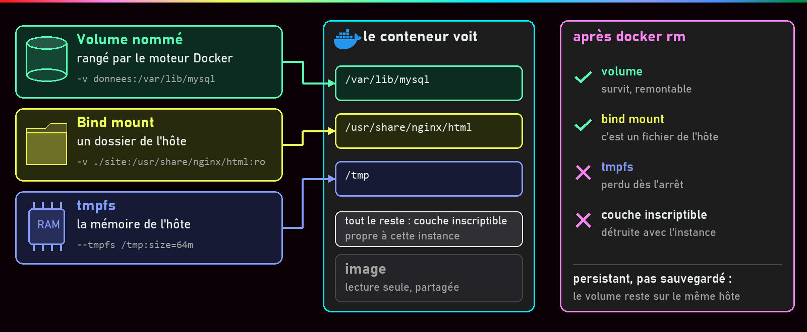{ .hero }

!!! abstract "Dans cette page"

    **Tu vas comprendre :**

    - pourquoi un fichier écrit dans un conteneur disparaît quand on le supprime ;
    - où ranger les données d'une base pour qu'elles survivent ;
    - pourquoi des données qui survivent ne sont pas pour autant sauvegardées.

    **Prérequis :** [Image et cycle de vie](Image-et-cycle-de-vie.md) et [Les couches d'une image](Couches-d-une-image.md). **Durée :** 30 min. **Niveau :** débutant.

!!! quote "En clair"

    Un conteneur, c'est une **chambre d'hôtel**. Quand tu rends la clé (`docker rm`), le ménage efface tout ce que tu y as laissé. Ce qui doit durer va dans un **casier à la consigne** (un volume) : la prochaine chambre peut l'ouvrir. Tu peux aussi apporter **ton propre classeur** de la maison (un bind mount), ou écrire sur un **tableau blanc** effacé à chaque départ (un tmpfs). Limite de l'image : la consigne est dans le même hôtel. S'il brûle, le casier brûle aussi.

    { .anim }

## L'essentiel en 30 secondes

<div class="grid cards" markdown>

-   :material-database:{ .lg .middle } __Volume nommé__

    ---

    Rangé et géré par Docker. Il survit au conteneur et se rebranche dans un autre : la place des données d'une base.

-   :material-folder-open-outline:{ .lg .middle } __Bind mount__

    ---

    Un dossier précis de ton poste, vu tel quel dans le conteneur. Pour le code, la configuration, les scripts, en lecture seule si possible.

-   :material-memory:{ .lg .middle } __tmpfs__

    ---

    En mémoire, jamais écrit sur disque, perdu à l'arrêt. Pour l'éphémère ou le sensible.

-   :material-alert-outline:{ .lg .middle } __Le piège · persister n'est pas sauvegarder__

    ---

    Le volume est sur le même hôte, le même disque, le même moteur. Un `down -v` ou un disque perdu l'emportent.

</div>

!!! warning "À retenir"

    **On remplace le conteneur, on garde le volume.** Tout ce qui est écrit hors d'un montage disparaît avec `docker rm`. Un montage **cache** ce qui existait au même endroit dans l'image. Et `docker compose down -v` **détruit la base**.

Un **montage**, c'est brancher un espace de stockage à un endroit précis de l'arborescence du conteneur, comme on branche une clé USB sur un dossier : ce qui est écrit à cet endroit va dans le stockage branché, pas dans le conteneur.

## :material-database: Le volume : la donnée survit au conteneur

Le code et les outils viennent de l'**image** (lecture seule). Par-dessus, chaque conteneur reçoit une fine **couche inscriptible** où atterrit tout ce qu'il écrit ; elle disparaît avec lui (voir [Les couches d'une image](Couches-d-une-image.md)). L'**état** (tables d'une base, fichiers déposés par les utilisateurs) doit survivre au remplacement du conteneur : il va dans un volume, qui a sa propre vie.

| Commande | Le conteneur | Sa couche inscriptible | Un volume nommé |
|---|---|---|---|
| `docker stop` puis `start` | conservé | **conservée** | conservé |
| `docker rm` | supprimé | **supprimée** | conservé |
| `compose up -d --force-recreate` | remplacé | **perdue** | conservé et rebranché |
| `compose down` | supprimé (avec les réseaux) | perdue | **conservé** |
| `compose down -v` | supprimé | perdue | **supprimé** (sauf volumes externes) |

```bash
docker run --rm -v donnees:/data alpine:3.22 cat /data/note.txt  # (1)!
```

1. `-v donnees:/data` : branche le volume nommé `donnees` sur le dossier `/data` du conteneur. À gauche du `:` un **nom**, c'est un volume ; un **chemin** qui commence par `/`, c'est un bind mount. Docker crée le volume s'il n'existe pas.

???+ example "En vrai : sans volume, puis avec"

    **Ce qu'on fait :** on écrit un fichier dans un conteneur sans volume, on le supprime, on cherche le fichier. Puis on recommence en écrivant dans un volume.

    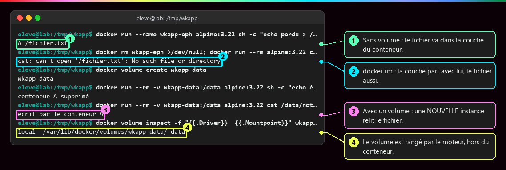

    **Ce qu'il faut regarder :**

    - ① `docker diff` montre le fichier ajouté (`A`) dans la couche du conteneur.
    - ② Après `docker rm`, un nouveau conteneur ne le trouve pas : la couche est partie avec l'ancien.
    - ③ Avec un volume, un **nouveau** conteneur relit le fichier écrit par le précédent, pourtant supprimé.
    - ④ Le volume est rangé par Docker sur l'hôte, hors de tout conteneur.

    Syntaxe longue équivalente : `--mount type=volume,src=donnees,dst=/data`.

## :material-folder-open-outline: Bind mount : un dossier de l'hôte

!!! quote "En clair"

    Un bind mount, c'est **ton propre classeur** posé dans la chambre : le conteneur lit et écrit directement dans un dossier de ton poste. Pratique pour du code ou de la configuration, mais il dépend de ton poste et de ses droits.

    { .anim }

| Critère | Volume nommé | Bind mount |
|---|---|---|
| Qui choisit l'emplacement ? | Docker | toi (un chemin de l'hôte) |
| Portabilité | aucune dépendance au poste | dépend du chemin, des droits (UID/GID non traduits), du système |
| Premier montage | un volume **vide** reçoit une copie du contenu de l'image à cet endroit | ne copie jamais rien |
| Idéal pour | `/var/lib/mysql` | code, configuration, scripts d'init, en `:ro` |

???+ example "En vrai : modifier un site sans reconstruire l'image"

    **Ce qu'on fait :** nginx sert une page posée dans un dossier de l'hôte, monté en lecture seule (`:ro`). On modifie la page sur l'hôte, puis on essaie de la modifier depuis le conteneur.

    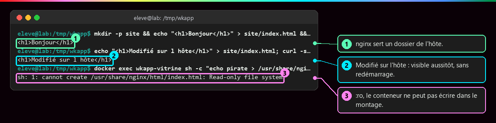

    **Ce qu'il faut regarder :** ① nginx sert bien le fichier de l'hôte ; ② la modification faite sur l'hôte est visible aussitôt, sans redémarrage ; ③ le conteneur, lui, ne peut pas écrire : `Read-only file system`. C'est le rôle de `:ro`.

???+ danger "En vrai : « mes fichiers ont disparu », l'effet de masque"

    **Ce qu'on fait :** on monte un dossier **vide** de l'hôte à l'endroit où l'image range sa page d'accueil. Puis on fait la même chose avec un volume nommé vide.

    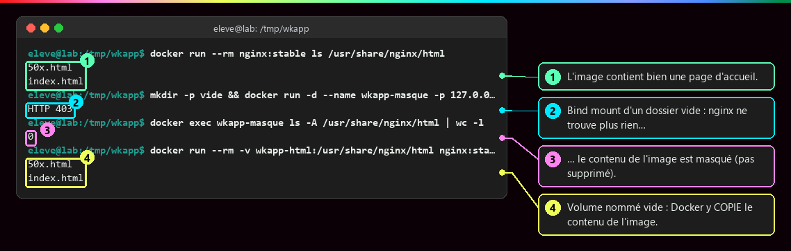

    **Ce qu'il faut regarder :**

    - ① L'image contient bien une page d'accueil.
    - ② Avec le dossier vide monté par-dessus, nginx répond `403` : il ne trouve plus rien à servir.
    - ③ Le dossier vu par le conteneur est vide : le contenu de l'image est **caché**, pas supprimé.
    - ④ Un volume nommé vide, lui, reçoit une **copie** du contenu de l'image au premier montage.

    Retirer le montage fait réapparaître le fichier. C'est cette copie au premier montage qui permet à un volume vide sur `/var/lib/mysql` de recevoir les bons propriétaires. Question à se poser à chaque fois : **que contient réellement le dossier vu par le programme ?**

## :material-memory: tmpfs : en mémoire

Rapide, jamais écrit sur disque, mais **perdu à l'arrêt** et pris sur la mémoire de l'hôte : on en fixe la taille, ce qui ne dispense pas de limiter la mémoire du conteneur ([Isolation d'un conteneur](Isolation-des-conteneurs.md)).

???+ example "En vrai : une racine en lecture seule, un /tmp en mémoire"

    **Ce qu'on fait :** on monte un tmpfs de 64 Mo sur `/tmp`, puis on lance un conteneur dont tout le reste est en lecture seule (`--read-only`).

    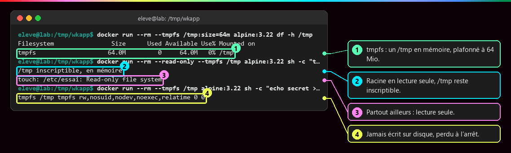

    **Ce qu'il faut regarder :** ① `/tmp` est un tmpfs plafonné à 64 Mo ; ② il reste inscriptible ③ alors que tout le reste est en lecture seule ; ④ le système le décrit comme `tmpfs` : en mémoire, perdu à l'arrêt.

    Le couple `--read-only` + `--tmpfs /tmp` est un réglage de durcissement courant : l'application garde un espace de travail, le reste du système de fichiers est figé.

## :material-database-cog: Une base conteneurisée

L'exemple suivi dans ces pages : MariaDB avec un volume pour les données et un bind mount en lecture seule pour les scripts de première initialisation.

```yaml
services:
  db:
    image: mariadb:11.4
    volumes:
      - db_data:/var/lib/mysql                     # (1)!
      - ./db/init:/docker-entrypoint-initdb.d:ro   # (2)!
volumes:
  db_data:                                         # (3)!
```

1. Volume nommé, en écriture : c'est là que MariaDB range ses tables.
2. Bind mount du dossier `db/init` du projet, en lecture seule : les scripts SQL à exécuter au tout premier démarrage.
3. La déclaration du volume : Compose le crée s'il n'existe pas, et le réutilise ensuite.

???+ example "En vrai : ce qui est réellement monté"

    **Ce qu'on fait :** on demande à Docker la liste des montages du conteneur `db`, puis on regarde dans le volume depuis un conteneur jetable.

    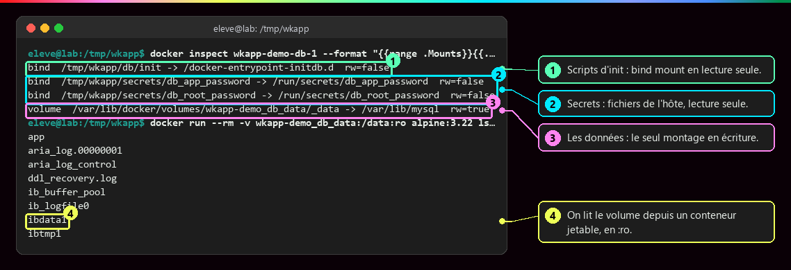

    **Ce qu'il faut regarder :** ① les scripts d'init sont un bind mount en lecture seule (`rw=false`) ; ② les mots de passe aussi, montés comme des fichiers ; ③ le volume des données est le **seul** montage en écriture ; ④ on lit son contenu depuis un conteneur jetable, en `:ro`, sans toucher à la base.

    Compose ajoute le nom du projet devant le volume (`wkapp-demo_db_data`).

???+ example "En vrai : les scripts d'initialisation ne servent qu'une fois"

    **Ce qu'on fait :** on lit le journal du premier démarrage, puis on recrée le conteneur sur le même volume et on relit le journal.

    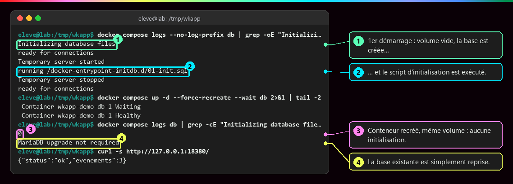

    **Ce qu'il faut regarder :** ① au premier démarrage, le volume est vide : la base est créée ; ② le script `01-init.sql` est exécuté ; ③ après recréation, zéro ligne d'initialisation ; ④ la base existante est simplement reprise.

    Le programme de démarrage de l'image n'exécute ces scripts que sur un **dossier de données vide**. Modifier `01-init.sql` ne change rien à une base existante.

!!! danger "Initialisation ≠ migration de schéma"

    Pour faire évoluer une base existante : des **migrations versionnées** qu'on peut rejouer sans dégât, une stratégie de **retour arrière**, et une **sauvegarde cohérente** juste avant. Autre règle : deux serveurs MariaDB indépendants ne doivent jamais écrire dans le même dossier de données.

## :material-backup-restore: Persistance, sauvegarde, restauration

!!! quote "En clair"

    Ton casier à la consigne garde tes affaires d'un séjour à l'autre : c'est la **persistance**. Une **sauvegarde**, c'est une photocopie rangée dans **un autre bâtiment**. Et elle ne vaut que si tu as déjà vérifié qu'elle se relit.

    { .anim }

| Notion | Définition | Protège contre |
|---|---|---|
| **Persistance** | les données survivent à la vie d'un conteneur | le remplacement d'un conteneur |
| **Sauvegarde** | une copie **cohérente**, **datée**, stockée **ailleurs** | la perte du volume, du disque, de l'hôte, une erreur humaine |
| **Restauration** | la procédure, **testée**, qui remet la copie en service | rien, tant qu'elle n'a pas été essayée |

Copier `/var/lib/mysql` pendant que le serveur écrit **n'est pas** une sauvegarde valide. Les méthodes valables : export logique (`mariadb-dump`), sauvegarde physique avec un outil compatible (`mariadb-backup`), instantané coordonné avec la base.

```bash
docker compose exec -T db bash -c 'mariadb-dump \
  --defaults-extra-file=<(printf "[client]\nuser=root\npassword=%s\n" "$(cat /run/secrets/db_root_password)") \
  --single-transaction --routines --triggers --databases app' > backups/app-$(date +%Y%m%d-%H%M%S).sql  # (1)!
```

1. `exec -T db` lance l'export **dans** le conteneur `db`, sans terminal interactif. Le mot de passe est lu dans le secret monté et passé par un fichier d'options éphémère : il n'apparaît ni dans la liste des processus, ni dans le fichier produit. `--single-transaction` donne une image cohérente des tables sans bloquer les écritures. La sortie est redirigée (`>`) vers un fichier daté **sur l'hôte**.

Le test de restauration se fait sur un conteneur `mariadb:11.4` **neuf et sans réseau** (`--network none`) : import, puis un `SELECT` qui retrouve les données.

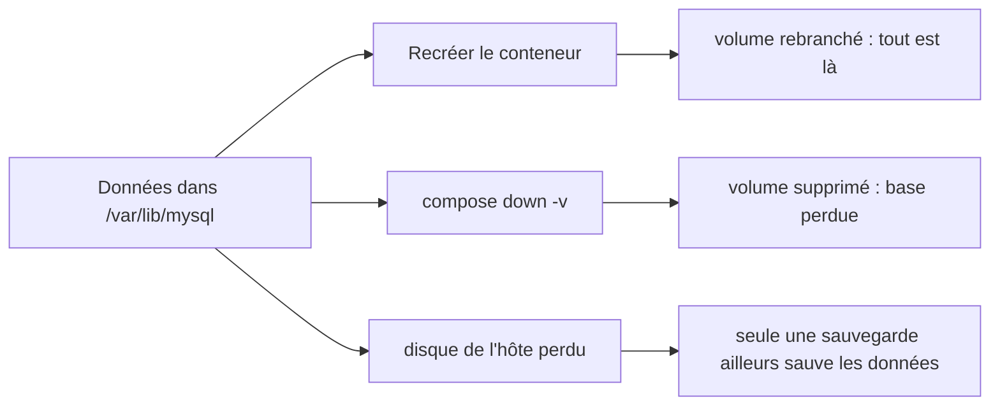

## :material-flask-outline: À toi de jouer

!!! tip "Pratique sans rien installer : le lab interactif"

    Une **machine Docker simulée** à gauche, le **tutoriel pas à pas** à droite, et Conti, le robot du lab, pour te dire quoi observer avant chaque commande. Chaque option est expliquée, tu vois ce que tu dois obtenir, et chaque étape se valide toute seule. Tu ne peux rien casser.

    [:material-console: Ouvrir le lab interactif](labs/stockage.md){ .md-button .md-button--primary target="_blank" rel="noopener" }

**Sur ton poste**, le même lab pas à pas :

Cinq étapes, environ 10 minutes. Tape les commandes une par une et compare avec ce que tu dois voir.

**Étape 1 · Écrire sans volume**

```bash
docker run --name ephemere alpine:3.22 sh -c 'echo perdu > /fichier.txt'   # (1)!
docker diff ephemere                                                        # (2)!
docker rm ephemere                                                          # (3)!
docker run --rm alpine:3.22 cat /fichier.txt                                # (4)!
```

1. Un conteneur écrit le mot « perdu » dans `/fichier.txt`, puis s'arrête. Pas de `--rm` : on le garde pour l'examiner.
2. Liste ce qui a changé dans sa couche inscriptible par rapport à l'image.
3. Supprime le conteneur, et sa couche avec lui.
4. Un **nouveau** conteneur, tiré de la même image, cherche le fichier.

Tu dois voir le fichier ajouté (`A`), puis plus rien :

```text
A /fichier.txt
ephemere
cat: can't open '/fichier.txt': No such file or directory
```

**Étape 2 · Un volume qui survit**

```bash
docker volume create labo                                                                      # (1)!
docker run --rm -v labo:/data alpine:3.22 sh -c 'echo bonjour du conteneur A > /data/note.txt' # (2)!
docker run --rm -v labo:/data:ro alpine:3.22 cat /data/note.txt                                # (3)!
docker run --rm -v labo:/data:ro alpine:3.22 sh -c 'echo x > /data/autre.txt'                  # (4)!
```

1. Crée un volume nommé `labo`.
2. Un conteneur A écrit dans le volume, puis est supprimé (`--rm`).
3. Un conteneur B, tout neuf, relit le fichier. `:ro` : il branche le volume en lecture seule.
4. Le même conteneur B essaie d'écrire : refusé, à cause de `:ro`.

Tu dois voir :

```text
labo
bonjour du conteneur A
sh: can't create /data/autre.txt: Read-only file system
```

**Étape 3 · Un dossier de ton poste dans le conteneur**

```bash
mkdir site && echo '<h1>Bonjour</h1>' > site/index.html                                          # (1)!
docker run -d --name vitrine -p 127.0.0.1:8080:80 -v "$PWD/site":/usr/share/nginx/html:ro nginx:stable  # (2)!
curl -s http://127.0.0.1:8080/
echo '<h1>Modifié sur mon poste</h1>' > site/index.html                                          # (3)!
curl -s http://127.0.0.1:8080/
docker exec vitrine sh -c 'echo pirate > /usr/share/nginx/html/index.html'                        # (4)!
```

1. Crée un dossier `site` contenant une page web.
2. `-v "$PWD/site":/usr/share/nginx/html:ro` : branche ce dossier (`$PWD` = le dossier où tu es) là où nginx cherche ses pages, en lecture seule. Le chemin commence par `/` : c'est un bind mount.
3. Modifie la page **sur ton poste**, sans toucher au conteneur.
4. Essaie de modifier la page **depuis** le conteneur.

Tu dois voir l'identifiant du conteneur (le tien sera différent), la page, sa nouvelle version, puis un refus :

```text
5bbd06e9095087e296343f5207afa36eea6bc0b4b70ce4b19658f3e90fdf9a60
<h1>Bonjour</h1>
<h1>Modifié sur mon poste</h1>
sh: 1: cannot create /usr/share/nginx/html/index.html: Read-only file system
```

**Étape 4 · Un /tmp en mémoire**

```bash
docker run --rm --tmpfs /tmp:size=16m alpine:3.22 df -h /tmp   # (1)!
```

1. `--tmpfs /tmp:size=16m` : un dossier `/tmp` en mémoire, limité à 16 Mo. `df -h` affiche son type et sa taille.

Tu dois voir un système de fichiers `tmpfs` de 16 Mo :

```text
Filesystem                Size      Used Available Use% Mounted on
tmpfs                    16.0M         0     16.0M   0% /tmp
```

**Étape 5 · Faire le ménage**

```bash
docker rm -f vitrine      # (1)!
docker volume rm labo     # (2)!
rm -r site
```

1. Supprime le conteneur nginx. À faire **avant** le volume.
2. Supprime le volume : cette fois, la note est vraiment perdue.

Tu dois voir :

```text
vitrine
labo
```

??? tip "Ça ne marche pas ?"

    | Message | Cause | Solution |
    |---|---|---|
    | `volume is in use` | un conteneur, même arrêté, utilise encore le volume | `docker ps -a`, supprime le conteneur, puis le volume |
    | la page « Welcome to nginx! » au lieu de « Bonjour » | tu as écrit `-v site:/usr/...` sans `$PWD/` : sans `/` au début, Docker a créé un **volume** nommé `site` | `docker rm -f vitrine && docker volume rm site`, puis relance avec `"$PWD/site"` |
    | `port is already allocated` | le port 8080 est déjà pris | utilise `-p 127.0.0.1:8081:80` et `curl` sur 8081 |
    | `Conflict. The container name "/vitrine" is already in use` | un essai précédent | `docker rm -f vitrine` puis recommence |
    | `mkdir: cannot create directory 'site': File exists` | le dossier existe déjà | `rm -r site` puis recommence |

## :material-help-circle-outline: Vérifie que tu as compris

??? question "1. Tu fais `docker stop` puis `docker start` sur un conteneur qui a écrit un fichier sans volume. Le fichier est-il encore là ?"

    **Oui.** Arrêter un conteneur garde sa couche inscriptible. C'est `docker rm` (ou une recréation par Compose) qui la détruit.

??? question "2. Tu montes un dossier vide de ton poste sur `/usr/share/nginx/html`. Pourquoi nginx répond-il 403, alors que l'image contient une page ?"

    Parce que le montage **cache** ce qu'il y avait à cet endroit dans l'image. Un bind mount ne copie rien : nginx voit le dossier vide. Un volume nommé vide, lui, aurait reçu une copie de la page.

??? question "3. Ta base est dans un volume nommé. Est-elle sauvegardée ?"

    **Non.** Elle survit au remplacement du conteneur, mais elle est sur le même disque, le même hôte. Un `docker compose down -v` ou une panne de disque l'emportent. Une sauvegarde est une copie cohérente, datée, rangée **ailleurs**, et dont la restauration a été testée.

!!! success "Et ensuite ?"

    Tu sais où ranger ce qui doit durer et ce qui peut disparaître. Page suivante : [Docker Compose](Docker-Compose.md), pour décrire réseaux, volumes et services dans un seul fichier.

## :material-server: Pour aller plus loin

??? note "Sous Docker Desktop (Windows, macOS), où vivent les volumes ?"

    Le moteur tourne dans un environnement Linux géré : les **volumes** y sont stockés, leur `Mountpoint` n'est pas un chemin de l'Explorateur ou du Finder. Un **bind mount** peut pointer vers un dossier du poste, via le partage de fichiers de Docker Desktop, au prix de performances plus faibles.

??? note "Pages liées"

    [Les couches d'une image](Couches-d-une-image.md) (la couche inscriptible), [Secrets, fichiers, réseau et ressources](Secrets-fichiers-reseau-ressources.md) (les secrets montés en fichiers), [Docker Compose](Docker-Compose.md) (`down` contre `down -v`).

??? abstract "Pour les créateurs : script de motion design « Le conteneur meurt, la donnée reste » (70 s)"

    Le moteur Docker en plateau ; conteneurs en cartes bleues, volume en cylindre vert, données en petits carrés jaunes (« lignes de table »).

    | Séq. | Durée | À l'écran | Animation | Texte à l'écran |
    |---|---|---|---|---|
    | 1 | 0-8 s | Une carte « conteneur db v1 » sur une plaque grise « image mariadb:11.4 » ; une fine pellicule blanche « couche inscriptible » | Des carrés jaunes s'empilent sur la pellicule | « Sans volume, la base écrit dans la couche de l'instance. » |
    | 2 | 8-16 s | Une main « docker rm » | La carte et sa pellicule se désagrègent, les carrés tombent ; la plaque image reste | « docker rm : l'instance et ses données partent ensemble. » |
    | 3 | 16-26 s | Une nouvelle carte et un cylindre vert « volume db_data » | Un tube relie carte et cylindre ; les carrés vont dans le cylindre | « Avec un volume, les données vivent à côté du conteneur. » |
    | 4 | 26-36 s | Une main « docker compose down » | La carte se désagrège, le tube se détache, **le cylindre reste** | « Le conteneur meurt. Le volume reste. » |
    | 5 | 36-44 s | « docker compose up » : une carte neuve « db v2 » | Le tube se rebranche ; un compteur « événements : 4 » | « Une nouvelle instance retrouve les mêmes données. » |
    | 6 | 44-52 s | Un fichier « 01-init.sql » avec une flèche vers le cylindre | La flèche s'allume au premier démarrage puis reste grise | « Les scripts d'initialisation ne servent qu'une fois : sur un volume vide. » |
    | 7 | 52-62 s | « down -v », puis un éclair « panne de disque » | Le cylindre se fissure ; un second cylindre, **sur un autre plateau** (« sauvegarde, ailleurs »), reste intact | « Persistance n'est pas sauvegarde. » |
    | 8 | 62-70 s | Le second cylindre renvoie ses carrés vers une base neuve | Une coche verte « restauration testée » | « Une sauvegarde ne vaut que par sa restauration testée. » |

    Le contraste entre la séquence 2 (carrés qui tombent) et la séquence 4 (cylindre qui reste) porte tout le message : même cadrage, même geste, seule la présence du volume change.

??? info "Pour les créateurs : idées de schémas"

    **Le conteneur en couches, vu de profil.** Un empilement de plaques (image en gris, couche inscriptible en blanc fin), traversé par des « tubes » venant de l'extérieur (volume en vert depuis un cylindre « moteur Docker », bind mounts en orange depuis un dossier « hôte »). Chaque tube recouvre ce qu'il y a sous lui : c'est l'effet de masque.

    ```
       Processus  ──voit──►  /            (une seule arborescence, assemblée)
                             ├─ /usr, /etc ...       ◄── image (lecture seule)
                             ├─ /var/log, /tmp ...   ◄── couche inscriptible (meurt avec l'instance)
                             ├─ /var/lib/mysql       ◄── volume nommé (géré par le moteur)
                             ├─ /docker-entrypoint-initdb.d  ◄── bind mount :ro (dossier de l'hôte)
                             └─ /run/secrets/...     ◄── bind mount :ro (fichiers de l'hôte)
    ```

    **Cycle de vie d'une base conteneurisée.**

    ```mermaid
    stateDiagram-v2
        [*] --> VolumeVide: docker compose up (1re fois)
        VolumeVide --> Initialise: scripts de docker-entrypoint-initdb.d exécutés
        Initialise --> EnService: serveur prêt
        EnService --> EnService: down puis up (volume réutilisé)
        EnService --> Sauvegarde: mariadb-dump --single-transaction
        Sauvegarde --> EnService
        EnService --> [*]: down -v (volume détruit)
    ```
