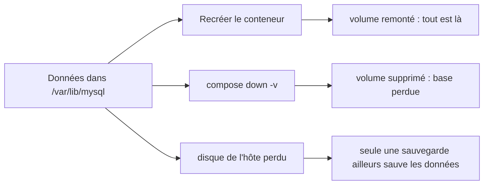

# Stockage et volumes

<p class="lead">Un conteneur est jetable, ses données ne doivent pas l'être. Ce qui doit durer va dans un <strong>volume</strong> ou un <strong>bind mount</strong>, jamais dans la couche inscriptible de l'instance. Et même un volume persistant <strong>n'est pas une sauvegarde</strong>.</p>

{ .hero }

## L'essentiel en 30 secondes

<div class="grid cards" markdown>

-   :material-database:{ .lg .middle } __Volume nommé__

    ---

    Rangé et géré par le moteur Docker. Il survit au conteneur et se remonte dans un autre : la place des données d'une base.

-   :material-folder-open-outline:{ .lg .middle } __Bind mount__

    ---

    Un chemin précis de l'hôte, vu tel quel. Pour le code, la configuration, les scripts, en lecture seule si possible.

-   :material-memory:{ .lg .middle } __tmpfs__

    ---

    En mémoire, jamais écrit sur disque, perdu à l'arrêt. Pour l'éphémère ou le sensible.

-   :material-alert-outline:{ .lg .middle } __Le piège · persister n'est pas sauvegarder__

    ---

    Le volume est sur le même hôte, le même disque, le même moteur. Un `down -v` ou un disque perdu l'emportent.

</div>

!!! warning "À retenir"

    **On remplace le conteneur, on garde le volume.** Tout ce qui est écrit hors d'un montage disparaît avec `docker rm`. Un montage **masque** ce qui existait au même chemin. Et `docker compose down -v` **détruit la base**.

## :material-database: Le volume : la donnée survit au conteneur

Le code et les dépendances viennent de l'**image** (lecture seule). L'**état** (tables, fichiers déposés) doit survivre au remplacement de l'instance : il va dans un volume, qui a sa propre identité.

| Commande | L'instance | Sa couche inscriptible | Un volume nommé |
|---|---|---|---|
| `docker stop` puis `start` | conservée | **conservée** | conservé |
| `docker rm` | supprimée | **supprimée** | conservé |
| `compose up -d --force-recreate` | remplacée | **perdue** | conservé et remonté |
| `compose down` | supprimée (avec les réseaux) | perdue | **conservé** |
| `compose down -v` | supprimée | perdue | **supprimé** (sauf volumes externes) |

???+ example "En vrai : sans volume, puis avec"

    

    Chaque `docker run --rm` crée puis détruit une instance, et pourtant la seconde relit le fichier du volume. Syntaxe longue équivalente : `--mount type=volume,src=wkapp-data,dst=/data`. Le cycle de vie d'une instance : [Image et cycle de vie](Image-et-cycle-de-vie.md).

## :material-folder-open-outline: Bind mount : un dossier de l'hôte

| Critère | Volume nommé | Bind mount |
|---|---|---|
| Qui choisit l'emplacement ? | le moteur Docker | l'utilisateur (chemin de l'hôte) |
| Portabilité | aucune dépendance au poste | dépend du chemin, des droits (UID/GID non traduits), de la plateforme |
| Premier montage | un volume **vide** reçoit le contenu de l'image à ce chemin | ne copie jamais rien |
| Idéal pour | `/var/lib/mysql` | code, configuration, scripts d'init, en `:ro` |

???+ example "En vrai : modifier un site sans reconstruire l'image"

    

???+ danger "En vrai : « mes fichiers ont disparu », l'effet de masque"

    

    Rien n'est supprimé dans l'image : retirer le montage fait réapparaître le fichier. C'est la copie au premier montage qui permet à un volume vide sur `/var/lib/mysql` de recevoir les bons propriétaires. Question à se poser systématiquement : **que contient réellement le chemin vu par le processus ?**

## :material-memory: tmpfs : en mémoire

Rapide, jamais écrit sur disque, mais **perdu à l'arrêt** et pris sur la mémoire de l'hôte : on en fixe la taille, ce qui ne dispense pas de limiter la mémoire du conteneur ([Isolation d'un conteneur](Isolation-des-conteneurs.md)).

???+ example "En vrai : une racine en lecture seule, un /tmp en mémoire"

    

    Le couple `--read-only` + `--tmpfs /tmp` est un réglage de durcissement courant : l'application garde un espace de travail, le reste du système de fichiers est figé.

## :material-database-cog: Une base conteneurisée

Le fil rouge : MariaDB avec un volume pour les données et un bind mount en lecture seule pour les scripts de première initialisation.

```yaml
services:
  db:
    image: mariadb:11.4
    volumes:
      - db_data:/var/lib/mysql                     # volume persistant, en écriture
      - ./db/init:/docker-entrypoint-initdb.d:ro   # scripts fournis, en lecture seule
volumes:
  db_data:
```

???+ example "En vrai : ce qui est réellement monté"

    

    Compose préfixe le volume par le nom du projet (`wkapp-demo_db_data`). On inspecte son contenu depuis un conteneur jetable, en `:ro`, sans toucher à la base.

???+ example "En vrai : les scripts d'initialisation ne servent qu'une fois"

    

    Le point d'entrée de l'image n'exécute ces scripts que sur un **répertoire de données vide**. Modifier `01-init.sql` ne change rien à une base existante.

!!! danger "Initialisation ≠ migration de schéma"

    Pour faire évoluer une base existante : des **migrations versionnées** et idempotentes, une stratégie de **retour arrière**, et une **sauvegarde cohérente** juste avant. Autre règle : deux serveurs MariaDB indépendants ne doivent jamais écrire dans le même répertoire de données.

## :material-backup-restore: Persistance, sauvegarde, restauration

| Notion | Définition | Protège contre |
|---|---|---|
| **Persistance** | les données survivent à la vie d'un conteneur | le remplacement d'une instance |
| **Sauvegarde** | une copie **cohérente**, **datée**, stockée **ailleurs** | la perte du volume, du disque, de l'hôte, une erreur humaine |
| **Restauration** | la procédure, **testée**, qui remet la copie en service | rien, tant qu'elle n'a pas été essayée |

Copier `/var/lib/mysql` pendant que le serveur écrit **n'est pas** une sauvegarde valide. Les méthodes valables : export logique (`mariadb-dump`), sauvegarde physique avec un outil compatible (`mariadb-backup`), snapshot coordonné avec la base.

```bash
# Export logique cohérent, sans arrêter la base ; le mot de passe est lu dans le secret monté
# et passé par un fichier d'options éphémère : il n'apparaît ni dans ps, ni dans le fichier produit.
docker compose exec -T db bash -c 'mariadb-dump \
  --defaults-extra-file=<(printf "[client]\nuser=root\npassword=%s\n" "$(cat /run/secrets/db_root_password)") \
  --single-transaction --routines --triggers --databases app' > backups/app-$(date +%Y%m%d-%H%M%S).sql
```

`--single-transaction` donne une image cohérente des tables InnoDB sans bloquer les écritures. Le test de restauration se fait sur une instance `mariadb:11.4` **neuve et sans réseau** (`--network none`) : import, puis un `SELECT` qui retrouve les données.



??? note "Sous Docker Desktop (Windows, macOS), où vivent les volumes ?"

    Le moteur tourne dans un environnement Linux géré : les **volumes** y sont stockés, leur `Mountpoint` n'est pas un chemin de l'Explorateur ou du Finder. Un **bind mount** peut pointer vers un dossier du poste, via le partage de fichiers de Docker Desktop, au prix de performances plus faibles.

## :material-flask-outline: À toi de jouer

```bash
docker run --name ephemere alpine:3.22 sh -c 'echo perdu > /fichier.txt'
docker diff ephemere          # A /fichier.txt : arrêtée, l'instance garde sa couche
docker rm ephemere            # cette fois, la couche est détruite avec l'instance

docker volume create labo
docker run --rm -v labo:/data alpine:3.22 sh -c 'date > /data/trace'
docker run --rm -v labo:/data:ro alpine:3.22 cat /data/trace            # relu par une nouvelle instance
docker run --rm -v labo:/data:ro alpine:3.22 sh -c 'echo x > /data/y'   # Read-only file system
docker run --rm --tmpfs /tmp:size=16m alpine:3.22 df -h /tmp            # tmpfs 16.0M
docker volume rm labo
```

Pour aller plus loin : [Les couches d'une image](Couches-d-une-image.md) (la couche inscriptible), [Secrets, fichiers, réseau et ressources](Secrets-fichiers-reseau-ressources.md) (les secrets montés en fichiers), [Docker Compose](Docker-Compose.md) (`down` contre `down -v`).

??? abstract "Pour les créateurs : script de motion design « Le conteneur meurt, la donnée reste » (70 s)"

    Le moteur Docker en plateau ; conteneurs en cartes bleues, volume en cylindre vert, données en petits carrés jaunes (« lignes de table »).

    | Séq. | Durée | À l'écran | Animation | Texte à l'écran |
    |---|---|---|---|---|
    | 1 | 0-8 s | Une carte « conteneur db v1 » sur une plaque grise « image mariadb:11.4 » ; une fine pellicule blanche « couche inscriptible » | Des carrés jaunes s'empilent sur la pellicule | « Sans volume, la base écrit dans la couche de l'instance. » |
    | 2 | 8-16 s | Une main « docker rm » | La carte et sa pellicule se désagrègent, les carrés tombent ; la plaque image reste | « docker rm : l'instance et ses données partent ensemble. » |
    | 3 | 16-26 s | Une nouvelle carte et un cylindre vert « volume db_data » | Un tube relie carte et cylindre ; les carrés vont dans le cylindre | « Avec un volume, les données vivent à côté du conteneur. » |
    | 4 | 26-36 s | Une main « docker compose down » | La carte se désagrège, le tube se détache, **le cylindre reste** | « Le conteneur meurt. Le volume reste. » |
    | 5 | 36-44 s | « docker compose up » : une carte neuve « db v2 » | Le tube se rebranche ; un compteur « événements : 4 » | « Une nouvelle instance retrouve les mêmes données. » |
    | 6 | 44-52 s | Un fichier « 01-init.sql » avec une flèche vers le cylindre | La flèche s'allume au premier démarrage puis reste grise | « Les scripts d'initialisation ne servent qu'une fois : sur un volume vide. » |
    | 7 | 52-62 s | « down -v », puis un éclair « panne de disque » | Le cylindre se fissure ; un second cylindre, **sur un autre plateau** (« sauvegarde, ailleurs »), reste intact | « Persistance n'est pas sauvegarde. » |
    | 8 | 62-70 s | Le second cylindre renvoie ses carrés vers une base neuve | Une coche verte « restauration testée » | « Une sauvegarde ne vaut que par sa restauration testée. » |

    Le contraste entre la séquence 2 (carrés qui tombent) et la séquence 4 (cylindre qui reste) porte tout le message : même cadrage, même geste, seule la présence du volume change.

??? info "Pour les créateurs : idées de schémas"

    **Le conteneur en couches, vu de profil.** Un empilement de plaques (image en gris, couche inscriptible en blanc fin), traversé par des « tubes » venant de l'extérieur (volume en vert depuis un cylindre « moteur Docker », bind mounts en orange depuis un dossier « hôte »). Chaque tube recouvre ce qu'il y a sous lui : c'est l'effet de masque.

    ```
       Processus  ──voit──►  /            (une seule arborescence, assemblée)
                             ├─ /usr, /etc ...       ◄── image (lecture seule)
                             ├─ /var/log, /tmp ...   ◄── couche inscriptible (meurt avec l'instance)
                             ├─ /var/lib/mysql       ◄── volume nommé (géré par le moteur)
                             ├─ /docker-entrypoint-initdb.d  ◄── bind mount :ro (dossier de l'hôte)
                             └─ /run/secrets/...     ◄── bind mount :ro (fichiers de l'hôte)
    ```

    **Cycle de vie d'une base conteneurisée.**

    ```mermaid
    stateDiagram-v2
        [*] --> VolumeVide: docker compose up (1re fois)
        VolumeVide --> Initialise: scripts de docker-entrypoint-initdb.d exécutés
        Initialise --> EnService: serveur prêt
        EnService --> EnService: down puis up (volume réutilisé)
        EnService --> Sauvegarde: mariadb-dump --single-transaction
        Sauvegarde --> EnService
        EnService --> [*]: down -v (volume détruit)
    ```
