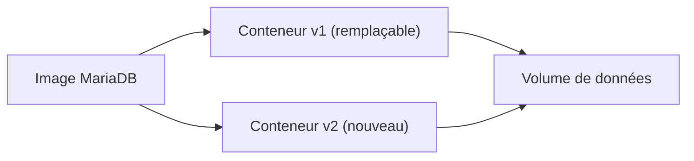
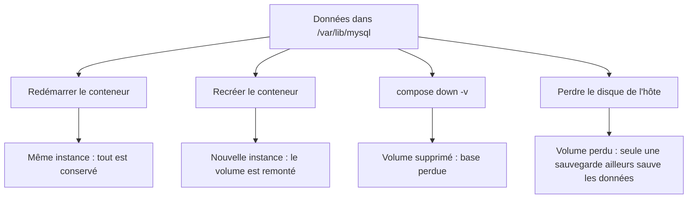
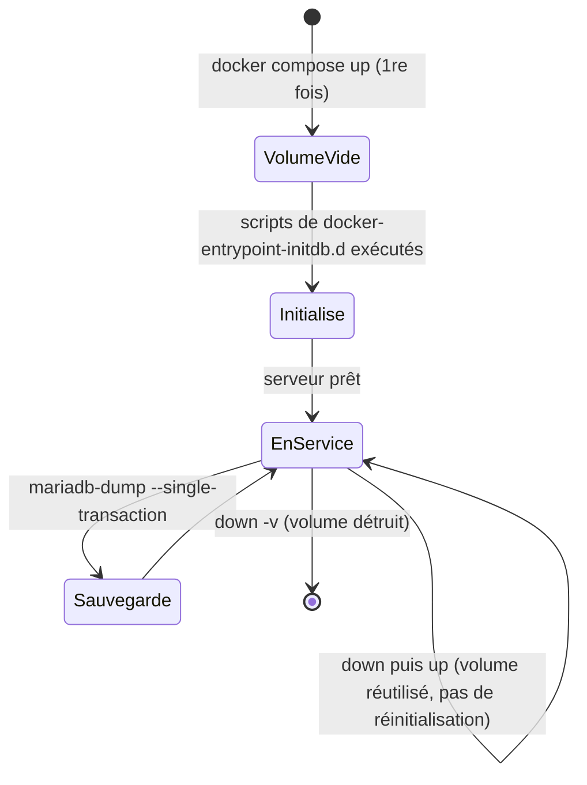

# Stockage : couche du conteneur, volumes, bind mounts

> **En une phrase.** Un conteneur est jetable, ses données ne doivent pas l'être : ce qui doit durer va dans un **volume** (géré par Docker) ou un **bind mount** (un chemin de l'hôte), jamais dans la couche inscriptible de l'instance ; et même un volume persistant **n'est pas une sauvegarde**.

---

## 1. Synthèse

### Le modèle mental : découpler le calcul et les données

```
   Image (lecture seule)          ← code, dépendances : reconstruite à chaque version
 + couche inscriptible            ← propre à l'instance : disparaît avec docker rm
 + montages                       ← données : vivent indépendamment du conteneur
   ├─ volume nommé   /var/lib/mysql
   ├─ bind mount     /docker-entrypoint-initdb.d  (lecture seule)
   └─ tmpfs          /tmp  (mémoire)
```

Le code et les dépendances viennent de l'**image**. L'**état** (les tables d'une base, les fichiers déposés par les utilisateurs) doit survivre au remplacement de l'instance qui l'utilise : on remplace le conteneur, on garde le volume.



### Ce que deviennent les données selon la commande

| Commande | L'instance | Sa couche inscriptible | Un volume nommé |
|---|---|---|---|
| `docker stop` puis `docker start` | conservée, réutilisée | **conservée** | conservé |
| `docker rm` | supprimée | **supprimée** | conservé |
| `docker compose up -d --force-recreate` | remplacée | **perdue** | conservé et remonté |
| `docker compose down` | supprimée (avec les réseaux) | **perdue** | **conservé** |
| `docker compose down -v` | supprimée | perdue | **supprimé** (sauf volumes externes) |

Le cycle de vie détaillé d'une instance est expliqué dans [Image et cycle de vie du conteneur](Image-et-cycle-de-vie.md).

### Les quatre emplacements possibles

| Mode | Où sont les fichiers | Survit à `docker rm` ? | Usage courant |
|---|---|---|---|
| **Couche inscriptible** | associée à l'instance, dans le stockage du moteur | non | fichiers temporaires de l'instance |
| **Volume Docker** (nommé) | géré par le moteur (`/var/lib/docker/volumes/...` sous Linux) | **oui** | données applicatives persistantes (base de données) |
| **Bind mount** | un chemin précis du système de l'hôte | oui (c'est un fichier de l'hôte) | code en développement, configuration, scripts, fichiers maîtrisés |
| **tmpfs** | la mémoire de l'hôte Linux | non, ni même à l'arrêt | données éphémères ou sensibles qui ne doivent pas toucher le disque |

### Volume ou bind mount : comment choisir

| Critère | Volume nommé | Bind mount |
|---|---|---|
| Qui choisit l'emplacement ? | le moteur Docker | l'utilisateur (chemin de l'hôte) |
| Dépendance au poste | aucune : portable d'un hôte à l'autre | au chemin, aux droits et à la plateforme |
| Droits initiaux | un volume vide reçoit les fichiers et droits de l'image au point de montage | ceux de l'hôte, tels quels |
| Idéal pour | `/var/lib/mysql`, données « qui appartiennent au moteur » | code, configuration, scripts d'initialisation, en lecture seule si possible |

### Persistance, sauvegarde, restauration : trois choses distinctes

| Notion | Définition | Protège contre |
|---|---|---|
| **Persistance** | les données survivent à la vie d'un conteneur | le remplacement d'une instance |
| **Sauvegarde** | une copie **cohérente**, **datée**, stockée **ailleurs** | la perte du volume, du disque, de l'hôte, une erreur humaine |
| **Restauration** | la procédure, **testée**, qui remet la copie en service | rien, tant qu'elle n'a pas été essayée |

> [!IMPORTANT]
> **Les pièges à retenir**
> 1. **Persistance du volume ≠ persistance du conteneur.** Le volume survit au conteneur ; tout ce qui est écrit ailleurs (couche inscriptible) disparaît avec lui.
> 2. **Un montage masque ce qui existe déjà au même chemin.** Le contenu de l'image n'est pas supprimé, mais le processus ne voit plus que le contenu monté.
> 3. **`docker compose down -v` détruit la base.** À ne jamais lancer sur des données à conserver.
> 4. **Un volume n'est pas une sauvegarde.** Il est sur le même hôte, le même disque et le même moteur que l'application : un `down -v`, un `docker volume rm`, un disque perdu l'emportent.
> 5. **Copier le répertoire d'une base active n'est pas une sauvegarde valide.** Il faut une méthode qui respecte la cohérence des transactions, puis un test de restauration.
> 6. **Les scripts d'initialisation ne s'exécutent que sur un volume vide.** Modifier `01-init.sql` ne change rien à une base existante : ce n'est pas un outil de migration.
> 7. **Partage technique ≠ partage sûr.** Deux serveurs MariaDB indépendants ne doivent jamais écrire dans le même répertoire de données.

---

## 2. Cas d'usage classiques

### Cas 1 : prouver qu'un volume survit à ses conteneurs

**Besoin.** Vérifier que des données écrites par une instance sont relues par une autre.

```bash
docker volume create atelier-data
docker volume inspect atelier-data           # Driver: local, Mountpoint: /var/lib/docker/volumes/atelier-data/_data

docker run --rm --mount type=volume,src=atelier-data,dst=/data \
  alpine:3.22 sh -c 'echo essai > /data/test.txt'
docker run --rm --mount type=volume,src=atelier-data,dst=/data \
  alpine:3.22 cat /data/test.txt             # essai
```

**Ce qu'on observe.** Le premier conteneur est détruit dès la fin de sa commande (`--rm`). Le second est une **nouvelle instance**, et pourtant il relit le fichier.
**À retenir.** Un volume nommé a une identité propre, gérée par le moteur. Il n'est attaché définitivement à aucun conteneur : il peut être remonté dans un autre. La syntaxe courte équivalente est `-v atelier-data:/data`.

### Cas 2 : supprimer toute l'application et retrouver la base intacte

**Besoin.** Recréer les conteneurs d'une application PHP + MariaDB (mise à jour, changement de configuration) sans perdre les données.

```yaml
services:
  db:
    image: mariadb:11.4
    volumes:
      - db_data:/var/lib/mysql
volumes:
  db_data:
```

```bash
docker compose down                       # conteneurs et réseaux supprimés
docker ps -a --filter name=webapp # plus aucun conteneur
docker volume ls --filter name=app        # local  webapp_db_data  ← toujours là
docker compose up -d
curl -s http://127.0.0.1:8080/            # l'événement n° 4 ajouté avant le down est toujours présent
```

**Ce qu'on observe sur un poste de test.** Après `down`, le volume `webapp_db_data` subsiste (Compose préfixe son nom par celui du projet). Au `up` suivant, le nouveau conteneur `db` le remonte et l'événement `"Test de persistance Docker"` (id 4) est toujours là.
**À retenir.** Avec `down -v`, le volume aurait été supprimé : le démarrage suivant serait reparti d'un volume vide, avec seulement les trois événements du script d'initialisation.

### Cas 3 : savoir ce qui est réellement monté, et où

**Besoin.** Vérifier la nature et l'emplacement de chaque montage d'un conteneur.

```bash
docker inspect webapp-db-1 \
  --format '{{range .Mounts}}{{.Type}} {{.Source}} -> {{.Destination}} rw={{.RW}}{{"\n"}}{{end}}'
```

```
bind   /home/user/webapp/db/init                    -> /docker-entrypoint-initdb.d     rw=false
bind   /home/user/webapp/secrets/db_app_password    -> /run/secrets/db_app_password    rw=false
bind   /home/user/webapp/secrets/db_root_password   -> /run/secrets/db_root_password   rw=false
volume /var/lib/docker/volumes/webapp_db_data/_data  -> /var/lib/mysql                  rw=true
```

**Ce qu'on observe.** Trois bind mounts en lecture seule (scripts d'initialisation et secrets : des fichiers de l'hôte que l'on maîtrise) et un seul volume en écriture (les données). On peut lire le contenu du volume sans toucher à la base, depuis un conteneur jetable : `docker run --rm -v webapp_db_data:/data:ro mariadb:11.4 ls /data` (on y voit `ibdata1`, `mysql/`, `app/`…).
**À retenir.** Question d'exploitation à se poser systématiquement : **que contient réellement le chemin vu par le processus ?**

### Cas 4 : publier un site sans reconstruire l'image (bind mount en lecture seule)

**Besoin.** Servir le contenu d'un dossier `./site` du poste, et le modifier à chaud.

```bash
mkdir -p site && echo '<h1>Bonjour</h1>' > site/index.html
docker run -d --name vitrine -p 127.0.0.1:8081:80 \
  --mount type=bind,src="$PWD"/site,dst=/usr/share/nginx/html,readonly \
  nginx:stable
curl -s http://127.0.0.1:8081/            # <h1>Bonjour</h1>
echo '<h1>Modifié</h1>' > site/index.html
curl -s http://127.0.0.1:8081/            # <h1>Modifié</h1>, sans redémarrage
```

**Ce qu'on observe.** Le conteneur lit directement les fichiers de l'hôte. L'option `readonly` (ou `:ro` en syntaxe courte) l'empêche d'y écrire.
**Le coût.** Une dépendance au chemin de l'hôte (`$PWD` doit exister sur chaque machine), à ses droits (UID/GID non traduits) et à la plateforme (sous Docker Desktop, le chemin passe par le partage de fichiers).

### Cas 5 : l'effet de masque, ou « mes fichiers ont disparu »

**Besoin.** Comprendre pourquoi une application ne trouve plus un fichier présent dans son image.

```bash
mkdir -p vide
docker run -d --name masque -p 127.0.0.1:8082:80 \
  -v "$PWD"/vide:/usr/share/nginx/html:ro nginx:stable
curl -sI http://127.0.0.1:8082/ | head -1     # HTTP/1.1 403 Forbidden
docker exec masque ls /usr/share/nginx/html   # (rien)
```

**Ce qu'on observe.** L'image contient bien `index.html` dans ce répertoire, mais le bind mount d'un dossier vide le **masque** pendant toute la durée du montage. Rien n'est supprimé dans l'image : retirer le montage fait réapparaître le fichier.
**Nuance utile.** Un **volume nommé vide** se comporte autrement : à son premier montage, Docker y copie le contenu de l'image présent à ce chemin. C'est pour cela qu'un volume vide monté sur `/var/lib/mysql` reçoit les bons propriétaires. Un bind mount, lui, ne copie jamais rien.

### Cas 6 : initialiser une base une seule fois, et comprendre pourquoi elle ne se réinitialise pas

**Besoin.** Créer les tables et quelques données de départ au premier lancement.

```yaml
services:
  db:
    image: mariadb:11.4
    volumes:
      - db_data:/var/lib/mysql                         # volume persistant, en écriture
      - ./db/init:/docker-entrypoint-initdb.d:ro       # scripts fournis, en lecture seule
```

**Ce qu'on observe sur un poste de test.** Au premier démarrage, le journal de `db` affiche `Initializing database files` puis `running /docker-entrypoint-initdb.d/01-init.sql`. À tous les démarrages suivants, le volume étant déjà rempli : `MariaDB upgrade not required`, et plus aucune ligne d'initialisation. Les trois événements de départ ne sont pas dupliqués.
**À retenir.** Le point d'entrée de l'image n'exécute ces scripts que sur un **répertoire de données vide**. Le volume et le script ont des cycles de vie différents : le script est une ressource de première mise en service, le volume porte l'état. Un fichier d'initialisation ne doit pas devenir un emplacement de données opérationnelles.

> [!WARNING]
> **Initialisation ≠ migration de schéma.** Pour faire évoluer une base qui existe déjà, il faut des **migrations versionnées** (et idempotentes), une gestion des dépendances entre versions de l'application et du schéma, une **stratégie de retour arrière**, et une **sauvegarde cohérente** juste avant toute opération risquée.

### Cas 7 : sauvegarder une base active, puis prouver que la restauration fonctionne

**Besoin.** Obtenir une copie cohérente de la base sans l'arrêter, et sans exposer le mot de passe.

```bash
# Export logique dans le conteneur db ; le mot de passe est lu dans le secret monté,
# et passé par un fichier d'options éphémère : il n'apparaît ni dans ps, ni dans le fichier produit.
docker compose exec -T db bash -c 'mariadb-dump \
  --defaults-extra-file=<(printf "[client]\nuser=root\npassword=%s\n" "$(cat /run/secrets/db_root_password)") \
  --single-transaction --routines --triggers --databases app' > backups/app-$(date +%Y%m%d-%H%M%S).sql
```

**Ce qu'on observe sur un poste de test.** Le fichier produit (2,5 ko) commence par l'en-tête `-- MariaDB dump` et contient l'`INSERT` des événements. Le test de restauration est fait sur une instance `mariadb:11.4` **neuve, sans réseau** (`--network none`) : import du fichier, puis un `SELECT` retrouve les quatre événements.
**À retenir.** `--single-transaction` produit une image cohérente des tables InnoDB sans bloquer les écritures. Les trois familles de méthodes valables sont : export logique (`mariadb-dump`), sauvegarde physique avec un outil compatible (par exemple `mariadb-backup`), ou snapshot coordonné avec la base. Archiver `/var/lib/mysql` pendant que le serveur écrit **n'en fait pas partie**. Et le test de restauration fait partie de la stratégie.

### Cas 8 : un répertoire temporaire en mémoire (tmpfs)

```bash
docker run --rm --tmpfs /tmp:size=64m alpine:3.22 df -h /tmp    # tmpfs  64.0M ... /tmp
```

**À retenir.** Rapide, jamais écrit sur disque, mais **perdu à l'arrêt** et pris sur la mémoire de l'hôte : on en fixe la taille, et cela ne dispense pas de limiter la mémoire du conteneur (voir [Isolation des conteneurs](Isolation-des-conteneurs.md)).

> [!NOTE]
> **Sous Docker Desktop (Windows, macOS), où vivent les volumes ?** Le moteur Docker tourne dans un environnement Linux géré. Les **volumes** sont stockés **dans cet environnement** : leur `Mountpoint` n'est pas un chemin exploitable dans l'Explorateur Windows ou le Finder. Un **bind mount**, lui, peut pointer vers un dossier du poste, via le partage de fichiers de Docker Desktop (au prix de performances plus faibles). Ne pas confondre l'emplacement des fichiers sur le poste et l'emplacement du stockage du moteur.

---

## 3. Idées de schémas

### Schéma A : le conteneur en couches, vu de profil

```
   Processus  ──voit──►  /            (une seule arborescence, assemblée)
                         ├─ /usr, /etc ...       ◄── image (lecture seule)
                         ├─ /var/log, /tmp ...   ◄── couche inscriptible (meurt avec l'instance)
                         ├─ /var/lib/mysql       ◄── volume nommé (géré par le moteur)
                         ├─ /docker-entrypoint-initdb.d  ◄── bind mount :ro (dossier de l'hôte)
                         └─ /run/secrets/...     ◄── bind mount :ro (fichiers de l'hôte)
```

Version graphique : un empilement de plaques (image en gris, couche inscriptible en blanc fin), traversé par des « tubes » colorés venant de l'extérieur (volume en vert depuis un cylindre « moteur Docker », bind mounts en orange depuis un dossier « hôte »). Chaque tube recouvre ce qu'il y a sous lui : c'est l'effet de masque.

### Schéma B : quatre situations, quatre résultats



### Schéma C : cycle de vie d'une base conteneurisée



---

## 4. Script de motion design : « Le conteneur meurt, la donnée reste » (environ 70 s)

Style : fond clair, le moteur Docker représenté comme un plateau ; conteneurs en cartes bleues, volume en cylindre vert, données en petits carrés jaunes (« lignes de table »).

| Séq. | Durée | À l'écran | Animation | Texte à l'écran |
|---|---|---|---|---|
| 1 | 0-8 s | Une carte « conteneur db v1 » posée sur une plaque grise « image mariadb:11.4 » ; une fine pellicule blanche « couche inscriptible » sur le dessus | Des carrés jaunes s'empilent sur la pellicule blanche | « Sans volume, la base écrit dans la couche de l'instance. » |
| 2 | 8-16 s | Une main « docker rm » | La carte et sa pellicule se désagrègent, les carrés jaunes tombent et disparaissent ; la plaque image reste intacte | « docker rm : l'instance et ses données partent ensemble. » |
| 3 | 16-26 s | Une nouvelle carte, et à côté un cylindre vert « volume db_data » | Un tube relie la carte au cylindre ; les carrés jaunes vont désormais dans le cylindre | « Avec un volume, les données vivent à côté du conteneur. » |
| 4 | 26-36 s | Une main « docker compose down » | La carte se désagrège, le tube se détache, **le cylindre reste**, pulsant doucement | « Le conteneur meurt. Le volume reste. » |
| 5 | 36-44 s | « docker compose up » : une carte neuve « db v2 » (nouvelle couleur de liseré) | Le tube se rebranche sur le même cylindre ; un compteur « événements : 4 » s'affiche | « Une nouvelle instance retrouve les mêmes données. » |
| 6 | 44-52 s | Un fichier « 01-init.sql » à côté, avec une flèche vers le cylindre | La flèche s'allume au tout premier démarrage puis s'éteint et reste grise lors du redémarrage | « Les scripts d'initialisation ne servent qu'une fois : sur un volume vide. » |
| 7 | 52-62 s | Une main « down -v », puis un éclair « panne de disque » | Le cylindre se fissure et disparaît dans les deux cas ; un second cylindre, posé **sur un autre plateau** (« sauvegarde, ailleurs »), reste intact | « Persistance n'est pas sauvegarde. » |
| 8 | 62-70 s | Le second cylindre renvoie ses carrés jaunes vers une base neuve | Une coche verte « restauration testée » | « Une sauvegarde ne vaut que par sa restauration testée. » |

**Conseil de réalisation.** Le contraste entre la séquence 2 (carrés qui tombent) et la séquence 4 (cylindre qui reste) porte tout le message : garder exactement le même cadrage et le même geste de suppression pour que seule la présence du volume change. En séquence 7, placer la sauvegarde sur un plateau visiblement séparé de l'hôte.

---

## 5. Vérifier soi-même

```bash
docker run --name ephemere alpine:3.22 sh -c 'echo perdu > /fichier.txt'
docker diff ephemere          # A /fichier.txt : arrêtée, l'instance garde sa couche inscriptible
docker rm ephemere            # cette fois, la couche inscriptible est détruite avec l'instance

docker volume create labo
docker run --rm -v labo:/data alpine:3.22 sh -c 'date > /data/trace'
docker run --rm -v labo:/data:ro alpine:3.22 cat /data/trace  # relu par une nouvelle instance
docker run --rm -v labo:/data:ro alpine:3.22 sh -c 'echo x > /data/y'   # Read-only file system
docker volume rm labo
```

## Voir aussi

- [Accueil du wiki](../README.md)
- Page précédente : [Réseaux Docker et publication de ports](Reseaux-et-ports.md)
- Page suivante : [Docker Compose](Docker-Compose.md)
- Pour aller plus loin : [Les couches d'une image](Couches-d-une-image.md) (la couche inscriptible), [Secrets, fichiers, réseau et ressources](Secrets-fichiers-reseau-ressources.md) (les secrets montés en fichiers)
