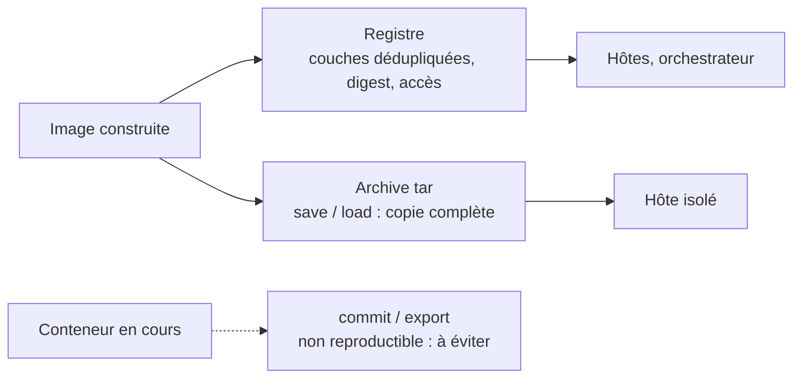

# Versionner et publier une image

<p class="lead">Une image ne se modifie jamais : chaque changement produit une <strong>nouvelle image</strong>, nommée par un <strong>tag</strong>, identifiée par son <strong>digest</strong> et distribuée par un <strong>registre</strong> (ou, à défaut, par une archive).</p>

{ .hero }

## L'essentiel en 30 secondes

<div class="grid cards" markdown>

-   :material-source-branch:{ .lg .middle } __Reconstruire__

    ---

    Code modifié : **nouvelle image**, nouveau tag. Aucun conteneur existant n'est mis à jour.

-   :material-tag-multiple-outline:{ .lg .middle } __Nommer__

    ---

    `docker image tag` ajoute un nom, pas une version. Le tag dit « quelle version ? ».

-   :material-fingerprint:{ .lg .middle } __Identifier__

    ---

    Le digest dit « quel contenu exact ? ». En production, on déploie **par digest**.

-   :material-cloud-upload-outline:{ .lg .middle } __Distribuer__

    ---

    `push` puis `pull` : le serveur n'a besoin ni du Dockerfile ni des sources.

</div>

!!! warning "À retenir"

    **Reconstruire ne met à jour aucun conteneur** : il faut les recréer. **Un tag peut être republié** : pour savoir ce qui tourne vraiment, on compare des digests. **`push` publie tout ce que contiennent les couches**, y compris un fichier copié par erreur, et on ne rappelle pas une image déjà tirée.

## :material-source-branch: Une nouvelle version, c'est une nouvelle image

| Situation | Ce qu'il faut faire |
|---|---|
| Le code ou les dépendances changent | **construire** une nouvelle image, sous un nouveau tag |
| L'ancienne version doit rester disponible | rien : `1.0` reste utilisable tant que l'image est conservée |
| Des conteneurs tournent sur l'ancienne | les **recréer** à partir de la nouvelle référence |
| On veut juste un autre nom | `docker image tag` : aucune image produite |

???+ example "En vrai : 1.0 et 1.1 côte à côte"

    

    Le conteneur lancé avant le build est resté en version 1 : `COPY` a copié le code au build, il ne le suit pas.

??? note "Même contenu, autre identifiant ?"

    Avec le magasin d'images containerd, l'ID local est le digest de l'**index**, qui inclut l'attestation de provenance générée par BuildKit à chaque build. Reconstruire entièrement depuis le cache peut donc changer l'ID alors que les fichiers sont identiques. Ce qu'on compare doit être défini avec précision.

## :material-tag-multiple-outline: Une politique de tags

| Type | Exemple | Règle |
|---|---|---|
| Version précise, **immuable** | `1.2.0` | jamais réécrit |
| Révision du code | `sha-1a2b3c4` | relie l'image au commit Git |
| Tags **mobiles** | `1.2`, `latest` | pratiques en test, à éviter en production |
| Production | `web@sha256:…` | on déploie **par digest** |

Pour la traçabilité : Dockerfile et sources dans **Git**, chaque tag associé à une **révision**, le **digest** relevé après le `push`.

```bash
GIT_SHA=$(git rev-parse --short HEAD)
docker build --label org.opencontainers.image.revision=$GIT_SHA \
  -t compte/web:1.1.0 -t compte/web:sha-$GIT_SHA .
docker push --all-tags compte/web
```

Version (tag), lien vers le code (étiquette, tag de commit) et identité (digest) répondent à trois questions : « quelle version ? », « quel code ? », « quel contenu exact ? ». Idéalement, l'intégration continue construit, signe et joint un inventaire (SBOM) : voir [Sécurité des images](Securite-des-images.md).

## :material-cloud-upload-outline: Publier dans un registre

Le **nom de l'image contient le registre** : c'est lui qui décide où `push` envoie et où `pull` cherche.

| Registre | Référence |
|---|---|
| Docker Hub (par défaut) | `compte/web:1.1` |
| GitHub, GitLab | `ghcr.io/compte/web:1.1`, `registry.gitlab.com/groupe/projet/web:1.1` |
| Clouds | Amazon ECR, Azure Container Registry, Google Artifact Registry |
| Auto-hébergé | `registry.example.org/equipe/web:1.1` (image `registry`, ou Harbor) |

???+ example "En vrai : un registre local, deux push"

    

    Docker accepte `localhost` sans TLS ; tout autre registre doit présenter un certificat valide. Pour Docker Hub : `docker login` (identifiant + jeton d'accès personnel), puis `docker push compte/web:1.1`. Le registre n'a fait que stocker : aucun conteneur `web` n'y a tourné.

???+ example "En vrai : tirer exactement ce contenu"

    

    Un digest se **copie** depuis le registre ou `docker image inspect` : `<empreinte réelle>` dans une documentation n'est pas une valeur à taper telle quelle.

??? note "Publier pour AMD64 et ARM64"

    Un build ordinaire produit une image pour **la plateforme du poste**. Pour un même tag sur Mac ARM64 et serveurs AMD64 :

    ```bash
    docker buildx build --platform linux/amd64,linux/arm64 -t compte/web:1.1 --push .
    docker buildx imagetools inspect compte/web:1.1     # deux plateformes listées
    ```

    Buildx pousse un **index** qui référence un manifeste par plateforme (voir [Les couches d'une image](Couches-d-une-image.md)). Il faut un constructeur capable de produire les deux (nœuds natifs ou émulation QEMU).

## :material-package-variant-closed: Sans registre : l'archive



???+ example "En vrai : `save`, tout supprimer, `load`"

    

    L'archive se transporte (clé USB, `scp`) et se vérifie à la main ; `docker image save … | gzip` la compresse, `load` sait la relire. À ne pas confondre avec `docker export`, qui aplatit le système de fichiers d'un **conteneur** et perd la configuration.

??? note "Ce que la reproductibilité exige vraiment"

    Un Dockerfile ne garantit pas deux builds identiques au bit près : la base référencée par tag a pu bouger, les dépendances téléchargées aussi, des commandes dépendent du temps ou du réseau (`apt-get update`, dates), et la plateforme cible compte. Fixer la base par digest et figer les dépendances améliorent la traçabilité ; les mises à jour de sécurité restent à **organiser**.

## :material-flask-outline: À toi de jouer

```bash
docker run -d --name registre -p 127.0.0.1:5000:5000 registry:2
docker image tag atelier:1.0 localhost:5000/atelier:1.0     # image de la page « Écrire un Dockerfile »
docker image ls | grep atelier                              # même ID pour les deux noms
docker push localhost:5000/atelier:1.0
docker push localhost:5000/atelier:1.0                      # combien de couches renvoyées ?
docker image inspect localhost:5000/atelier:1.0 --format '{{json .RepoDigests}}'
curl http://127.0.0.1:5000/v2/atelier/tags/list
docker image save -o atelier.tar atelier:1.0 && du -h atelier.tar
docker rm -f registre && rm atelier.tar
```

??? abstract "Pour les créateurs : script de motion design (75 s)"

    Trois zones fixes (poste, registre, serveur), une seule couleur d'accent pour l'image qui voyage, des étiquettes de tag en papier, un tampon « sha256 » pour le digest.

    | Séq. | Durée | À l'écran | Animation | Texte à l'écran |
    |---|---|---|---|---|
    | 1 | 0-8 s | Poste : un dossier de code et un Dockerfile | Ils fusionnent en une boîte « image » ; une étiquette `web:1.1` s'accroche | « build : du code et une recette, on obtient une image. » |
    | 2 | 8-16 s | Une deuxième étiquette `compte/web:1.1` sur la même boîte | La boîte ne bouge pas, ne grossit pas | « tag : un nom de plus, pas une image de plus. » |
    | 3 | 16-28 s | La boîte se décompose en couches vers le registre | Les couches de base, déjà présentes, rebondissent ; seule la couche du code traverse | « push : on n'envoie que ce que le registre n'a pas. » |
    | 4 | 28-36 s | Dans le registre, l'image se reconstitue ; un tampon `sha256:…` s'imprime | Léger écrasement du tampon | « Le registre stocke, l'empreinte identifie : le digest. » |
    | 5 | 36-48 s | Serveur vide, sans Dockerfile ni code | Les couches manquantes descendent et s'empilent ; la boîte s'allume en conteneur | « pull, puis run : le serveur n'a besoin que de l'image. » |
    | 6 | 48-58 s | Le code change sur le poste : nouvelle boîte `1.2` | Le conteneur du serveur reste en `1.1` | « Une nouvelle image ne met à jour aucun conteneur : il faut le recréer. » |
    | 7 | 58-68 s | Dans le registre, `latest` passe de `1.1` à `1.2` | Les tampons `sha256` restent en place | « Le tag peut changer de cible. Le digest, jamais. » |
    | 8 | 68-75 s | Synthèse | `build`, `tag`, `push`, `pull`/`run` s'allument | « Construire. Nommer. Publier. Exécuter ailleurs. » |

    La séquence 3 porte l'idée la plus utile (la déduplication des couches) : un petit « déjà présent » au-dessus des couches qui ne traversent pas.

??? info "Pour les créateurs : idées de schémas"

    - **Le tag bouge, le digest reste** : une frise à trois dates, une boîte par date avec son digest (`sha256:aaa…`, `bbb…`, `ccc…`). L'étiquette `1.1` est décrochée puis raccrochée (republication), `latest` saute de boîte en boîte ; les digests ne quittent jamais leur boîte.
    - **Une référence, deux architectures** : `docker buildx build --platform linux/amd64,linux/arm64 --push` vers un index, puis un manifeste par plateforme, tiré l'un par un serveur AMD64, l'autre par un Mac ARM64.
    - **Chaque opération, son objet** : `pull` (image récupérée), `inspect` (informations), `build` (image produite), `tag` (référence ajoutée), `push` (image publiée), `run` (conteneur créé), `image rm` (référence retirée). L'image est distribuée ; le conteneur est exécuté.
