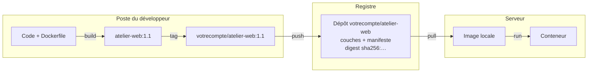
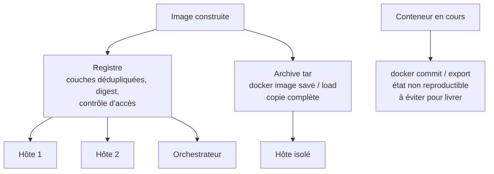
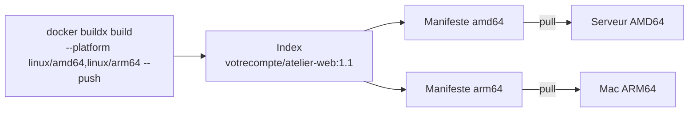

# Versionner et publier une image

> **En une phrase.** Une image ne se modifie jamais : chaque changement produit une **nouvelle image**, qu'on nomme par un **tag** lisible, qu'on identifie par son **digest** et qu'on distribue par un **registre** (ou, à défaut, par une archive).

---

## 1. Synthèse

### Le modèle mental : le trajet d'une image

```
 POSTE DU DÉVELOPPEUR                      REGISTRE                         SERVEUR
 code + Dockerfile                         (Docker Hub, GHCR, privé…)
      │ docker build -t atelier-web:1.1 .
      ▼
 image locale atelier-web:1.1
      │ docker image tag … votrecompte/atelier-web:1.1
      ▼
 votrecompte/atelier-web:1.1 ── docker push ──►  couches + manifeste  ── docker pull ──►  image locale
                                                 digest sha256:…                              │ docker run
                                                                                               ▼
                                                                                           conteneur
```

Le serveur n'a besoin **ni du Dockerfile, ni des sources** : il récupère l'image toute faite.

### Reconstruire, jamais modifier en place

| Situation | Ce qu'il faut faire |
|---|---|
| Le code ou les dépendances changent | **construire une nouvelle image**, sous un nouveau tag (`atelier-web:1.1`) |
| L'ancienne version doit rester disponible | rien : `atelier-web:1.0` reste utilisable tant que l'image est conservée |
| Des conteneurs tournent sur l'ancienne image | les **recréer** à partir de la nouvelle référence : un build ne met à jour aucun conteneur existant |
| On veut juste un autre nom pour la même image | `docker image tag` : aucune nouvelle image n'est produite |

### Version déclarée et identité cryptographique

| | Tag (`1.1`) | Digest (`sha256:…`) |
|---|---|---|
| Ce qu'il communique | une **intention** de versionnement, lisible dans les commandes et les déploiements | l'**identité exacte** du contenu publié |
| Peut-on republier dessous ? | oui, un autre contenu peut prendre le même tag | non, par construction |
| Rôle | organiser | vérifier, retrouver, déployer à l'identique |

Les deux sont **complémentaires**. Pour une traçabilité renforcée :
- conserver le Dockerfile et les sources dans **Git** ;
- associer chaque tag d'image à une **révision** du projet ;
- **relever le digest** de l'artefact publié.

### Une politique de tags qui tient la route

| Type de tag | Exemple | Règle |
|---|---|---|
| Version précise, **immuable** | `1.2.0` | jamais réécrit |
| Révision du code | `sha-1a2b3c4` | relie l'image au commit Git |
| Tags **mobiles** | `1.2`, `latest` | pratiques en test, à éviter pour la production |
| Production | `atelier-web@sha256:…` | on déploie **par digest** |

Idéalement, les images de livraison sont construites par l'intégration continue à partir d'un commit étiqueté, puis signées et accompagnées de leur inventaire de composants (SBOM) : voir [Sécurité des images](Securite-des-images.md).

### Les registres

| Registre | Forme de la référence | Remarque |
|---|---|---|
| Docker Hub | `votrecompte/atelier-web:1.1` (`docker.io/` implicite) | registre par défaut, dépôts publics ou privés |
| GitHub Container Registry | `ghcr.io/compte/atelier-web:1.1` | lié aux dépôts GitHub |
| GitLab Container Registry | `registry.gitlab.com/groupe/projet/atelier-web:1.1` | lié aux projets GitLab |
| Registres des clouds | Amazon ECR, Azure Container Registry, Google Artifact Registry | intégrés aux droits du fournisseur |
| Registre auto-hébergé | `registry.example.org/equipe/atelier-web:1.1` | image `registry`, ou Harbor pour un usage d'entreprise |

Le **nom de l'image contient le registre** : c'est la référence qui décide où `push` envoie et où `pull` cherche.

### Publier : trois commandes

| Commande | Effet | Ce qu'elle ne fait pas |
|---|---|---|
| `docker image tag atelier-web:1.1 votrecompte/atelier-web:1.1` | prépare une référence qui désigne le dépôt cible | ne reconstruit pas, n'envoie rien |
| `docker login` | ouvre une session auprès du registre ciblé (Docker Hub par défaut) | ne donne pas de droits sur un dépôt qu'on ne possède pas |
| `docker push votrecompte/atelier-web:1.1` | transfère les objets nécessaires ; les couches déjà présentes dans le registre ne sont pas renvoyées | ne publie pas les autres tags (sauf `--all-tags`) |

### Plusieurs plateformes sous une même référence

Un build local ordinaire produit une image pour **la plateforme de l'environnement de build**. Pour publier `linux/amd64` et `linux/arm64` sous un même tag, Buildx construit les deux variantes et pousse un **index multi-plateforme**. Une image locale mono-plateforme et une référence multi-plateforme publiée **ne sont pas le même artefact** (voir [Les couches d'une image](Couches-d-une-image.md) pour la structure index et manifestes).

### Distribuer sans registre

| Méthode | Ce qu'on transporte | Usage |
|---|---|---|
| **Registre** (`push` / `pull`) | couches dédupliquées, adressées par digest, avec contrôle d'accès ; chaque hôte ne tire que ce qui lui manque | le cas normal, indispensable dès qu'il y a plusieurs hôtes ou un orchestrateur |
| **Archive d'image** (`docker image save` / `docker image load`) | une copie **complète** de l'image (couches, configuration, tags) dans un fichier tar | environnement isolé sans accès au registre ; à transporter et vérifier à la main |
| **Copie d'un conteneur** (`docker commit`, `docker export`) | l'état d'un conteneur, avec sa couche inscriptible (fichiers temporaires, journaux, éventuels secrets) | à éviter pour livrer : non reproductible, sans lien avec le Dockerfile ; `export` perd en plus les couches et la configuration |

### Ce que la reproductibilité exige réellement

Avoir un Dockerfile **ne garantit pas** que deux builds produisent exactement les mêmes octets. Le résultat dépend de :
- la version réelle de l'image de base (un tag peut avoir bougé) ;
- les fichiers du contexte et les dépendances téléchargées ;
- les commandes sensibles au temps ou au réseau (`apt-get update`, dates, téléchargements) ;
- la plateforme cible et les outils de construction.

Fixer la base par digest et maîtriser les dépendances améliorent la traçabilité. Les mises à jour de sécurité, elles, restent à **organiser explicitement**.

### À chaque opération son objet

| Opération | Résultat principal |
|---|---|
| `pull` | image récupérée depuis un registre |
| `inspect` | informations sur une image existante |
| `build` | image produite à partir d'une recette et d'un contexte |
| `tag` | nouvelle référence vers une image |
| `push` | image publiée dans un registre |
| `run` | nouvelle instance de conteneur |
| `image rm` | référence locale retirée, parfois données libérées |

**L'image est distribuée ; le conteneur est exécuté.**

### Les distinctions à conserver

| Notion | Ce qu'elle désigne |
|---|---|
| Dockerfile | les instructions de construction |
| Contexte | les fichiers accessibles au constructeur |
| Couche | une différence de système de fichiers, réutilisable |
| Configuration | les paramètres fournis avec l'image |
| Tag | une référence lisible et modifiable |
| Digest | l'empreinte d'un objet distribué |
| Cache de build | la réutilisation de résultats intermédiaires |

Un changement de configuration ne crée pas nécessairement une nouvelle couche de fichiers.

> [!IMPORTANT]
> **Les pièges à retenir**
> 1. **Reconstruire ne met à jour aucun conteneur.** Il faut recréer les instances à partir de la nouvelle référence.
> 2. **`docker image tag` ne crée pas de version.** Deux tags sur le même identifiant désignent la même image ; une vraie version se construit à partir de sources modifiées.
> 3. **Un tag peut être republié.** Pour savoir ce qui tourne vraiment, relever et comparer les **digests**, pas les noms.
> 4. **`push` publie tout ce que contiennent les couches**, y compris un fichier sensible copié par erreur. Une fois l'image tirée par d'autres, on ne peut plus la rappeler.
> 5. **Nettoyer le poste n'efface pas le registre**, et supprimer un tag dans le registre ne supprime pas les copies déjà tirées.
> 6. **`<empreinte réelle>` n'est pas une valeur à taper telle quelle** : un digest se copie depuis le registre ou depuis `docker image inspect`.

---

## 2. Cas d'usage classiques

### Cas 1 : construire la version 2 et faire tourner les deux

**Besoin.** Modifier la réponse du service, sans perdre la version en production.

Dans `app.py` :

```python
body = b"Bonjour depuis Docker - version 2 !\n"
```

```bash
docker build -t atelier-web:1.1 .
docker image ls atelier-web
docker run -d --rm --name v10 -p 8080:8080 atelier-web:1.0
docker run -d --rm --name v11 -p 8081:8080 atelier-web:1.1
curl http://localhost:8080      # Bonjour depuis Docker !
curl http://localhost:8081      # Bonjour depuis Docker - version 2 !
docker stop v10 v11
```

**Ce qu'on observe.** Si le contenu a changé et que le build a abouti, `atelier-web:1.0` et `atelier-web:1.1` ont **deux identifiants distincts**. Les deux versions tournent côte à côte, sur deux ports.
**À retenir.** Le conteneur `v10` lancé avant le build est resté en version 1 : une nouvelle construction ne touche pas aux instances existantes.

### Cas 2 : distinguer un nouveau tag d'une nouvelle version

```bash
docker image tag demo/web-php:1.0 demo/web-php:1.1
docker image inspect demo/web-php:1.0 demo/web-php:1.1 demo/web-php:1.2 \
  --format '{{.RepoTags}} {{.Id}} créée={{.Created}}'
```

Sur un poste de test :

```
[demo/web-php:1.0 demo/web-php:1.1] sha256:4fd5873fe2f1… créée=2026-10-26T14:08:27
[demo/web-php:1.0 demo/web-php:1.1] sha256:4fd5873fe2f1… créée=2026-10-26T14:08:27
[demo/web-php:1.2]                  sha256:14bc3e8a8c5f… créée=2026-10-26T14:21:57
```

**Ce qu'on observe.** `1.0` et `1.1` ont le même identifiant et la même date : le tag n'a produit **aucun nouveau contenu**, juste une étiquette de plus. `1.2`, construite après une modification du code, a un autre identifiant, une autre date et une dernière couche différente.
**Une subtilité réelle.** Sur ce même poste (magasin d'images containerd), reconstruire `1.0` entièrement depuis le cache a quand même changé son identifiant (`bb86b090…` puis `4fd5873f…`). L'identifiant local y est le digest de l'index, qui inclut l'**attestation de provenance** générée par BuildKit à chaque build. Même contenu de fichiers, autre empreinte : ce qu'on compare doit être défini avec précision.

### Cas 3 : publier sur Docker Hub

```bash
docker image tag atelier-web:1.1 votrecompte/atelier-web:1.1
docker login                                   # identifiant + jeton d'accès personnel
docker push votrecompte/atelier-web:1.1
docker buildx imagetools inspect votrecompte/atelier-web:1.1
```

**Ce qu'on observe.** `votrecompte` doit être remplacé par un identifiant Docker Hub réel, avec les droits sur le dépôt correspondant. Pendant le `push`, les couches que le registre possède déjà (ici, toutes celles de `python:3.13-slim-bookworm`) ne sont pas renvoyées. `imagetools inspect` affiche ensuite le digest du manifeste ou de l'index publié et les plateformes disponibles.
**Côté destinataire.**

```bash
docker pull votrecompte/atelier-web:1.1                                  # par tag
docker pull votrecompte/atelier-web@sha256:<empreinte réelle>            # exactement cet objet
```

L'empreinte se copie depuis la sortie de `imagetools inspect` : `<empreinte réelle>` n'est pas une valeur à exécuter telle quelle.

### Cas 4 : s'entraîner avec un registre local

**Besoin.** Tester le cycle complet `tag`, `push`, `pull` sans compte en ligne.

```bash
docker run -d --name registre -p 127.0.0.1:5000:5000 registry:2
docker image tag atelier-web:1.1 localhost:5000/atelier-web:1.1
docker push localhost:5000/atelier-web:1.1
curl http://localhost:5000/v2/_catalog                     # {"repositories":["atelier-web"]}
curl http://localhost:5000/v2/atelier-web/tags/list        # {"name":"atelier-web","tags":["1.1"]}
docker image rm localhost:5000/atelier-web:1.1
docker pull localhost:5000/atelier-web:1.1
docker rm -f registre
```

**Ce qu'on observe.** Le préfixe `localhost:5000/` suffit à changer de registre : c'est le nom qui décide de la destination. Docker accepte `localhost` sans TLS ; tout autre registre doit présenter un certificat valide.
**À retenir.** Le registre ne fait que stocker et servir : aucun conteneur `atelier-web` n'y a tourné.

### Cas 5 : publier pour AMD64 et ARM64

**Besoin.** Une partie de l'équipe travaille sur Mac ARM64, les serveurs sont en AMD64.

```bash
docker buildx build --platform linux/amd64,linux/arm64 \
  -t votrecompte/atelier-web:1.1 --push .
docker buildx imagetools inspect votrecompte/atelier-web:1.1      # deux plateformes listées
```

**Ce qu'on observe.** Buildx construit une variante par plateforme, puis pousse un index qui les référence. Chaque machine qui tire `votrecompte/atelier-web:1.1` reçoit la variante de son architecture.
**Prérequis.** Un constructeur capable de produire les plateformes demandées (nœuds natifs, ou émulation QEMU installée sur l'hôte) et un accès en écriture au registre. Les deux variantes n'ont **ni les mêmes couches ni le même digest de manifeste** : pour comparer deux images, comparer le même niveau (index avec index, manifeste avec manifeste de la même plateforme).

### Cas 6 : transporter une image sans registre

**Besoin.** Livrer une image sur un serveur isolé, sans accès à Internet ni au registre.

```bash
docker image save -o web-php.tar demo/web-php:1.1
ls -lh web-php.tar                          # 172M
tar -tf web-php.tar | head -4               # blobs/sha256/…  (format OCI)
# … copie du fichier (clé USB, scp), puis sur la machine cible :
docker image load -i web-php.tar            # Loaded image: demo/web-php:1.1
```

**Ce qu'on observe.** Sur un poste de test, l'archive fait 172 Mo au format OCI (un dossier `blobs/sha256/` d'objets adressés par leur empreinte). Après `docker image rm` puis `docker image load`, l'image revient avec **le même identifiant** : elle est transférable sans son conteneur ni son Dockerfile d'origine.
**À retenir.** L'archive est une copie complète, sans déduplication : elle se transporte et se vérifie à la main (empreinte du fichier). On peut la compresser (`docker image save demo/web-php:1.1 | gzip > web-php.tar.gz`), `load` sait la relire. À ne pas confondre avec `docker export`, qui aplatit le système de fichiers d'un **conteneur** et perd la configuration.

### Cas 7 : relier une image publiée à son code source

**Besoin.** Six mois plus tard, retrouver de quel commit provient l'image qui tourne en production.

```bash
GIT_SHA=$(git rev-parse --short HEAD)
docker build \
  --label org.opencontainers.image.revision=$GIT_SHA \
  -t votrecompte/atelier-web:1.1.0 \
  -t votrecompte/atelier-web:sha-$GIT_SHA .
docker push --all-tags votrecompte/atelier-web
docker image inspect votrecompte/atelier-web:1.1.0 --format '{{json .RepoDigests}}'   # digest à consigner
```

**Ce qu'on observe.** L'image porte trois repères : un tag de version, un tag de commit, une étiquette `revision` lisible par `docker image inspect`. Le digest relevé après le `push` est celui qu'on inscrit dans le fichier de déploiement.
**À retenir.** Version déclarée (tag), lien vers le code (étiquette, tag de commit) et identité cryptographique (digest) répondent à trois questions différentes : « quelle version ? », « quel code ? », « quel contenu exact ? ».

---

## 3. Idées de schémas

### Schéma A : du code au serveur



À souligner : la flèche entre le poste et le serveur ne transporte **que l'image**, jamais le Dockerfile ni les sources.

### Schéma B : le tag bouge, le digest reste

Une frise horizontale avec trois dates. À chaque date, une boîte image avec son digest (`sha256:aaa…`, `sha256:bbb…`, `sha256:ccc…`). Une étiquette « `1.1` » est accrochée à la première boîte, puis décrochée et raccrochée à la deuxième (republication). L'étiquette « `latest` » saute de boîte en boîte. Les digests, eux, ne quittent jamais leur boîte. Légende : « un fichier de déploiement qui cite un digest désigne toujours la même boîte ».

### Schéma C : trois façons de distribuer



### Schéma D : une référence, deux architectures



---

## 4. Script de motion design : « Du code au serveur » (environ 75 s)

Style : trois zones fixes de gauche à droite (poste, registre, serveur), une seule couleur d'accent pour l'image qui voyage, des étiquettes de tag en papier et un tampon « sha256 » pour le digest.

| Séq. | Durée | À l'écran | Animation | Texte à l'écran |
|---|---|---|---|---|
| 1 | 0-8 s | Zone « poste » : un dossier de code et un Dockerfile | Ils fusionnent en une boîte « image » ; une étiquette `atelier-web:1.1` s'accroche | « build : du code et une recette, on obtient une image. » |
| 2 | 8-16 s | Une deuxième étiquette `votrecompte/atelier-web:1.1` s'ajoute sur la même boîte | La boîte ne bouge pas, ne grossit pas | « tag : un nom de plus, pas une image de plus. » |
| 3 | 16-28 s | La boîte se décompose en couches qui partent vers le registre | Les couches de base sont déjà dans le registre : elles « rebondissent » et restent sur le poste ; seule la couche du code traverse | « push : on n'envoie que ce que le registre n'a pas encore. » |
| 4 | 28-36 s | Dans le registre, l'image se reconstitue ; un tampon `sha256:…` s'imprime dessus | Le tampon s'appuie avec un léger écrasement | « Le registre stocke et attribue une empreinte : le digest. » |
| 5 | 36-48 s | Zone « serveur » vide, sans Dockerfile ni code | Les couches manquantes descendent du registre et s'empilent ; la boîte se lance en conteneur (elle s'allume) | « pull, puis run : le serveur n'a besoin que de l'image. » |
| 6 | 48-58 s | Retour sur le poste : le code change, nouvelle boîte `1.2` | Le conteneur du serveur reste en `1.1`, il ne clignote pas | « Une nouvelle image ne met à jour aucun conteneur : il faut le recréer. » |
| 7 | 58-68 s | Dans le registre, l'étiquette `latest` passe de `1.1` à `1.2` | Le tampon `sha256` de chaque boîte reste en place | « Le tag peut changer de cible. Le digest, jamais. » |
| 8 | 68-75 s | Synthèse : les quatre verbes alignés sur le trajet | `build`, `tag`, `push`, `pull`/`run` s'allument successivement | « Construire. Nommer. Publier. Exécuter ailleurs. » |

**Conseil de réalisation.** La séquence 3 porte l'idée la plus utile en pratique (la déduplication des couches) : rendre visible que les couches de base ne traversent pas, par exemple avec un petit « déjà présent » au-dessus d'elles. Garder la zone serveur volontairement vide de tout fichier source pendant la séquence 5.

---

## 5. Vérifier soi-même

```bash
# Prérequis : l'image atelier-web:1.0 construite dans la page précédente
docker run -d --name registre -p 127.0.0.1:5000:5000 registry:2
docker image tag atelier-web:1.0 localhost:5000/atelier-web:1.0
docker image ls | grep atelier-web                       # même ID pour les deux noms
docker push localhost:5000/atelier-web:1.0
docker image inspect localhost:5000/atelier-web:1.0 --format '{{json .RepoDigests}}'
curl http://localhost:5000/v2/atelier-web/tags/list
docker image save -o atelier.tar atelier-web:1.0 && ls -lh atelier.tar
docker rm -f registre && rm atelier.tar
```

Questions à se poser : le digest affiché après le `push` est-il égal à l'identifiant local ? Que se passe-t-il si l'on pousse de nouveau la même image (combien de couches sont envoyées) ?

## Voir aussi

- [Accueil du wiki](../README.md)
- Page précédente : [Contexte de build, cache et .dockerignore](Contexte-de-build-et-cache.md)
- Page suivante : [Réseaux Docker et publication de ports](Reseaux-et-ports.md)

> [!NOTE]
> **Et ensuite ?** On sait maintenant construire et distribuer un environnement applicatif identifié. Une application réelle a souvent besoin de **plusieurs services qui communiquent**, de **données conservées hors des conteneurs** et de **paramètres de réseau et d'exécution coordonnés**. C'est l'objet de la partie suivante : [réseaux](Reseaux-et-ports.md), [stockage](Stockage-et-volumes.md) et [Docker Compose](Docker-Compose.md).
