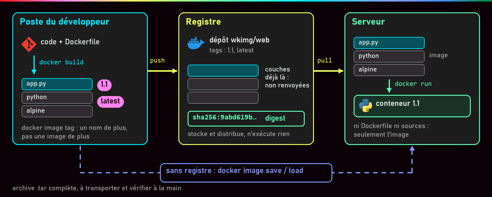
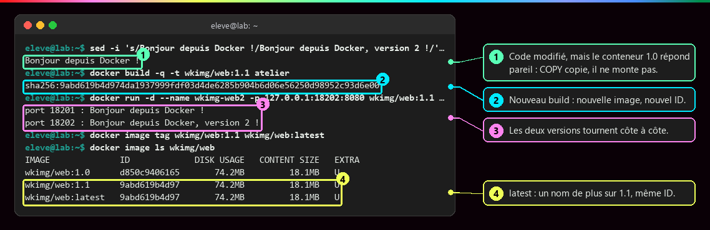
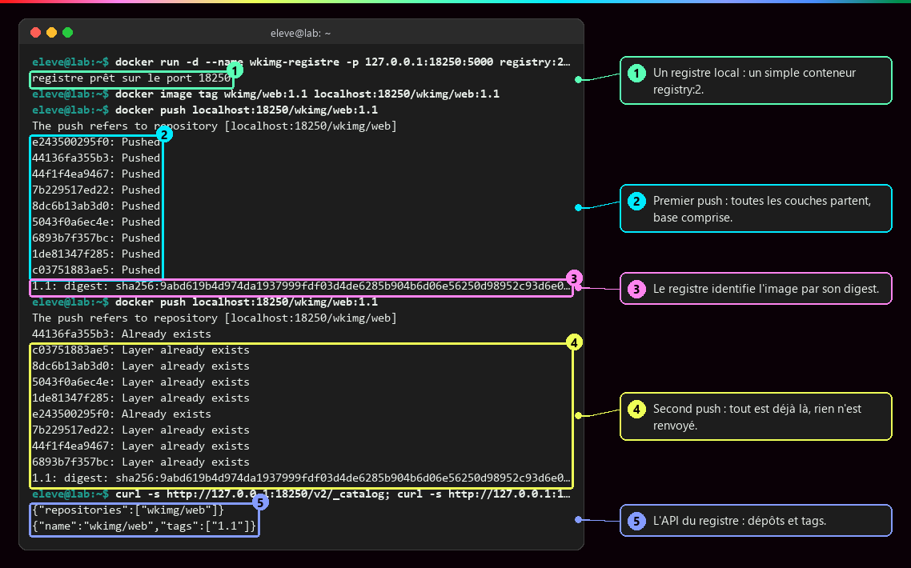
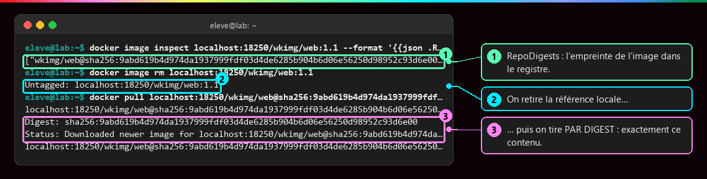
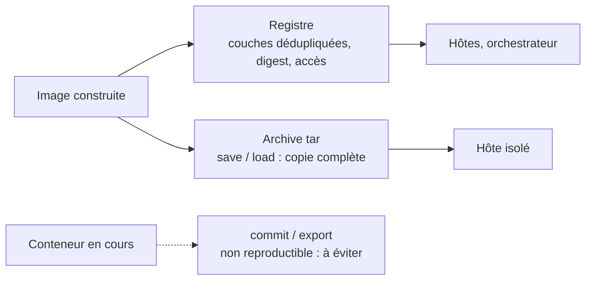
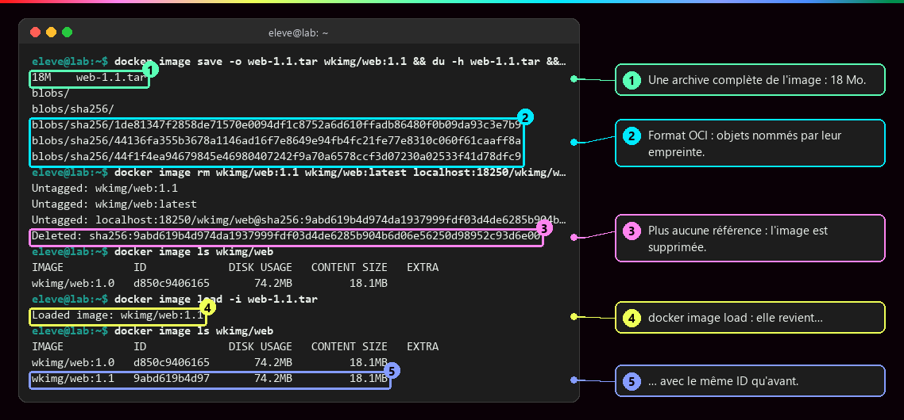

# Versionner et publier une image

<p class="lead">Une image ne se modifie jamais : chaque changement produit une <strong>nouvelle image</strong>, nommée par un <strong>tag</strong>, identifiée par son <strong>digest</strong> et distribuée par un <strong>registre</strong> (ou, à défaut, par une archive).</p>

{ .hero }

!!! abstract "Dans cette page"

    **Tu vas comprendre :**

    - pourquoi modifier ton code ne change rien aux conteneurs qui tournent déjà ;
    - comment nommer tes versions pour savoir toujours ce qui tourne ;
    - comment envoyer une image vers un registre, puis la récupérer sur une autre machine.

    **Prérequis :** [Écrire un Dockerfile](Ecrire-un-Dockerfile.md) (tu réutilises son image `atelier:1.0`) et [Les couches d'une image](Couches-d-une-image.md) pour le tag et le digest. **Durée :** 30 min. **Niveau :** débutant.

!!! quote "En clair"

    Pense à un **livre imprimé**. On ne corrige pas les exemplaires déjà vendus : on imprime une **nouvelle édition**, avec un nouveau numéro. Le **registre**, c'est l'entrepôt qui stocke les éditions et les envoie à qui les demande. Limite de l'image : l'étiquette d'une image (le tag) peut être recollée sur une autre édition, ce qui n'arrive pas à un numéro d'édition. C'est pour cela qu'on vérifie aussi l'**empreinte** (le digest).

    { .anim }

## L'essentiel en 30 secondes

<div class="grid cards" markdown>

-   :material-source-branch:{ .lg .middle } __Reconstruire__

    ---

    Code modifié : **nouvelle image**, nouveau tag. Aucun conteneur existant n'est mis à jour.

-   :material-tag-multiple-outline:{ .lg .middle } __Nommer__

    ---

    `docker image tag` ajoute un nom, pas une version. Le tag dit « quelle version ? ».

-   :material-fingerprint:{ .lg .middle } __Identifier__

    ---

    Le digest dit « quel contenu exact ? ». En production, on déploie **par digest**.

-   :material-cloud-upload-outline:{ .lg .middle } __Distribuer__

    ---

    `push` puis `pull` : le serveur n'a besoin ni du Dockerfile ni du code source.

</div>

!!! warning "À retenir"

    **Reconstruire ne met à jour aucun conteneur** : il faut les recréer. **Un tag peut être republié** : pour savoir ce qui tourne vraiment, on compare des digests. **`push` publie tout ce que contiennent les couches**, y compris un fichier copié par erreur, et on ne peut pas reprendre une image que d'autres ont déjà téléchargée.

## :material-source-branch: Une nouvelle version, c'est une nouvelle image

| Situation | Ce qu'il faut faire |
|---|---|
| Le code ou les dépendances changent | **construire** une nouvelle image, sous un nouveau tag |
| L'ancienne version doit rester disponible | rien : `1.0` reste utilisable tant que l'image est conservée |
| Des conteneurs tournent sur l'ancienne | les **recréer** à partir de la nouvelle |
| On veut juste un autre nom | `docker image tag` : aucune image produite |

???+ example "En vrai : 1.0 et 1.1 côte à côte"

    **Ce qu'on fait :** un conteneur tourne sur l'image `1.0`. On change le texte dans `app.py`, on construit `1.1`, on la lance à côté, puis on ajoute le nom `latest` à `1.1`.

    

    **Ce qu'il faut regarder :**

    - ① : le code est modifié, mais le conteneur `1.0` répond comme avant : `COPY` a recopié le code au build, il ne le suit pas.
    - ② : le nouveau build produit une nouvelle image, avec un nouvel identifiant.
    - ③ : les deux versions tournent côte à côte, chacune sur son port.
    - ④ : `latest` n'est qu'un nom de plus sur `1.1` : même identifiant.

## :material-tag-multiple-outline: Une politique de tags

!!! quote "En clair"

    Un tag, c'est un **marque-page** : tu peux le déplacer. Certains doivent rester fixes (`1.2.0`, la version exacte), d'autres sont faits pour bouger (`latest`, « la plus récente »). Pour désigner un contenu sans ambiguïté, on utilise l'empreinte, le digest.

    { .anim }

| Type | Exemple | Règle |
|---|---|---|
| Version précise, **immuable** | `1.2.0` | jamais réécrit |
| Révision du code | `sha-1a2b3c4` | relie l'image à la version du code dans Git |
| Tags **mobiles** | `1.2`, `latest` | pratiques en test, à éviter en production |
| Production | `web@sha256:…` | on déploie **par digest** |

Pour savoir d'où vient chaque image : le Dockerfile et le code dans **Git** (l'outil qui garde l'historique du code), chaque tag relié à une **révision** de Git, et le **digest** noté après la publication.

```bash
GIT_SHA=$(git rev-parse --short HEAD)                                  # (1)!
docker build --label org.opencontainers.image.revision=$GIT_SHA \
  -t compte/web:1.1.0 -t compte/web:sha-$GIT_SHA .                     # (2)!
docker push --all-tags compte/web                                      # (3)!
```

1. Récupère l'identifiant court de la version actuelle du code dans Git, par exemple `1a2b3c4`.
2. Construit une seule image, qui porte une étiquette avec cette révision et **deux** tags : la version et la révision. Le `\` en fin de ligne continue la commande sur la ligne suivante.
3. Publie tous les tags du dépôt `compte/web`.

Version (tag), lien vers le code (étiquette, tag de révision) et identité (digest) répondent à trois questions : « quelle version ? », « quel code ? », « quel contenu exact ? ». Idéalement, l'intégration continue construit, signe et joint un inventaire (SBOM) : voir [Sécurité des images](Securite-des-images.md).

## :material-cloud-upload-outline: Publier dans un registre

!!! quote "En clair"

    Le registre est une **bibliothèque d'images** : on y dépose (`push`), on y emprunte (`pull`). Il ne fait rien tourner. Et comme sur une adresse postale, c'est le **nom de l'image** qui dit dans quelle bibliothèque elle va.

    { .anim }

| Registre | Nom de l'image |
|---|---|
| Docker Hub (par défaut) | `compte/web:1.1` |
| GitHub, GitLab | `ghcr.io/compte/web:1.1`, `registry.gitlab.com/groupe/projet/web:1.1` |
| Clouds | Amazon ECR, Azure Container Registry, Google Artifact Registry |
| Sur ton propre serveur | `registry.example.org/equipe/web:1.1` (image `registry`, ou Harbor) |

???+ example "En vrai : un registre local, deux push"

    **Ce qu'on fait :** on démarre un registre sur la machine, simple conteneur `registry:2`. On donne à l'image un nom qui commence par l'adresse de ce registre, on la publie deux fois, puis on interroge le registre.

    

    **Ce qu'il faut regarder :**

    - ① : le registre est un simple conteneur.
    - ② : au premier `push`, toutes les couches partent, celles de la base comprises.
    - ③ : le registre répond avec le digest de l'image : c'est sous cette empreinte qu'il la range.
    - ④ : au second `push`, tout existe déjà : rien n'est renvoyé. Les couches sont reconnues à leur empreinte.
    - ⑤ : l'API du registre (son interface web pour les programmes) liste les dépôts et les tags.

    Docker accepte un registre sur `localhost` sans chiffrement ; tout autre registre doit présenter un certificat TLS valide. Pour Docker Hub : `docker login` (identifiant et jeton d'accès personnel), puis `docker push compte/web:1.1`. Le registre n'a fait que stocker : aucun conteneur `web` n'y a tourné.

???+ example "En vrai : tirer exactement ce contenu"

    **Ce qu'on fait :** on relève le digest de l'image publiée, on retire son nom local, puis on la retélécharge en donnant le digest au lieu du tag.

    

    **Ce qu'il faut regarder :**

    - ① : `RepoDigests` donne l'empreinte de l'image dans le registre.
    - ② : on retire la référence locale…
    - ③ : … puis on télécharge **par digest** : on obtient exactement ce contenu, même si le tag a bougé entre-temps.

    Un digest se **copie** depuis le registre ou `docker image inspect`. Un `<empreinte réelle>` écrit dans une documentation n'est pas une valeur à taper telle quelle.

## :material-package-variant-closed: Sans registre : l'archive



???+ example "En vrai : `save`, tout supprimer, `load`"

    **Ce qu'on fait :** on enregistre l'image dans un fichier d'archive (`tar`), on supprime l'image, puis on la recharge depuis l'archive.

    

    **Ce qu'il faut regarder :**

    - ① : une archive complète de l'image, 18 Mo.
    - ② : dedans, au format standard OCI, des fichiers nommés par leur empreinte.
    - ③ : plus aucun nom ne pointe vers l'image : elle est supprimée (`Deleted`).
    - ④ : `docker image load` la fait revenir…
    - ⑤ : … avec le même identifiant qu'avant (celui de la ligne ③).

    L'archive se transporte (clé USB, copie par `scp`) vers une machine sans accès au registre ; `docker image save … | gzip` la compresse, et `load` sait la relire. À ne pas confondre avec `docker export`, qui aplatit les fichiers d'un **conteneur** et perd la configuration.

## :material-flask-outline: À toi de jouer

!!! tip "Pratique sans rien installer : le lab interactif"

    Une **machine Docker simulée** à gauche, le **tutoriel pas à pas** à droite, et Conti, le robot du lab, pour te dire quoi observer avant chaque commande. Chaque option est expliquée, tu vois ce que tu dois obtenir, et chaque étape se valide toute seule. Tu ne peux rien casser.

    [:material-console: Ouvrir le lab interactif](labs/publier.md){ .md-button .md-button--primary target="_blank" rel="noopener" }

**Sur ton poste**, le même lab pas à pas :

Six étapes, environ 15 minutes. Il te faut le dossier `atelier` et l'image `atelier:1.0` de la page [Écrire un Dockerfile](Ecrire-un-Dockerfile.md) : si tu ne les as plus, refais ses étapes 1 et 2. Place-toi dans le dossier : `cd atelier`.

**Étape 1 · Lancer la version 1.0, puis modifier le code**

```bash
docker run -d --name web -p 127.0.0.1:8080:8080 atelier:1.0                       # (1)!
sed -i 's/Bonjour depuis Docker !/Bonjour depuis Docker, version 2 !/' app.py     # (2)!
curl http://127.0.0.1:8080                                                        # (3)!
```

1. Démarre un conteneur `web` sur la version 1.0.
2. `sed -i` modifie le fichier sur place : il remplace le texte de la réponse. Tu peux aussi le faire à la main dans un éditeur.
3. Interroge le conteneur, **après** la modification.

Tu dois voir l'identifiant du conteneur (le tien sera différent), puis l'**ancien** texte :

```text
d712164ca6c5d9efed1bbe986875083255e1e6c92762c98d3a1e2cdcf96aa231
Bonjour depuis Docker !
```

**Étape 2 · Construire la version 1.1 et la lancer à côté**

```bash
docker build -q -t atelier:1.1 .                                  # (1)!
docker run -d --name web2 -p 127.0.0.1:8081:8080 atelier:1.1      # (2)!
curl http://127.0.0.1:8080; curl http://127.0.0.1:8081            # (3)!
docker image ls atelier                                           # (4)!
```

1. Construit une **nouvelle** image avec le code modifié, sous le tag `1.1`. `-q` n'affiche que son identifiant.
2. Un second conteneur, `web2`, sur le port 8081 de ta machine.
3. Interroge les deux, l'un après l'autre (`;` enchaîne deux commandes).
4. Liste tes images `atelier`.

Tu dois voir deux réponses différentes, et deux images avec deux identifiants différents (les tiens seront différents) :

```text
sha256:e097545272d0367a9499dad55ebbf6a208240eba0e1b0fd72b6bc87c9008de54
5b11cbf16fd2596d444be1f50954fa8d731e5453101857d3f12aeb89fd978fb8
Bonjour depuis Docker !
Bonjour depuis Docker, version 2 !
IMAGE         ID             DISK USAGE   CONTENT SIZE   EXTRA
atelier:1.0   547a15591fd6       74.2MB         18.1MB   U
atelier:1.1   e097545272d0       74.2MB         18.1MB   U
```

**Étape 3 · Démarrer un registre et nommer l'image pour lui**

```bash
docker run -d --name registre -p 127.0.0.1:5000:5000 registry:2                                     # (1)!
docker image tag atelier:1.1 localhost:5000/atelier:1.1                                             # (2)!
docker image ls --filter reference=atelier:1.1 --filter reference=localhost:5000/atelier:1.1        # (3)!
```

1. Lance l'image officielle `registry:2` : un vrai registre, joignable sur le port 5000 de ta machine.
2. Ajoute un nom qui **commence par l'adresse du registre** : c'est lui qui dira à `push` où envoyer.
3. Liste les deux noms.

Tu dois voir deux noms et le **même** identifiant : `tag` n'a rien copié.

```text
IMAGE                         ID             DISK USAGE   CONTENT SIZE   EXTRA
localhost:5000/atelier:1.1    e097545272d0       74.2MB         18.1MB   U
atelier:1.1                   e097545272d0       74.2MB         18.1MB   U
```

**Étape 4 · Publier, deux fois**

```bash
docker push localhost:5000/atelier:1.1   # (1)!
docker push localhost:5000/atelier:1.1   # (2)!
```

1. Envoie l'image vers le registre désigné par son nom.
2. Recommence, sans rien changer.

Au premier envoi, tu dois voir chaque morceau de l'image marqué `Pushed`, puis le digest (des lignes `Waiting` ou `Preparing` peuvent s'afficher pendant l'envoi ; tes empreintes seront différentes) :

```text
The push refers to repository [localhost:5000/atelier]
44136fa355b3: Pushed
7b229517ed22: Pushed
6893b7f357bc: Pushed
bc3bda4835eb: Pushed
44f1f4ea9467: Pushed
8dc6b13ab3d0: Pushed
5043f0a6ec4e: Pushed
1de81347f285: Pushed
c03751883ae5: Pushed
1.1: digest: sha256:e097545272d0367a9499dad55ebbf6a208240eba0e1b0fd72b6bc87c9008de54 size: 856
```

Au second envoi, tout existe déjà : rien ne part.

```text
The push refers to repository [localhost:5000/atelier]
7b229517ed22: Layer already exists
6893b7f357bc: Layer already exists
1de81347f285: Layer already exists
44136fa355b3: Already exists
8dc6b13ab3d0: Layer already exists
c03751883ae5: Layer already exists
5043f0a6ec4e: Layer already exists
bc3bda4835eb: Already exists
44f1f4ea9467: Layer already exists
1.1: digest: sha256:e097545272d0367a9499dad55ebbf6a208240eba0e1b0fd72b6bc87c9008de54 size: 856
```

**Étape 5 · Vérifier ce que contient le registre**

```bash
curl http://127.0.0.1:5000/v2/atelier/tags/list                          # (1)!
docker image inspect -f '{{json .RepoDigests}}' localhost:5000/atelier:1.1   # (2)!
```

1. Demande au registre, par son API, les tags du dépôt `atelier`.
2. Affiche les digests connus pour cette image.

Tu dois voir le tag `1.1`, puis le digest, le même que celui annoncé par `push` :

```text
{"name":"atelier","tags":["1.1"]}
["atelier@sha256:e097545272d0367a9499dad55ebbf6a208240eba0e1b0fd72b6bc87c9008de54","localhost:5000/atelier@sha256:e097545272d0367a9499dad55ebbf6a208240eba0e1b0fd72b6bc87c9008de54"]
```

Sur un autre poste, `docker pull localhost:5000/atelier@sha256:e0975…` (le digest complet) récupérerait exactement ce contenu.

**Étape 6 · Faire le ménage**

```bash
docker rm -f -v web web2 registre                                      # (1)!
docker image rm atelier:1.0 atelier:1.1 localhost:5000/atelier:1.1     # (2)!
cd .. && rm -rf atelier                                                # (3)!
```

1. Arrête et supprime les trois conteneurs. `-v` supprime aussi le volume anonyme où le registre rangeait les images publiées ; sans lui, ce volume resterait sur le disque.
2. Retire les trois noms ; l'image n'est supprimée (`Deleted`) qu'au dernier nom retiré.
3. Supprime le dossier de travail.

Tu dois voir :

```text
web
web2
registre
Untagged: atelier:1.0
Deleted: sha256:547a15591fd604550792a2fe270ea11bbce68e631041052aec933a94204b957e
Untagged: atelier:1.1
Untagged: localhost:5000/atelier:1.1
Deleted: sha256:e097545272d0367a9499dad55ebbf6a208240eba0e1b0fd72b6bc87c9008de54
```

??? tip "Ça ne marche pas ?"

    | Message | Cause | Solution |
    |---|---|---|
    | `No such image: atelier:1.0` | l'image de la page précédente a été supprimée | refais les étapes 1 et 2 de [Écrire un Dockerfile](Ecrire-un-Dockerfile.md) |
    | `Bind for 127.0.0.1:5000 failed: port is already allocated` | le port 5000 est déjà pris (sur macOS, souvent par AirPlay) | utilise un autre port, par exemple `-p 127.0.0.1:5001:5000`, et remplace `localhost:5000` par `localhost:5001` partout |
    | `dial tcp 127.0.0.1:5000: connect: connection refused` | le registre n'est pas démarré | `docker ps --filter name=registre`, puis relance l'étape 3 |
    | `Conflict. The container name "/web" is already in use` | un conteneur `web` existe encore | `docker rm -f web` puis recommence |
    | `curl` répond toujours l'ancien texte sur 8081 | `app.py` n'a pas été modifié avant le build | vérifie avec `cat app.py`, puis reconstruis `1.1` et recrée `web2` |

## :material-help-circle-outline: Vérifie que tu as compris

??? question "1. Tu corriges un bug et tu reconstruis sous le même tag `atelier:1.0`. Le conteneur qui tourne déjà profite-t-il de la correction ?"

    **Non.** Le conteneur reste attaché à l'image avec laquelle il a été créé. Le tag `1.0` désigne maintenant une autre image, mais il faut **recréer** le conteneur pour en profiter. Et réutiliser un tag de version brouille l'historique : mieux vaut un nouveau tag (`1.0.1`).

??? question "2. Au second `push`, rien n'est renvoyé. Comment le registre sait-il qu'il a déjà tout ?"

    Chaque couche est identifiée par son **empreinte** (son digest). Avant d'envoyer, Docker demande au registre s'il connaît déjà cette empreinte ; si oui, il n'envoie rien. C'est aussi pour cela que les couches d'une base commune ne voyagent qu'une fois.

??? question "3. En production, pourquoi déployer `web@sha256:…` plutôt que `web:1.1` ?"

    Parce qu'un tag peut être **republié** et désigner demain un autre contenu. Le digest est l'empreinte du contenu : il garantit que tous les serveurs font tourner exactement la même image, et qu'on peut le vérifier.

!!! success "Et ensuite ?"

    Tu sais construire, nommer, publier et retrouver une image : la partie images du parcours est terminée. Page suivante : [Réseaux et ports](Reseaux-et-ports.md), pour faire communiquer tes conteneurs entre eux et avec l'extérieur.

## :material-server: Pour aller plus loin

??? note "Même contenu, autre identifiant ?"

    Avec le magasin d'images containerd, l'ID local est le digest de l'**index**, qui inclut l'attestation de provenance générée par BuildKit à chaque build. Reconstruire entièrement depuis le cache peut donc changer l'ID alors que les fichiers sont identiques. Ce qu'on compare doit être défini avec précision.

??? note "Publier pour AMD64 et ARM64"

    Un build ordinaire produit une image pour **la plateforme du poste**. Pour un même tag sur Mac ARM64 et serveurs AMD64 :

    ```bash
    docker buildx build --platform linux/amd64,linux/arm64 -t compte/web:1.1 --push .
    docker buildx imagetools inspect compte/web:1.1     # deux plateformes listées
    ```

    Buildx pousse un **index** qui référence un manifeste par plateforme (voir [Les couches d'une image](Couches-d-une-image.md)). Il faut un constructeur capable de produire les deux (nœuds natifs ou émulation QEMU).

??? note "Ce que la reproductibilité exige vraiment"

    Un Dockerfile ne garantit pas deux builds identiques au bit près : la base référencée par tag a pu bouger, les dépendances téléchargées aussi, des commandes dépendent du temps ou du réseau (`apt-get update`, dates), et la plateforme cible compte. Fixer la base par digest et figer les dépendances améliorent la traçabilité ; les mises à jour de sécurité restent à **organiser**.

??? abstract "Pour les créateurs : script de motion design (75 s)"

    Trois zones fixes (poste, registre, serveur), une seule couleur d'accent pour l'image qui voyage, des étiquettes de tag en papier, un tampon « sha256 » pour le digest.

    | Séq. | Durée | À l'écran | Animation | Texte à l'écran |
    |---|---|---|---|---|
    | 1 | 0-8 s | Poste : un dossier de code et un Dockerfile | Ils fusionnent en une boîte « image » ; une étiquette `web:1.1` s'accroche | « build : du code et une recette, on obtient une image. » |
    | 2 | 8-16 s | Une deuxième étiquette `compte/web:1.1` sur la même boîte | La boîte ne bouge pas, ne grossit pas | « tag : un nom de plus, pas une image de plus. » |
    | 3 | 16-28 s | La boîte se décompose en couches vers le registre | Les couches de base, déjà présentes, rebondissent ; seule la couche du code traverse | « push : on n'envoie que ce que le registre n'a pas. » |
    | 4 | 28-36 s | Dans le registre, l'image se reconstitue ; un tampon `sha256:…` s'imprime | Léger écrasement du tampon | « Le registre stocke, l'empreinte identifie : le digest. » |
    | 5 | 36-48 s | Serveur vide, sans Dockerfile ni code | Les couches manquantes descendent et s'empilent ; la boîte s'allume en conteneur | « pull, puis run : le serveur n'a besoin que de l'image. » |
    | 6 | 48-58 s | Le code change sur le poste : nouvelle boîte `1.2` | Le conteneur du serveur reste en `1.1` | « Une nouvelle image ne met à jour aucun conteneur : il faut le recréer. » |
    | 7 | 58-68 s | Dans le registre, `latest` passe de `1.1` à `1.2` | Les tampons `sha256` restent en place | « Le tag peut changer de cible. Le digest, jamais. » |
    | 8 | 68-75 s | Synthèse | `build`, `tag`, `push`, `pull`/`run` s'allument | « Construire. Nommer. Publier. Exécuter ailleurs. » |

    La séquence 3 porte l'idée la plus utile (la déduplication des couches) : un petit « déjà présent » au-dessus des couches qui ne traversent pas.

??? info "Pour les créateurs : idées de schémas"

    - **Le tag bouge, le digest reste** : une frise à trois dates, une boîte par date avec son digest (`sha256:aaa…`, `bbb…`, `ccc…`). L'étiquette `1.1` est décrochée puis raccrochée (republication), `latest` saute de boîte en boîte ; les digests ne quittent jamais leur boîte.
    - **Une référence, deux architectures** : `docker buildx build --platform linux/amd64,linux/arm64 --push` vers un index, puis un manifeste par plateforme, tiré l'un par un serveur AMD64, l'autre par un Mac ARM64.
    - **Chaque opération, son objet** : `pull` (image récupérée), `inspect` (informations), `build` (image produite), `tag` (référence ajoutée), `push` (image publiée), `run` (conteneur créé), `image rm` (référence retirée). L'image est distribuée ; le conteneur est exécuté.
