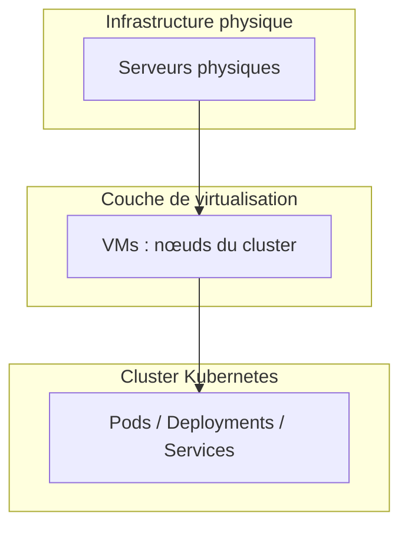
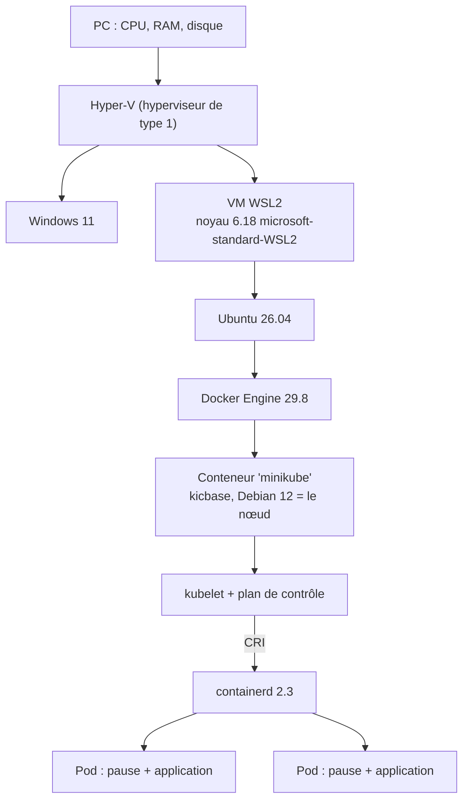
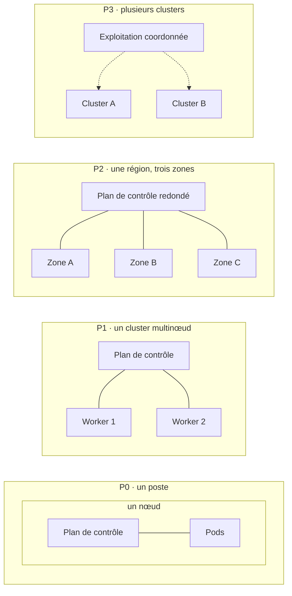

# Virtualisation et orchestration : les couches

> **En une phrase.** Virtualisation, conteneurisation et orchestration ne sont pas des technologies concurrentes mais des **couches qui s'empilent** : la virtualisation découpe le matériel en machines, la conteneurisation isole les applications sur ces machines, et l'orchestration pilote l'ensemble selon un état désiré.

---

## 1. Synthèse

### Le modèle mental : la pile

```
  ┌─────────────────────────────────────────────┐
  │ ORCHESTRATION   Kubernetes                  │  pilote : état désiré, scaling, résilience
  │   ┌─────────┐ ┌─────────┐ ┌─────────┐       │
  │   │conteneur│ │conteneur│ │conteneur│       │  CONTENEURISATION : isole les processus
  │   └─────────┘ └─────────┘ └─────────┘       │  (containerd, Docker, LXC)
  │ ┌─────────────────┐   ┌─────────────────┐   │
  │ │  VM = nœud 1    │   │  VM = nœud 2    │   │  VIRTUALISATION : découpe le matériel
  │ └─────────────────┘   └─────────────────┘   │  (KVM, VMware, Hyper-V)
  │            serveurs physiques               │  MATÉRIEL : CPU, RAM, disque, réseau
  └─────────────────────────────────────────────┘
```

Trois formules à retenir :
- **Virtualisation** = fondation matérielle abstraite.
- **Conteneurisation** = unité d'exécution logique.
- **Orchestration** = pilotage global et automatisé.

### La complémentarité des couches

| Niveau | Technologie | Rôle principal | Exemples |
|---|---|---|---|
| **Matériel** | Virtualisation | isoler des systèmes d'exploitation complets, répartir CPU et RAM | KVM, VMware, Hyper-V |
| **Système** | Conteneurisation | isoler les processus applicatifs sur un noyau partagé | Docker, LXC, containerd |
| **Application** | Orchestration | maintenir l'état désiré, mettre à l'échelle, résister aux pannes | Kubernetes |

Autrement dit : la virtualisation opère au niveau de l'**infrastructure** (elle découple le matériel du logiciel), la conteneurisation au niveau du **processus** (elle isole une application et ses dépendances), l'orchestration au niveau du **système applicatif** (elle décrit et maintient un état désiré). Une infrastructure cloud-native les combine dans cet ordre : virtualisation, puis conteneurisation, puis orchestration. La différence entre VM et conteneur est détaillée dans [Machine virtuelle ou conteneur](Machine-virtuelle-ou-conteneur.md).

### Kubernetes peut s'appuyer sur la virtualisation, sans l'exiger

Kubernetes a besoin de **nœuds** : des machines Linux (ou Windows) qui exécutent un kubelet et un moteur de conteneurs. Ces nœuds peuvent être des serveurs physiques (on parle de *bare metal*), mais sont **souvent des VM**, car la virtualisation apporte trois choses :

| Apport | Concrètement |
|---|---|
| **Isolation matérielle** | chaque nœud, plan de contrôle ou worker, a son propre système et son propre noyau |
| **Gestion des ressources physiques** | CPU, RAM, disque et réseau sont attribués à chaque nœud par l'hyperviseur |
| **Flexibilité** | créer ou supprimer des nœuds selon la charge, migrer des charges de travail, allouer dynamiquement les ressources |

### Selon l'environnement

| Environnement | Ce qu'est un nœud |
|---|---|
| **Poste de travail** (Minikube) | une **VM** ou un **conteneur**, selon le *driver* choisi |
| **Fournisseur cloud** | presque toujours une **VM** : AWS EC2, GCP Compute Engine, Azure VM, OpenStack… |
| **Centre de données sur site** | une VM (VMware, Proxmox, KVM) ou un serveur physique |

### L'élasticité : deux mécanismes distincts

| Mécanisme | Ce qu'il ajuste | Couche | Outil |
|---|---|---|---|
| Autoscaling des **pods** | le nombre de réplicas d'une application | orchestration | **HPA** (Horizontal Pod Autoscaler) ; **VPA** pour les ressources d'un pod |
| Autoscaling des **nœuds** | le nombre de machines du cluster | virtualisation | **Cluster Autoscaler** (ou équivalent du fournisseur), qui crée et détruit des VM |

La virtualisation facilite aussi la **migration à chaud** des VM sur certaines plateformes (déplacer un nœud d'un serveur physique à un autre sans l'arrêter) et la **répartition des ressources** matérielles sans redéployer tout le cluster. Ces mécanismes ne sont **pas automatiques** : il faut les installer et les configurer.

### Du poste de travail à la production : quatre paliers

Ces repères sont des **scénarios pédagogiques**, pas des catégories officielles de Kubernetes ni des étapes obligatoires : un seul cluster peut suffire durablement s'il répond au besoin. Vocabulaire : le **plan de contrôle** (*control plane*) pilote le cluster, les **nœuds de travail** (*workers*) exécutent les pods.

| Palier | Situation | Apport | Limite |
|---|---|---|---|
| **P0** · apprentissage local | un cluster Minikube sur un poste ; dans l'exemple à un nœud, plan de contrôle et applications partagent ce nœud | manipuler un vrai cluster avec peu de moyens | si le poste s'arrête, tout le cluster s'arrête ; plusieurs nœuds Minikube sur le même poste n'y changent rien |
| **P1** · cluster multinœud | un plan de contrôle commun, des workers sur plusieurs machines, éventuellement regroupés en **pools de nœuds** (workers aux caractéristiques communes, regroupement facultatif) | plus de capacité, applications réparties | plusieurs workers ne font pas la haute disponibilité : plan de contrôle et dépendances communes restent des points de panne ; **deux VM sur le même serveur physique tombent ensemble** |
| **P2** · haute disponibilité dans une région | plan de contrôle redondé, workers répartis sur des **domaines de panne** distincts (par exemple des zones de disponibilité) | limiter l'impact d'une panne de machine ou de zone | la disponibilité dépend aussi du placement des réplicas, de la capacité restante, du réseau et des données ; des pools spécialisés (calcul, entrées-sorties) répondent à la charge, pas à la redondance |
| **P3** · plusieurs clusters | chaque cluster a son plan de contrôle, ses workers et son état ; aucun ne contrôle l'autre | séparer les périmètres, préparer une reprise sur un autre cluster ou une autre région | les clusters ne répliquent pas les données et ne basculent pas le trafic d'eux-mêmes : la continuité demande une stratégie explicite et des tests |

Un service managé (EKS, GKE, AKS…) peut prendre en charge le plan de contrôle à partir de P1, sans que ce soit obligatoire. Chaque palier répond à un besoin, et **chaque palier ajoute des responsabilités d'exploitation**.

### Minikube ou production : mêmes mécanismes, autres exigences

| Domaine | Apprendre et développer avec Minikube | Kubernetes en production |
|---|---|---|
| Infrastructure | un ou plusieurs nœuds sur le poste | capacité et disponibilité adaptées au service |
| Réseau et accès | tester Services, Ingress et règles réseau | maîtriser l'exposition, le DNS et les certificats |
| Stockage | données de test, souvent locales | persistance, sauvegardes et restauration |
| Sécurité | expérimenter les droits et l'isolation | moindre privilège, protection des Secrets |
| Images | construire et tester les images | déployer des versions identifiées et contrôlées |
| Supervision | observer et diagnostiquer avec journaux et métriques | surveiller le service et traiter les alertes |
| Déploiements | essayer les manifestes et les mises à jour | automatiser, tracer, prévoir le retour arrière |

La **préproduction** valide une version dans un environnement représentatif de la cible. Minikube aide le développeur à préparer cette validation, mais ne reproduit ni la disponibilité, ni la charge, ni l'intégration de la production.

### Le vocabulaire minimal de la production

| Thème | Termes |
|---|---|
| Nœuds | **node pool** (groupe de machines de même gabarit), **Cluster Autoscaler** (ajoute et retire des nœuds) |
| Réplicas et placement | **HPA** (nombre de réplicas), **VPA** (ressources des pods), **PDB** (*PodDisruptionBudget* : nombre minimal de pods à garder pendant une maintenance), **PodAntiAffinity** (éviter deux réplicas sur le même nœud) |
| Stockage | **StorageClass** et pilotes **CSI**, modes **RWO / RWX**, instantanés (*snapshots*) et sauvegardes |
| Exposition | **Ingress Controller** derrière un **LoadBalancer**, DNS externe, **cert-manager** pour les certificats |
| Sécurité | **RBAC** (droits), **NetworkPolicy** (flux réseau), **PSA** (*Pod Security Admission*), gestion des Secrets (KMS, External Secrets) |

> [!IMPORTANT]
> **Les pièges à retenir**
> 1. **« Conteneur ou VM » est un faux dilemme.** En production, les conteneurs tournent presque toujours **dans** des VM : chaque couche isole à son niveau.
> 2. **Kubernetes ne crée pas de machines.** Il place des pods sur les nœuds existants. Ajouter des nœuds relève de la couche de virtualisation (Cluster Autoscaler, fournisseur cloud).
> 3. **Plus de nœuds ne veut pas dire haute disponibilité.** Il faut des domaines de panne distincts, un plan de contrôle redondé et des réplicas bien placés.
> 4. **Plusieurs clusters ne veulent pas dire reprise automatique.** Données et trafic ne suivent pas tout seuls.
> 5. **Un cluster local reste un cluster de test**, même avec plusieurs nœuds : tout dépend d'un seul poste.

---

## 2. Cas d'usage classiques

### Cas 1 : lire l'empilement réel d'un cluster Minikube sous Windows

**Besoin.** Comprendre ce qui tourne vraiment quand on lance `minikube start` sur un PC Windows avec WSL2.

```bash
uname -r                                                       # dans la distribution WSL2
docker ps --filter name=^minikube$ --format "{{.Names}}  {{.Image}}  {{.Status}}"
kubectl get nodes -o wide
minikube ssh -- "ps aux | grep -E '[c]ontainerd|[k]ubelet ' | cut -c1-120"
minikube ssh -- "sudo crictl version"
```

**Ce qu'on observe** (poste de test : Windows 11, Ubuntu 26.04 sous WSL2, Docker Engine 29.8, Minikube 1.39 avec le driver Docker, Kubernetes 1.37) :

| Couche | Ce qu'on trouve | Technologie |
|---|---|---|
| Matériel | le PC | CPU, RAM, disque |
| Hyperviseur | Hyper-V, activé par WSL2 | virtualisation |
| VM | la VM légère de WSL2, noyau `6.18.33.2-microsoft-standard-WSL2` | virtualisation |
| Système | la distribution Ubuntu 26.04 dans cette VM | |
| Moteur de conteneurs | Docker Engine 29.8 | conteneurisation |
| Nœud Kubernetes | **un conteneur** Docker `minikube` (image `gcr.io/k8s-minikube/kicbase:v0.0.51`, Debian 12) | conteneurisation |
| Agent du nœud et runtime | dans ce conteneur : le **kubelet** v1.37 et **containerd** 2.3.4, joint par la CRI (*Container Runtime Interface*) | orchestration et conteneurisation |
| Pods | un processus `containerd-shim-runc-v2` par pod, puis les conteneurs lancés par runc | conteneurisation |

**À retenir.** Même sur un portable, les trois couches sont présentes : une VM (WSL2), deux niveaux de conteneurs (le nœud dans Docker, les pods dans containerd) et Kubernetes. Docker ne sert ici qu'à **héberger** le nœud : ce sont le kubelet et containerd qui exécutent les pods. Hyper-V est un hyperviseur de type 1 : une fois activé, Windows lui-même tourne au-dessus de lui.

### Cas 2 : constater qu'un nœud conteneur n'a pas de noyau à lui

```bash
kubectl get nodes -o custom-columns=NOM:.metadata.name,OS:.status.nodeInfo.osImage,NOYAU:.status.nodeInfo.kernelVersion,RUNTIME:.status.nodeInfo.containerRuntimeVersion
```

```
NOM        OS                               NOYAU                               RUNTIME
minikube   Debian GNU/Linux 12 (bookworm)   6.18.33.2-microsoft-standard-WSL2   containerd://2.3.4
```

**Ce qu'on observe.** Le nœud annonce un système **Debian 12**, mais le noyau de **WSL2**. C'est l'isolation logique en action : le conteneur nœud a son propre système de fichiers, mais partage le noyau de la VM WSL2, comme tous les conteneurs (voir [Isolation des conteneurs](Isolation-des-conteneurs.md)). Avec un driver VM, la colonne NOYAU montrerait le noyau propre de cette VM.

### Cas 3 : choisir le driver de Minikube

```bash
minikube start --driver=docker          # nœud = conteneur (rapide, léger)
minikube start -p vm --driver=kvm2      # nœud = VM KVM sous Linux
minikube start -p vm --driver=hyperv    # nœud = VM Hyper-V sous Windows
```

| Critère | Driver conteneur (`docker`, `podman`) | Driver VM (`kvm2`, `hyperv`, `virtualbox`, `qemu`…) |
|---|---|---|
| Démarrage | quelques secondes | plus long (démarrage d'un système complet) |
| Mémoire | faible | une VM entière à réserver |
| Noyau du nœud | celui de l'hôte | le sien |
| Accès réseau au nœud | dépend de la plateforme (tunnel parfois nécessaire) | IP de la VM |
| Fidélité à un vrai nœud | moindre | plus proche d'un nœud de production |

**À retenir.** Le choix du driver, c'est le choix de la couche d'isolation du **nœud** : conteneur ou VM. Kubernetes, au-dessus, se comporte de la même façon.

### Cas 4 : distinguer l'élasticité des pods et celle des nœuds

**Besoin.** Absorber un pic de charge sur l'application `web`.

```bash
minikube addons enable metrics-server                         # nécessaire au HPA
kubectl autoscale deployment web --cpu-percent=70 --min=2 --max=10
kubectl get hpa
```

**Ce qu'on observe.** Quand l'utilisation CPU moyenne dépasse 70 % des `requests`, le HPA augmente `replicas`. Mais si les nœuds sont pleins, les nouveaux pods restent `Pending`, et `kubectl describe pod` affiche un événement du type `0/1 nodes are available: 1 Insufficient cpu`.
**À retenir.** Le HPA (couche orchestration) **demande** plus de pods ; seul un Cluster Autoscaler (couche virtualisation) peut **fournir** plus de machines, en créant des VM chez le fournisseur. Sur Minikube, il n'existe pas : la capacité est celle du poste.

### Cas 5 : répartir les réplicas sur des domaines de panne

**Besoin.** Trois réplicas ne servent à rien s'ils tombent ensemble.

```yaml
# Dans spec.template.spec du Deployment web
topologySpreadConstraints:
  - maxSkew: 1
    topologyKey: topology.kubernetes.io/zone     # label posé sur les nœuds par le fournisseur cloud
    whenUnsatisfiable: DoNotSchedule
    labelSelector:
      matchLabels: { app: web }
```

**Ce qu'on observe.** Le scheduler place les réplicas dans des zones différentes, à un pod d'écart au plus.
**À retenir.** Kubernetes ne voit que les **labels** des nœuds. Si deux VM « de zones différentes » tournent en réalité sur le même serveur physique, la contrainte est respectée sur le papier et inutile en pratique : la redondance se conçoit **dans toutes les couches**.

### Cas 6 : simuler un cluster multinœud sur un poste

```bash
minikube start -p multi --nodes 3 --driver=docker
kubectl get nodes                       # multi, multi-m02, multi-m03
docker ps --filter name=multi           # trois conteneurs sur le même poste
minikube delete -p multi
```

**Ce qu'on observe.** Trois nœuds pour Kubernetes, qui sont trois conteneurs Docker sur **une seule** machine.
**À retenir.** Utile pour voir le scheduler répartir des pods ou tester une `PodAntiAffinity`. Inutile pour la disponibilité : le poste reste le domaine de panne unique (palier P0, pas P1).

### Cas 7 : Kubernetes sans virtualisation (bare metal)

**Besoin.** Des calculs intensifs, des GPU, ou la volonté d'éviter le coût de l'hyperviseur.
**Ce que ça implique.** Les nœuds sont des serveurs physiques, installés par exemple avec `kubeadm`. On gagne en performance brute, mais on perd la flexibilité de la couche VM : ajouter un nœud, c'est installer un serveur ; pas de migration à chaud ; pas de LoadBalancer fourni (il faut une solution comme MetalLB).
**À retenir.** La virtualisation n'est pas une obligation de Kubernetes, c'est une **facilité d'exploitation**.

---

## 3. Idées de schémas

### Schéma A : les trois couches (version du cours)



### Schéma B : la pile réelle d'un Minikube sous Windows



Variante graphique : une tour de blocs colorés (gris matériel, bleu virtualisation, vert conteneurisation, violet orchestration), avec à droite une accolade par couche.

### Schéma C : les quatre paliers côte à côte

Quatre vignettes de gauche à droite, même légende (cadre = limite d'un poste, d'un cluster ou d'une région ; trait entre plan de contrôle et workers = relation de gestion, pas trajet des requêtes) :



### Schéma D : deux boucles d'élasticité


---

## 4. Script de motion design : « De la machine au conteneur » (environ 75 s)

Style : fond sombre, construction verticale de bas en haut, comme un jeu de construction. Gris pour le matériel, bleu pour la virtualisation, vert pour les conteneurs, violet pour l'orchestration.

| Séq. | Durée | À l'écran | Animation | Texte à l'écran |
|---|---|---|---|---|
| 1 | 0-7 s | Un serveur physique gris, avec ses jauges CPU, RAM, disque | Le serveur se pose au sol, les jauges se remplissent | « Tout part du matériel. » |
| 2 | 7-17 s | Une fine dalle bleue « hyperviseur » sur le serveur | La dalle découpe le serveur en trois blocs bleus « VM », chacun avec un petit noyau | « La virtualisation découpe le matériel en machines complètes. » |
| 3 | 17-27 s | Dans chaque VM, de petites boîtes vertes | Les boîtes apparaissent en grappe ; un trait les relie au noyau de **leur** VM | « La conteneurisation isole les applications sur le noyau de chaque machine. » |
| 4 | 27-37 s | Un chef d'orchestre violet au-dessus des trois VM | Il pointe une VM : un conteneur s'y éteint et réapparaît dans une autre VM | « L'orchestration décide où chaque conteneur tourne et le remplace s'il tombe. » |
| 5 | 37-47 s | Une jauge « charge » monte | D'abord de nouvelles boîtes vertes apparaissent (HPA), puis les VM sont pleines et une quatrième VM bleue glisse depuis le bord (Cluster Autoscaler) | « Deux élasticités : plus de pods, puis plus de machines. » |
| 6 | 47-57 s | Deux VM posées sur le même serveur physique | Le serveur s'éteint : les deux VM et tous leurs conteneurs s'éteignent ensemble | « Deux VM sur le même serveur tombent ensemble. » |
| 7 | 57-68 s | Zoom sur un portable : la même tour se construit en miniature | Couches étiquetées : PC, Hyper-V, VM WSL2, Docker, conteneur « minikube », containerd, pods | « Même sur un portable, toutes les couches sont là. » |
| 8 | 68-75 s | Les trois couleurs empilées avec leur rôle | Les trois mots s'écrivent de bas en haut | « Fondation. Exécution. Pilotage. » |

**Conseil de réalisation.** La séquence 7 est la plus surprenante pour le public : prendre le temps d'empiler **chaque** couche une par une, en marquant l'imbrication « conteneur dans un conteneur » (le nœud Minikube, puis les pods dedans) par un effet de poupées russes.

---

## 5. Vérifier soi-même

```bash
uname -r                                            # noyau de la machine qui héberge Docker
minikube profile list                               # driver, runtime, nombre de nœuds
kubectl get nodes -o wide                           # OS-IMAGE et KERNEL-VERSION du nœud
docker ps --filter name=minikube                    # avec le driver docker : le nœud est un conteneur
minikube ssh -- "sudo crictl ps | head -5"          # les conteneurs des pods, vus depuis le nœud
minikube ssh -- "sudo ctr namespaces ls"            # k8s.io : le namespace containerd de Kubernetes
```

## Voir aussi

- [Accueil du wiki](../README.md)
- Page précédente : [De Compose aux manifestes Kubernetes](De-Compose-a-Kubernetes.md)
- Dernière page du plan. Pour reprendre au début : [Du monolithe aux microservices](Du-monolithe-aux-microservices.md)
- Sur la différence entre VM et conteneur : [Machine virtuelle ou conteneur](Machine-virtuelle-ou-conteneur.md)
- Sur le besoin d'orchestration : [Pourquoi orchestrer ?](Pourquoi-orchestrer.md)
