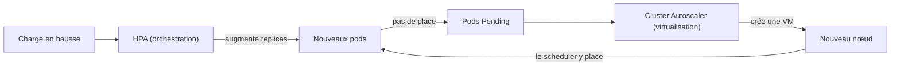

# Virtualisation et orchestration

<p class="lead">Virtualisation, conteneurisation et orchestration ne sont pas des technologies concurrentes mais des <strong>couches qui s'empilent</strong> : la première découpe le matériel en machines, la deuxième isole les applications sur ces machines, la troisième pilote l'ensemble selon un état désiré.</p>

{ .hero }

## L'essentiel en 30 secondes

<div class="grid cards" markdown>

-   :material-server:{ .lg .middle } __Virtualisation · la fondation__

    ---

    Découpe le matériel en machines complètes, chacune avec son noyau. KVM, VMware, Hyper-V.

-   :material-docker:{ .lg .middle } __Conteneurisation · l'exécution__

    ---

    Isole les processus d'une application sur le noyau **partagé** d'une machine. containerd, Docker, LXC.

-   :material-kubernetes:{ .lg .middle } __Orchestration · le pilotage__

    ---

    Place les pods sur les nœuds, maintient l'état désiré, remplace ce qui tombe. Kubernetes.

-   :material-alert-outline:{ .lg .middle } __Le piège · Kubernetes ne crée pas de machines__

    ---

    Il place des pods sur les nœuds **existants**. Ajouter des nœuds relève de la couche virtualisation.

</div>

!!! warning "À retenir"

    **« Conteneur ou VM » est un faux dilemme.** En production, les conteneurs tournent presque toujours **dans** des VM, et chaque couche isole à son niveau (voir [Machine virtuelle ou conteneur](Machine-virtuelle-ou-conteneur.md)). Et plus de nœuds ne veut pas dire haute disponibilité : deux VM sur le même serveur physique tombent ensemble.

## :material-layers-triple-outline: Trois couches, même sur un portable

| Niveau | Technologie | Rôle principal |
|---|---|---|
| **Infrastructure** | virtualisation | isoler des systèmes complets, répartir CPU et RAM |
| **Processus** | conteneurisation | isoler une application et ses dépendances sur un noyau partagé |
| **Système applicatif** | orchestration | maintenir l'état désiré, mettre à l'échelle, résister aux pannes |

Sur le poste de test (Windows 11, Ubuntu 26.04 sous WSL2, Docker Engine 29.8, Minikube 1.39 avec le driver Docker, Kubernetes 1.37), on retrouve les trois.

???+ example "En vrai : la VM, puis le nœud qui est un conteneur"

    

    La VM légère de WSL2 tourne sur Hyper-V, hyperviseur de type 1 : une fois activé, Windows lui-même tourne au-dessus de lui (Minikube affiche d'ailleurs `kvm/amd64` : il se sait dans une VM). Dans cette VM, Docker héberge **un conteneur** : c'est le nœud Kubernetes.

???+ example "En vrai : un nœud sans noyau à lui"

    

    Le nœud a son propre système de fichiers (Debian 12), mais partage le noyau de la VM, comme tout conteneur (voir [Isolation d'un conteneur](Isolation-des-conteneurs.md)). Avec un driver VM, la colonne NOYAU montrerait le noyau propre de cette VM.

???+ example "En vrai : dans le nœud, kubelet et containerd"

    

    Docker ne sert qu'à **héberger** le nœud : ce sont le kubelet et **son propre** containerd qui exécutent les pods, reliés par la CRI (*Container Runtime Interface*). D'où les deux niveaux de conteneurs : le nœud dans Docker, les pods dans containerd.

## :material-server-network: Un nœud : une VM, un conteneur ou un serveur

Kubernetes a besoin de **nœuds** qui exécutent un kubelet et un moteur de conteneurs. Ce sont souvent des VM, car la virtualisation apporte isolation matérielle, répartition des ressources et flexibilité (créer ou supprimer des nœuds, migrer à chaud sur certaines plateformes).

| Environnement | Ce qu'est un nœud |
|---|---|
| **Poste** (Minikube) | une VM ou un conteneur, selon le *driver* |
| **Cloud** | presque toujours une VM : AWS EC2, GCP Compute Engine, Azure VM, OpenStack… |
| **Sur site** | une VM (VMware, Proxmox, KVM) ou un serveur physique |

??? note "Choisir le driver de Minikube"

    ```bash
    minikube start --driver=docker          # nœud = conteneur (rapide, léger)
    minikube start -p vm --driver=kvm2      # nœud = VM KVM sous Linux
    minikube start -p vm --driver=hyperv    # nœud = VM Hyper-V sous Windows
    ```

    | Critère | Driver conteneur (`docker`, `podman`) | Driver VM (`kvm2`, `hyperv`, `virtualbox`, `qemu`…) |
    |---|---|---|
    | Démarrage | quelques secondes | plus long (un système complet) |
    | Mémoire | faible | une VM entière à réserver |
    | Noyau du nœud | celui de l'hôte | le sien |
    | Accès réseau au nœud | selon la plateforme (tunnel parfois nécessaire) | IP de la VM |
    | Fidélité à un vrai nœud | moindre | plus proche de la production |

    Le choix du driver, c'est le choix de la couche d'isolation du **nœud**. Kubernetes, au-dessus, se comporte pareil.

??? note "Kubernetes sans virtualisation (bare metal)"

    Pour du calcul intensif, des GPU ou éviter le coût de l'hyperviseur, les nœuds peuvent être des serveurs physiques (installés par exemple avec `kubeadm`). On gagne en performance brute, mais on perd la flexibilité : ajouter un nœud, c'est installer un serveur ; pas de migration à chaud ; pas de LoadBalancer fourni (il faut par exemple MetalLB). La virtualisation n'est pas une obligation de Kubernetes, c'est une **facilité d'exploitation**.

## :material-arrow-expand-all: Deux élasticités, deux couches

| Mécanisme | Ce qu'il ajuste | Couche | Outil |
|---|---|---|---|
| Autoscaling des **pods** | le nombre de réplicas | orchestration | **HPA** ; **VPA** pour les ressources d'un pod |
| Autoscaling des **nœuds** | le nombre de machines | virtualisation | **Cluster Autoscaler** (ou équivalent du fournisseur), qui crée et détruit des VM |



```bash
minikube addons enable metrics-server                         # nécessaire au HPA
kubectl autoscale deployment web --cpu-percent=70 --min=2 --max=10
kubectl get hpa
```

Au-delà de 70 % des `requests` CPU en moyenne, le HPA **demande** plus de pods. Si les nœuds sont pleins, ils restent `Pending` (`kubectl describe pod` affiche un événement du type `0/1 nodes are available: 1 Insufficient cpu`). Sur Minikube, aucun Cluster Autoscaler : la capacité est celle du poste, comme le montre `kubectl top nodes` plus haut. Ces mécanismes ne sont **pas automatiques** : il faut les installer et les configurer.

## :material-stairs-up: Du poste à la production : quatre paliers

Des **scénarios pédagogiques**, pas des catégories officielles ni des étapes obligatoires. Le **plan de contrôle** pilote le cluster, les **workers** exécutent les pods.

| Palier | Situation | Limite |
|---|---|---|
| **P0** · un poste | un cluster Minikube, plan de contrôle et applications sur le même nœud | si le poste s'arrête, tout s'arrête, même avec plusieurs nœuds Minikube |
| **P1** · multinœud | un plan de contrôle, des workers sur plusieurs machines, en **pools** éventuels | pas de haute disponibilité : plan de contrôle et dépendances restent des points de panne |
| **P2** · HA dans une région | plan de contrôle redondé, workers sur des **domaines de panne** distincts (zones) | dépend aussi du placement des réplicas, de la capacité restante, du réseau et des données |
| **P3** · plusieurs clusters | chaque cluster a son plan de contrôle et son état ; aucun ne contrôle l'autre | données et trafic ne basculent pas seuls : stratégie explicite et tests |

Un service managé (EKS, GKE, AKS…) peut prendre en charge le plan de contrôle dès P1. Chaque palier répond à un besoin, et **ajoute des responsabilités d'exploitation**.

???+ danger "Trois réplicas qui tombent ensemble"

    ```yaml
    # Dans spec.template.spec du Deployment web
    topologySpreadConstraints:
      - maxSkew: 1
        topologyKey: topology.kubernetes.io/zone     # label posé sur les nœuds par le fournisseur
        whenUnsatisfiable: DoNotSchedule
        labelSelector: { matchLabels: { app: web } }
    ```

    Le scheduler répartit les réplicas entre zones, à un pod d'écart au plus. Mais Kubernetes ne voit que les **labels** des nœuds : si deux VM « de zones différentes » tournent sur le même serveur physique, la contrainte est respectée sur le papier et inutile en pratique. La redondance se conçoit **dans toutes les couches**.

??? note "Simuler un cluster multinœud sur un poste"

    ```bash
    minikube start -p multi --nodes 3 --driver=docker
    kubectl get nodes                       # multi, multi-m02, multi-m03
    docker ps --filter name=multi           # trois conteneurs sur le même poste
    minikube delete -p multi
    ```

    Utile pour voir le scheduler répartir des pods ou tester une `PodAntiAffinity`. Inutile pour la disponibilité : le poste reste le domaine de panne unique (palier P0, pas P1).

??? note "Minikube ou production : mêmes mécanismes, autres exigences"

    | Domaine | Apprendre avec Minikube | Kubernetes en production |
    |---|---|---|
    | Infrastructure | un ou plusieurs nœuds sur le poste | capacité et disponibilité adaptées au service |
    | Réseau et accès | tester Services, Ingress et règles réseau | maîtriser l'exposition, le DNS et les certificats |
    | Stockage | données de test, souvent locales | persistance, sauvegardes et restauration |
    | Sécurité | expérimenter les droits et l'isolation | moindre privilège, protection des Secrets |
    | Images | construire et tester | versions identifiées et contrôlées |
    | Supervision | journaux et métriques pour diagnostiquer | surveiller le service, traiter les alertes |
    | Déploiements | essayer manifestes et mises à jour | automatiser, tracer, prévoir le retour arrière |

    La **préproduction** valide une version dans un environnement représentatif de la cible ; Minikube aide à la préparer, sans reproduire ni la disponibilité, ni la charge, ni l'intégration de la production.

??? note "Le vocabulaire minimal de la production"

    | Thème | Termes |
    |---|---|
    | Nœuds | **node pool** (machines de même gabarit), **Cluster Autoscaler** |
    | Réplicas et placement | **HPA**, **VPA**, **PDB** (*PodDisruptionBudget* : pods minimum pendant une maintenance), **PodAntiAffinity** (pas deux réplicas sur le même nœud) |
    | Stockage | **StorageClass**, pilotes **CSI**, modes **RWO / RWX**, instantanés et sauvegardes |
    | Exposition | **Ingress Controller** derrière un **LoadBalancer**, DNS externe, **cert-manager** |
    | Sécurité | **RBAC**, **NetworkPolicy**, **PSA** (*Pod Security Admission*), gestion des Secrets (KMS, External Secrets) |

## :material-flask-outline: À toi de jouer

```bash
uname -r                                            # noyau de la machine qui héberge Docker
minikube profile list                               # driver, runtime, nombre de nœuds
kubectl get nodes -o wide                           # OS-IMAGE et KERNEL-VERSION du nœud
docker ps --filter name=minikube                    # avec le driver docker : le nœud est un conteneur
minikube ssh -- "sudo crictl ps | head -5"          # les conteneurs des pods, vus depuis le nœud
minikube ssh -- "sudo ctr namespaces ls"            # k8s.io : le namespace containerd de Kubernetes
```

??? abstract "Pour les créateurs : script de motion design « De la machine au conteneur » (75 s)"

    Fond sombre, construction verticale de bas en haut, comme un jeu de construction. Gris pour le matériel, bleu pour la virtualisation, vert pour les conteneurs, violet pour l'orchestration.

    | Séq. | Durée | À l'écran | Animation | Texte à l'écran |
    |---|---|---|---|---|
    | 1 | 0-7 s | Un serveur physique gris, avec ses jauges CPU, RAM, disque | Le serveur se pose au sol, les jauges se remplissent | « Tout part du matériel. » |
    | 2 | 7-17 s | Une fine dalle bleue « hyperviseur » sur le serveur | La dalle découpe le serveur en trois blocs bleus « VM », chacun avec un petit noyau | « La virtualisation découpe le matériel en machines complètes. » |
    | 3 | 17-27 s | Dans chaque VM, de petites boîtes vertes | Les boîtes apparaissent en grappe ; un trait les relie au noyau de **leur** VM | « La conteneurisation isole les applications sur le noyau de chaque machine. » |
    | 4 | 27-37 s | Un chef d'orchestre violet au-dessus des trois VM | Il pointe une VM : un conteneur s'y éteint et réapparaît dans une autre VM | « L'orchestration décide où chaque conteneur tourne et le remplace s'il tombe. » |
    | 5 | 37-47 s | Une jauge « charge » monte | D'abord de nouvelles boîtes vertes apparaissent (HPA), puis les VM sont pleines et une quatrième VM bleue glisse depuis le bord (Cluster Autoscaler) | « Deux élasticités : plus de pods, puis plus de machines. » |
    | 6 | 47-57 s | Deux VM posées sur le même serveur physique | Le serveur s'éteint : les deux VM et tous leurs conteneurs s'éteignent ensemble | « Deux VM sur le même serveur tombent ensemble. » |
    | 7 | 57-68 s | Zoom sur un portable : la même tour se construit en miniature | Couches étiquetées : PC, Hyper-V, VM WSL2, Docker, conteneur « minikube », containerd, pods | « Même sur un portable, toutes les couches sont là. » |
    | 8 | 68-75 s | Les trois couleurs empilées avec leur rôle | Les trois mots s'écrivent de bas en haut | « Fondation. Exécution. Pilotage. » |

    La séquence 7 est la plus surprenante : empiler **chaque** couche une par une, en marquant l'imbrication « conteneur dans un conteneur » (le nœud Minikube, puis les pods dedans) par un effet de poupées russes.

??? info "Pour les créateurs : idées de schémas"

    - **Les quatre paliers côte à côte** : quatre vignettes de gauche à droite, même légende (cadre = limite d'un poste, d'un cluster ou d'une région ; trait entre plan de contrôle et workers = relation de gestion, pas trajet des requêtes). P0 : un nœud qui contient plan de contrôle et pods. P1 : un plan de contrôle et deux workers. P2 : un plan de contrôle redondé et trois zones. P3 : deux clusters reliés en pointillés par une « exploitation coordonnée ».
    - **Les trois couches génériques** : serveurs physiques, puis VM (les nœuds), puis pods, Deployments et Services ; une accolade colorée par couche.
    - Trois formules à afficher : **Virtualisation** = fondation matérielle abstraite ; **Conteneurisation** = unité d'exécution logique ; **Orchestration** = pilotage global et automatisé.
