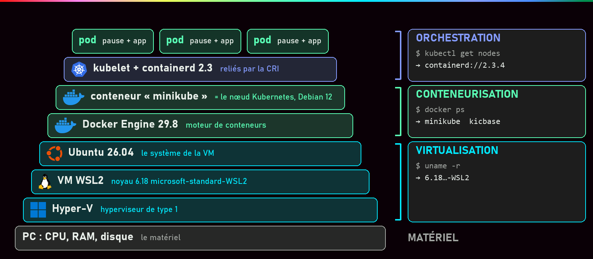
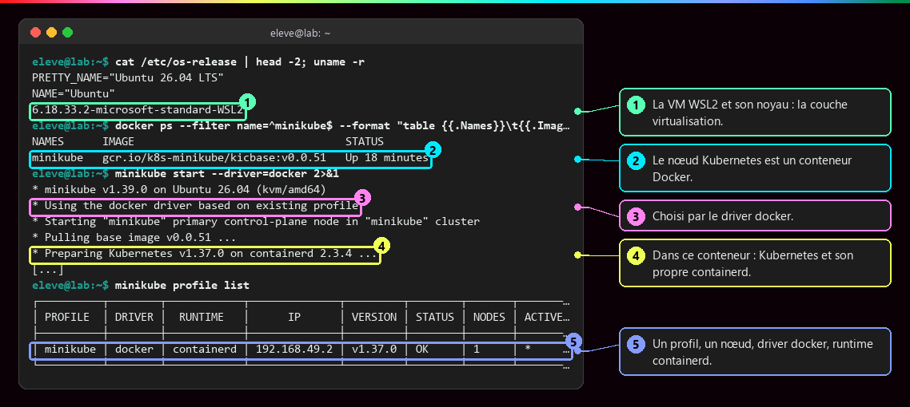
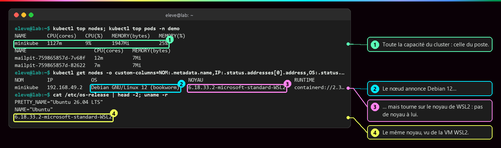
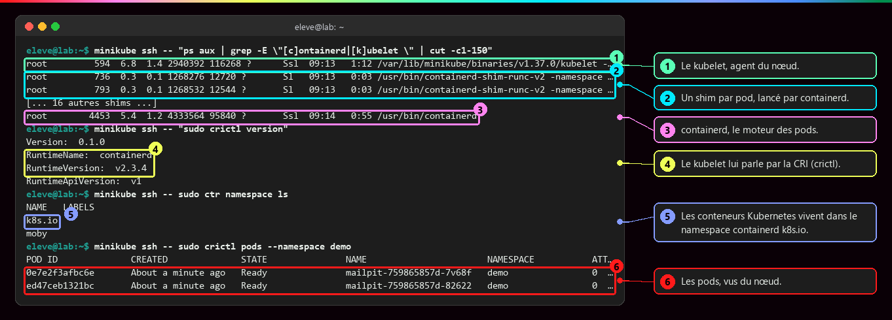
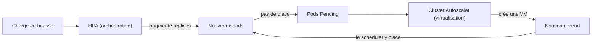

# Virtualisation et orchestration

<p class="lead">Virtualisation, conteneurisation et orchestration ne sont pas des technologies concurrentes mais des <strong>couches qui s'empilent</strong> : la première découpe le matériel en machines, la deuxième isole les applications sur ces machines, la troisième pilote l'ensemble selon un état désiré.</p>

{ .hero }

!!! abstract "Dans cette page"

    **Tu vas comprendre :**

    - pourquoi « VM ou conteneur ? » est une fausse question : en vrai, on a les deux, l'un dans l'autre ;
    - ce qu'est vraiment un « nœud » Kubernetes, y compris sur ton propre portable ;
    - pourquoi ajouter des pods ne suffit pas toujours, et qui ajoute des machines.

    **Prérequis :** [Machine virtuelle ou conteneur](Machine-virtuelle-ou-conteneur.md) et [Kubernetes : état désiré et réconciliation](Kubernetes-etat-desire.md). **Durée :** 35 min. **Niveau :** intermédiaire.

!!! quote "En clair"

    Imagine un **terrain** (le serveur physique). La **virtualisation** y construit des **bâtiments** séparés, chacun avec ses fondations (les VM et leur noyau). La **conteneurisation** découpe chaque bâtiment en **appartements** qui partagent les mêmes fondations (les conteneurs). L'**orchestration**, c'est le **syndic** : il attribue les appartements, remplace ce qui casse et en ouvre d'autres quand la demande monte. Mais le syndic ne construit pas de bâtiments : pour cela, il faut revenir à la couche du dessous.

## L'essentiel en 30 secondes

<div class="grid cards" markdown>

-   :material-server:{ .lg .middle } __Virtualisation · la fondation__

    ---

    Découpe le matériel en machines complètes, chacune avec son noyau. KVM, VMware, Hyper-V.

-   :material-docker:{ .lg .middle } __Conteneurisation · l'exécution__

    ---

    Isole les programmes d'une application sur le noyau **partagé** d'une machine. containerd, Docker, LXC.

-   :material-kubernetes:{ .lg .middle } __Orchestration · le pilotage__

    ---

    Place les pods sur les nœuds, maintient l'état désiré, remplace ce qui tombe. Kubernetes.

-   :material-alert-outline:{ .lg .middle } __Le piège · Kubernetes ne crée pas de machines__

    ---

    Il place des pods sur les nœuds **existants**. Ajouter des nœuds relève de la couche virtualisation.

</div>

!!! warning "À retenir"

    **« Conteneur ou VM » est un faux dilemme.** En production, les conteneurs tournent presque toujours **dans** des VM, et chaque couche isole à son niveau (voir [Machine virtuelle ou conteneur](Machine-virtuelle-ou-conteneur.md)). Et plus de nœuds ne veut pas dire haute disponibilité : deux VM sur le même serveur physique tombent ensemble.

## :material-layers-triple-outline: Trois couches, même sur un portable

| Niveau | Technologie | Rôle principal |
|---|---|---|
| **Infrastructure** | virtualisation | isoler des systèmes complets, répartir processeur et mémoire |
| **Processus** | conteneurisation | isoler une application et ses dépendances sur un noyau partagé |
| **Système applicatif** | orchestration | maintenir l'état désiré, mettre à l'échelle, résister aux pannes |

Sur le poste de test (Windows 11, Ubuntu 26.04 sous WSL2, Docker Engine 29.8, Minikube 1.39 avec le driver Docker, Kubernetes 1.37), on retrouve les trois. Le **driver** de Minikube est le moyen qu'il utilise pour fabriquer son nœud : une VM, ou ici un conteneur Docker.

???+ example "En vrai : la VM, puis le nœud qui est un conteneur"

    **Ce qu'on fait :** on regarde le système et le noyau du poste Linux, le conteneur Docker de Minikube, puis le profil du cluster.

    

    **Ce qu'il faut regarder :**

    - ① le noyau se termine par `microsoft-standard-WSL2` : Ubuntu tourne dans la VM légère de WSL2. C'est la **couche virtualisation**. Cette VM tourne sur Hyper-V, un **hyperviseur** (le logiciel qui découpe une machine physique en VM) de type 1 : une fois activé, Windows lui-même tourne au-dessus de lui. Minikube l'affiche d'ailleurs : `kvm/amd64`, il se sait dans une VM.
    - ② dans cette VM, Docker héberge **un conteneur** nommé `minikube` : c'est le nœud Kubernetes.
    - ③ ce choix vient du driver `docker`.
    - ④ dans ce conteneur tournent Kubernetes et **son propre** containerd.
    - ⑤ un profil, un seul nœud, driver `docker`, moteur de conteneurs `containerd`.

???+ example "En vrai : un nœud sans noyau à lui"

    **Ce qu'on fait :** on demande à Kubernetes la capacité du nœud et son système, puis on compare avec le poste.

    

    **Ce qu'il faut regarder :**

    - ① la capacité de tout le cluster, c'est celle du poste : processeur et mémoire de la VM WSL2.
    - ② le nœud annonce Debian 12 : c'est le système de fichiers de son image…
    - ③ … mais il tourne sur le noyau de WSL2. Comme tout conteneur, il n'a pas de noyau à lui (voir [Isolation d'un conteneur](Isolation-des-conteneurs.md)).
    - ④ le même noyau, vu directement depuis la VM WSL2. Avec un driver VM, la colonne NOYAU montrerait le noyau propre de cette VM.

???+ example "En vrai : dans le nœud, kubelet et containerd"

    **Ce qu'on fait :** on entre dans le conteneur `minikube` (`minikube ssh`) et on liste les programmes qui font tourner les pods.

    

    **Ce qu'il faut regarder :**

    - ① le **kubelet**, l'agent Kubernetes du nœud : il reçoit la liste des pods à faire tourner.
    - ② un **shim** par pod : un petit programme intermédiaire, lancé par containerd, qui garde le conteneur en vie et relaie sa sortie.
    - ③ **containerd**, le moteur qui exécute réellement les conteneurs des pods.
    - ④ le kubelet lui parle par la **CRI** (*Container Runtime Interface*), l'interface standard ; `crictl` est l'outil qui parle cette même langue.
    - ⑤ les conteneurs de Kubernetes sont rangés dans l'espace `k8s.io` de containerd.
    - ⑥ les pods, vus depuis le nœud.

    Docker ne sert donc qu'à **héberger** le nœud : ce sont le kubelet et son containerd à lui qui exécutent les pods. D'où deux niveaux de conteneurs : le nœud dans Docker, les pods dans containerd.

## :material-server-network: Un nœud : une VM, un conteneur ou un serveur

!!! quote "En clair"

    Pour Kubernetes, un nœud est simplement un **poste de travail** équipé d'un agent (le kubelet) et d'un moteur de conteneurs. Peu lui importe que ce poste soit un serveur physique, une VM ou même un conteneur.

Ce sont souvent des VM, car la virtualisation apporte l'isolation matérielle, la répartition des ressources et la souplesse : créer ou supprimer des nœuds en quelques minutes, et sur certaines plateformes les déplacer d'un serveur à l'autre sans les arrêter.

| Environnement | Ce qu'est un nœud |
|---|---|
| **Poste** (Minikube) | une VM ou un conteneur, selon le *driver* |
| **Cloud** | presque toujours une VM : AWS EC2, GCP Compute Engine, Azure VM, OpenStack… |
| **Sur site** | une VM (VMware, Proxmox, KVM) ou un serveur physique |

??? note "Choisir le driver de Minikube"

    ```bash
    minikube start --driver=docker          # (1)!
    minikube start -p vm --driver=kvm2      # (2)!
    minikube start -p vm --driver=hyperv    # (3)!
    ```

    1. Le nœud est un conteneur Docker : rapide et léger.
    2. `-p vm` crée un second cluster (un « profil ») nommé `vm`, dont le nœud est une VM KVM, sous Linux.
    3. La même chose avec une VM Hyper-V, sous Windows.

    | Critère | Driver conteneur (`docker`, `podman`) | Driver VM (`kvm2`, `hyperv`, `virtualbox`, `qemu`…) |
    |---|---|---|
    | Démarrage | quelques secondes | plus long (un système complet) |
    | Mémoire | faible | une VM entière à réserver |
    | Noyau du nœud | celui de l'hôte | le sien |
    | Accès réseau au nœud | selon la plateforme (tunnel parfois nécessaire) | IP de la VM |
    | Fidélité à un vrai nœud | moindre | plus proche de la production |

    Le choix du driver, c'est le choix de la couche d'isolation du **nœud**. Kubernetes, au-dessus, se comporte pareil.

## :material-arrow-expand-all: Deux élasticités, deux couches

!!! quote "En clair"

    Un restaurant se remplit. D'abord, on **ajoute des tables** dans la salle (des pods sur les nœuds existants). Quand la salle est pleine, il faut **ouvrir une autre salle** (une nouvelle VM). Ce ne sont pas les mêmes personnes qui s'en chargent.

| Mécanisme | Ce qu'il ajuste | Couche | Outil |
|---|---|---|---|
| Ajustement automatique des **pods** | le nombre de copies | orchestration | **HPA** (*Horizontal Pod Autoscaler*) ; **VPA** pour les ressources d'un pod |
| Ajustement automatique des **nœuds** | le nombre de machines | virtualisation | **Cluster Autoscaler** (ou l'équivalent du fournisseur), qui crée et détruit des VM |



```bash
minikube addons enable metrics-server                         # (1)!
kubectl autoscale deployment web --cpu-percent=70 --min=2 --max=10   # (2)!
kubectl get hpa                                               # (3)!
```

1. Installe le collecteur de mesures (processeur, mémoire) dont le HPA a besoin pour décider.
2. Crée un HPA pour le Deployment `web` : au-delà de 70 % de processeur en moyenne, il ajoute des pods, entre 2 et 10.
3. Affiche l'état du HPA : charge mesurée, cible, nombre de pods actuel.

Les 70 % se comptent par rapport aux `requests` de processeur déclarées dans le pod (sa réservation). Au-delà, le HPA **demande** plus de pods. Si les nœuds sont pleins, ces pods restent `Pending` (en attente de place) et `kubectl describe pod` affiche un événement du type `0/1 nodes are available: 1 Insufficient cpu`. Sur Minikube, aucun Cluster Autoscaler : la capacité est celle du poste, comme le montre `kubectl top nodes` plus haut. Ces mécanismes ne sont **pas automatiques** : il faut les installer et les configurer.

## :material-stairs-up: Du poste à la production : quatre paliers

!!! quote "En clair"

    Plus on monte, plus on supprime de **points de panne uniques**, ces pièces dont la chute fait tout tomber. Chaque palier protège contre une panne plus grosse, et demande plus de travail d'exploitation.

Des **scénarios pédagogiques**, pas des catégories officielles ni des étapes obligatoires. Le **plan de contrôle** est le cerveau du cluster (API, base etcd, scheduler) ; les **workers** sont les nœuds qui exécutent les pods. Un **domaine de panne** est un ensemble de machines qui peuvent tomber ensemble (un serveur, une salle, une zone de centre de données).

| Palier | Situation | Limite |
|---|---|---|
| **P0** · un poste | un cluster Minikube, plan de contrôle et applications sur le même nœud | si le poste s'arrête, tout s'arrête, même avec plusieurs nœuds Minikube |
| **P1** · multinœud | un plan de contrôle, des workers sur plusieurs machines, en **pools** éventuels (groupes de machines identiques) | pas de haute disponibilité : plan de contrôle et dépendances restent des points de panne |
| **P2** · HA dans une région | plan de contrôle redondé, workers sur des **domaines de panne** distincts (zones) | dépend aussi du placement des réplicas, de la capacité restante, du réseau et des données |
| **P3** · plusieurs clusters | chaque cluster a son plan de contrôle et son état ; aucun ne contrôle l'autre | données et trafic ne basculent pas seuls : stratégie explicite et tests |

Un service managé (EKS, GKE, AKS…) peut prendre en charge le plan de contrôle dès P1. Chaque palier répond à un besoin, et **ajoute des responsabilités d'exploitation**.

???+ danger "Trois réplicas qui tombent ensemble"

    ```yaml
    # Dans spec.template.spec du Deployment web
    topologySpreadConstraints:
      - maxSkew: 1                                       # (1)!
        topologyKey: topology.kubernetes.io/zone         # (2)!
        whenUnsatisfiable: DoNotSchedule                 # (3)!
        labelSelector:
          matchLabels:
            app: web                                     # (4)!
    ```

    1. Écart maximal autorisé : une zone ne peut pas avoir plus d'**un** pod de plus qu'une autre.
    2. Le critère de répartition : l'étiquette de **zone** posée sur chaque nœud par le fournisseur cloud.
    3. Si la règle ne peut pas être respectée, le pod attend (`Pending`) plutôt que d'être mal placé.
    4. Les pods concernés : ceux du Deployment `web`.

    Le scheduler (le composant qui choisit le nœud de chaque pod) répartit ainsi les réplicas entre zones. Mais Kubernetes ne voit que les **étiquettes** des nœuds : si deux VM « de zones différentes » tournent sur le même serveur physique, la contrainte est respectée sur le papier et inutile en pratique. La redondance se conçoit **dans toutes les couches**.

## :material-flask-outline: À toi de jouer

Six étapes, environ 10 minutes. Tu vas descendre les couches de ton propre cluster, du poste jusqu'aux pods. Ces commandes ne font que **lire** : rien à casser. Il te faut Minikube démarré avec le driver Docker (`minikube start --driver=docker`).

**Étape 1 · La couche virtualisation**

```bash
cat /etc/os-release | head -2; uname -r   # (1)!
```

1. Les deux premières lignes du fichier qui décrit le système, puis la version du noyau (`uname -r`).

Tu dois voir (sortie réelle sous Windows avec WSL2) :

```text
PRETTY_NAME="Ubuntu 26.04 LTS"
NAME="Ubuntu"
6.18.33.2-microsoft-standard-WSL2
```

Les versions dépendent de ta machine. Si ton noyau se termine par `microsoft-standard-WSL2`, ton Linux est une VM. Sur un Linux installé directement sur le PC, il n'y a pas de couche VM sur ton poste : elle existe en revanche chez tout hébergeur cloud.

**Étape 2 · Le nœud est un conteneur**

```bash
docker ps --filter name=^minikube$ --format "table {{.Names}}\t{{.Image}}\t{{.Status}}"   # (1)!
minikube profile list                                                                      # (2)!
```

1. Les conteneurs Docker dont le nom est exactement `minikube` (`^` : début, `$` : fin), avec leur image et leur état.
2. Les clusters Minikube de ton poste, avec leur driver et leur moteur de conteneurs.

Tu dois voir (sortie réelle ; durée et versions seront différentes chez toi) :

```text
NAMES      IMAGE                                 STATUS
minikube   gcr.io/k8s-minikube/kicbase:v0.0.51   Up 18 minutes
┌──────────┬────────┬────────────┬──────────────┬─────────┬────────┬───────┬────────────────┬────────────────────┐
│ PROFILE  │ DRIVER │  RUNTIME   │      IP      │ VERSION │ STATUS │ NODES │ ACTIVE PROFILE │ ACTIVE KUBECONTEXT │
├──────────┼────────┼────────────┼──────────────┼─────────┼────────┼───────┼────────────────┼────────────────────┤
│ minikube │ docker │ containerd │ 192.168.49.2 │ v1.37.0 │ OK     │ 1     │ *              │ *                  │
└──────────┴────────┴────────────┴──────────────┴─────────┴────────┴───────┴────────────────┴────────────────────┘
```

**Étape 3 · Le nœud vu par Kubernetes**

```bash
kubectl get nodes -o custom-columns=NOM:.metadata.name,IP:.status.addresses[0].address,OS:.status.nodeInfo.osImage,NOYAU:.status.nodeInfo.kernelVersion,RUNTIME:.status.nodeInfo.containerRuntimeVersion   # (1)!
```

1. `-o custom-columns` construit un tableau sur mesure : chaque colonne est un `TITRE:chemin` vers un champ de l'objet nœud. Ici : nom, adresse, système, noyau, moteur de conteneurs.

Tu dois voir (sortie réelle) :

```text
NOM        IP             OS                               NOYAU                               RUNTIME
minikube   192.168.49.2   Debian GNU/Linux 12 (bookworm)   6.18.33.2-microsoft-standard-WSL2   containerd://2.3.4
```

Compare la colonne `NOYAU` avec l'étape 1 : c'est **le même**. Le nœud a son propre système de fichiers (Debian), pas son propre noyau.

**Étape 4 · Entrer dans le nœud**

```bash
minikube ssh -- "sudo crictl version"     # (1)!
minikube ssh -- sudo ctr namespace ls     # (2)!
```

1. `minikube ssh --` lance une commande **dans** le nœud. `crictl` interroge le moteur de conteneurs par la CRI, comme le fait le kubelet.
2. `ctr` est l'outil de base de containerd : il liste ses espaces de rangement.

Tu dois voir (sortie réelle) :

```text
Version:  0.1.0
RuntimeName:  containerd
RuntimeVersion:  v2.3.4
RuntimeApiVersion:  v1
NAME   LABELS
k8s.io
moby
```

`k8s.io` contient les conteneurs des pods. Ces espaces de containerd n'ont rien à voir avec les namespaces Kubernetes.

**Étape 5 · Mesurer la capacité du cluster**

```bash
minikube addons enable metrics-server   # (1)!
kubectl top nodes                       # (2)!
```

1. Active le collecteur de mesures, s'il ne l'est pas déjà. Attends une minute avant l'étape suivante.
2. La consommation actuelle du nœud : processeur en millièmes de cœur (`m`), mémoire.

Tu dois voir (sortie réelle ; tes chiffres seront différents) :

```text
NAME       CPU(cores)   CPU(%)   MEMORY(bytes)   MEMORY(%)
minikube   1127m        9%       1947Mi          25%
```

Toute la capacité du cluster, c'est celle de ton poste. Aucun HPA ne pourra aller au-delà.

**Étape 6 · Faire le ménage**

Tu n'as rien créé : il n'y a rien à supprimer. Pour libérer la mémoire de ton poste quand tu as fini :

```bash
minikube stop   # (1)!
```

1. Arrête le conteneur du nœud sans rien effacer. `minikube start` le relancera tel quel.

Tu dois voir Minikube annoncer l'arrêt du nœud `minikube`, puis `docker ps --filter name=^minikube$` ne plus afficher aucune ligne.

??? tip "Ça ne marche pas ?"

    | Message | Cause | Solution |
    |---|---|---|
    | `docker ps` n'affiche que l'en-tête | Minikube utilise un driver VM, ou il est arrêté | `minikube profile list` : regarde les colonnes `DRIVER` et `STATUS` ; sinon `minikube start --driver=docker` |
    | `permission denied ... docker.sock` | tu n'es pas dans le groupe `docker` | voir [Bien démarrer](Bien-demarrer.md), ou préfixe par `sudo` |
    | `host is not running` avec `minikube ssh` | le nœud est arrêté | `minikube start --driver=docker` |
    | `error: Metrics API not available` | le collecteur vient d'être activé, ou ne l'est pas | `minikube addons enable metrics-server`, attends une minute et recommence |

## :material-help-circle-outline: Vérifie que tu as compris

??? question "1. Ton cluster Minikube a trois nœuds sur ton portable. Est-il hautement disponible ?"

    **Non.** Les trois nœuds sont trois conteneurs (ou trois VM) sur **le même** portable : c'est un seul domaine de panne. Si le portable s'éteint, tout s'arrête. Plusieurs nœuds servent ici à voir le scheduler répartir les pods, pas à résister aux pannes (palier P0).

??? question "2. Le HPA demande dix pods, mais quatre restent `Pending`. Pourquoi, et quelle couche peut régler le problème ?"

    Les nœuds n'ont plus assez de processeur ou de mémoire pour les accueillir. Kubernetes **ne crée pas de machines** : c'est la couche virtualisation, via un Cluster Autoscaler ou l'équivalent du fournisseur, qui ajoute une VM. Le scheduler y place alors les pods en attente.

??? question "3. Le nœud Minikube annonce Debian 12, ton Linux est Ubuntu. Quel noyau fait tourner les pods ?"

    Celui de ton Linux (ici, le noyau de la VM WSL2). Avec le driver Docker, le nœud est un conteneur : il apporte ses fichiers (Debian), mais partage le noyau de la machine qui l'héberge. Les pods, conteneurs dans ce conteneur, partagent ce même noyau.

!!! success "Et ensuite ?"

    Tu as fait tout le parcours. Tu sais ce qu'est vraiment un conteneur (un programme isolé par le noyau), comment construire et publier une image propre, faire tourner une application complète avec Compose, la durcir, puis la confier à Kubernetes, et sur quelles couches tout cela repose. Retourne à [l'accueil](index.md) pour refaire un mini-lab ou revoir une partie, et garde le [Glossaire](Glossaire.md) sous la main.

## :material-server: Pour aller plus loin

??? note "Kubernetes sans virtualisation (bare metal)"

    Pour du calcul intensif, des GPU ou éviter le coût de l'hyperviseur, les nœuds peuvent être des serveurs physiques (installés par exemple avec `kubeadm`). On gagne en performance brute, mais on perd la flexibilité : ajouter un nœud, c'est installer un serveur ; pas de migration à chaud ; pas de LoadBalancer fourni (il faut par exemple MetalLB). La virtualisation n'est pas une obligation de Kubernetes, c'est une **facilité d'exploitation**.

??? note "Simuler un cluster multinœud sur un poste"

    ```bash
    minikube start -p multi --nodes 3 --driver=docker
    kubectl get nodes                       # multi, multi-m02, multi-m03
    docker ps --filter name=multi           # trois conteneurs sur le même poste
    minikube delete -p multi
    ```

    Utile pour voir le scheduler répartir des pods ou tester une `PodAntiAffinity`. Inutile pour la disponibilité : le poste reste le domaine de panne unique (palier P0, pas P1).

??? note "Minikube ou production : mêmes mécanismes, autres exigences"

    | Domaine | Apprendre avec Minikube | Kubernetes en production |
    |---|---|---|
    | Infrastructure | un ou plusieurs nœuds sur le poste | capacité et disponibilité adaptées au service |
    | Réseau et accès | tester Services, Ingress et règles réseau | maîtriser l'exposition, le DNS et les certificats |
    | Stockage | données de test, souvent locales | persistance, sauvegardes et restauration |
    | Sécurité | expérimenter les droits et l'isolation | moindre privilège, protection des Secrets |
    | Images | construire et tester | versions identifiées et contrôlées |
    | Supervision | journaux et métriques pour diagnostiquer | surveiller le service, traiter les alertes |
    | Déploiements | essayer manifestes et mises à jour | automatiser, tracer, prévoir le retour arrière |

    La **préproduction** valide une version dans un environnement représentatif de la cible ; Minikube aide à la préparer, sans reproduire ni la disponibilité, ni la charge, ni l'intégration de la production.

??? note "Le vocabulaire minimal de la production"

    | Thème | Termes |
    |---|---|
    | Nœuds | **node pool** (machines de même gabarit), **Cluster Autoscaler** |
    | Réplicas et placement | **HPA**, **VPA**, **PDB** (*PodDisruptionBudget* : pods minimum pendant une maintenance), **PodAntiAffinity** (pas deux réplicas sur le même nœud) |
    | Stockage | **StorageClass**, pilotes **CSI**, modes **RWO / RWX**, instantanés et sauvegardes |
    | Exposition | **Ingress Controller** derrière un **LoadBalancer**, DNS externe, **cert-manager** |
    | Sécurité | **RBAC**, **NetworkPolicy**, **PSA** (*Pod Security Admission*), gestion des Secrets (KMS, External Secrets) |

??? abstract "Pour les créateurs : script de motion design « De la machine au conteneur » (75 s)"

    Fond sombre, construction verticale de bas en haut, comme un jeu de construction. Gris pour le matériel, bleu pour la virtualisation, vert pour les conteneurs, violet pour l'orchestration.

    | Séq. | Durée | À l'écran | Animation | Texte à l'écran |
    |---|---|---|---|---|
    | 1 | 0-7 s | Un serveur physique gris, avec ses jauges CPU, RAM, disque | Le serveur se pose au sol, les jauges se remplissent | « Tout part du matériel. » |
    | 2 | 7-17 s | Une fine dalle bleue « hyperviseur » sur le serveur | La dalle découpe le serveur en trois blocs bleus « VM », chacun avec un petit noyau | « La virtualisation découpe le matériel en machines complètes. » |
    | 3 | 17-27 s | Dans chaque VM, de petites boîtes vertes | Les boîtes apparaissent en grappe ; un trait les relie au noyau de **leur** VM | « La conteneurisation isole les applications sur le noyau de chaque machine. » |
    | 4 | 27-37 s | Un chef d'orchestre violet au-dessus des trois VM | Il pointe une VM : un conteneur s'y éteint et réapparaît dans une autre VM | « L'orchestration décide où chaque conteneur tourne et le remplace s'il tombe. » |
    | 5 | 37-47 s | Une jauge « charge » monte | D'abord de nouvelles boîtes vertes apparaissent (HPA), puis les VM sont pleines et une quatrième VM bleue glisse depuis le bord (Cluster Autoscaler) | « Deux élasticités : plus de pods, puis plus de machines. » |
    | 6 | 47-57 s | Deux VM posées sur le même serveur physique | Le serveur s'éteint : les deux VM et tous leurs conteneurs s'éteignent ensemble | « Deux VM sur le même serveur tombent ensemble. » |
    | 7 | 57-68 s | Zoom sur un portable : la même tour se construit en miniature | Couches étiquetées : PC, Hyper-V, VM WSL2, Docker, conteneur « minikube », containerd, pods | « Même sur un portable, toutes les couches sont là. » |
    | 8 | 68-75 s | Les trois couleurs empilées avec leur rôle | Les trois mots s'écrivent de bas en haut | « Fondation. Exécution. Pilotage. » |

    La séquence 7 est la plus surprenante : empiler **chaque** couche une par une, en marquant l'imbrication « conteneur dans un conteneur » (le nœud Minikube, puis les pods dedans) par un effet de poupées russes.

??? info "Pour les créateurs : idées de schémas"

    - **Les quatre paliers côte à côte** : quatre vignettes de gauche à droite, même légende (cadre = limite d'un poste, d'un cluster ou d'une région ; trait entre plan de contrôle et workers = relation de gestion, pas trajet des requêtes). P0 : un nœud qui contient plan de contrôle et pods. P1 : un plan de contrôle et deux workers. P2 : un plan de contrôle redondé et trois zones. P3 : deux clusters reliés en pointillés par une « exploitation coordonnée ».
    - **Les trois couches génériques** : serveurs physiques, puis VM (les nœuds), puis pods, Deployments et Services ; une accolade colorée par couche.
    - Trois formules à afficher : **Virtualisation** = fondation matérielle abstraite ; **Conteneurisation** = unité d'exécution logique ; **Orchestration** = pilotage global et automatisé.
