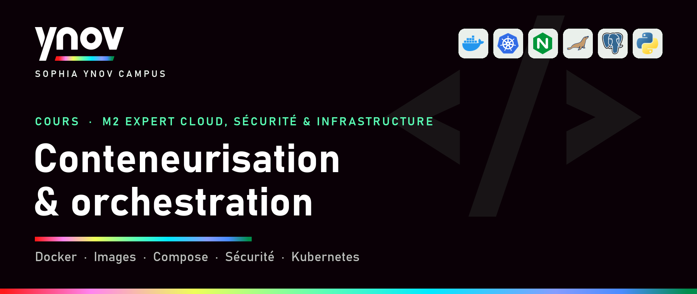
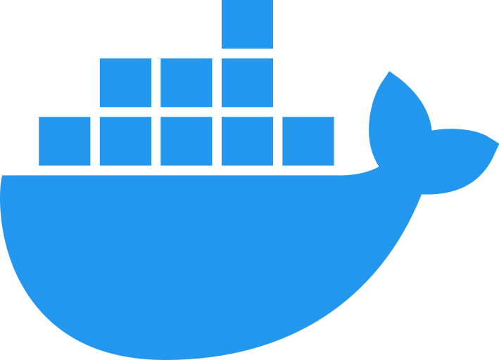
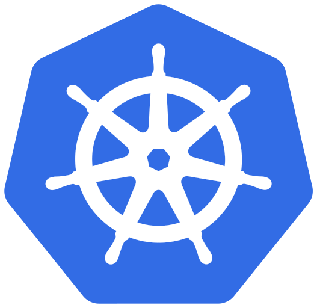
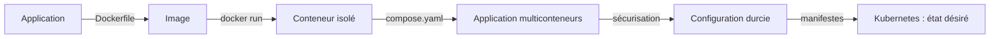

---
hide:
  - navigation
  - toc
---

# Conteneurisation et orchestration { .visually-hidden }

{ .hero }

## Module **Conteneurisation et orchestration** (M2 Expert Cloud, Sécurité & Infrastructure)

Un parcours complet pour comprendre ce qu'est vraiment un conteneur, construire des images propres, faire tourner une application multiconteneurs avec **Docker**  et **Compose**, la sécuriser, puis passer à l'orchestration avec **Kubernetes** .  
Chaque notion part d'une question simple et s'appuie sur des commandes réelles, avec ce qu'on observe vraiment sur une machine.

## Le parcours

<div class="grid cards" markdown>

-   :material-cube-outline:{ .lg .middle } __1 · Comprendre les conteneurs__

    ---

    Monolithe et microservices, VM ou conteneur, namespaces et cgroups, image et cycle de vie.

    [:octicons-arrow-right-24: Commencer](Du-monolithe-aux-microservices.md)

-   :material-layers-outline:{ .lg .middle } __2 · Construire des images__

    ---

    Couches, Dockerfile, contexte de build et cache, versionner et publier.

    [:octicons-arrow-right-24: Les couches d'une image](Couches-d-une-image.md)

-   :material-lan:{ .lg .middle } __3 · Faire tourner une application__

    ---

    Réseaux et ports, volumes, Docker Compose, healthchecks et diagnostic.

    [:octicons-arrow-right-24: Réseaux et ports](Reseaux-et-ports.md)

-   :material-shield-lock-outline:{ .lg .middle } __4 · Sécuriser__

    ---

    Sécurité des images, identités et capabilities, secrets, exposition et ressources.

    [:octicons-arrow-right-24: Sécurité des images](Securite-des-images.md)

-   :material-kubernetes:{ .lg .middle } __5 · Orchestrer__

    ---

    État désiré, Pod, Deployment, Service et Ingress, de Compose à Kubernetes.

    [:octicons-arrow-right-24: Pourquoi orchestrer ?](Pourquoi-orchestrer.md)

-   :material-map-outline:{ .lg .middle } __Le fil rouge__

    ---

    Une application, de son Dockerfile jusqu'au cluster.

    [:octicons-arrow-right-24: Voir plus bas](#le-fil-rouge)

</div>

## Le fil rouge



## Comment lire une page

| Section | Ce qu'on y trouve |
|---|---|
| **Synthèse** | l'essentiel en tableaux et listes courtes, et les pièges à retenir |
| **Cas d'usage** | des situations concrètes, avec les commandes et ce qu'on observe |
| **Schémas** | des visuels, avec leur code Mermaid |
| **Motion design** | un découpage séquence par séquence pour animer le concept |
| **Vérifier soi-même** | un mini-lab de quelques commandes |

## Auteur

<div class="team-grid">
  <a class="team-member" href="https://github.com/astronas">
    <span class="team-avatar" data-initials="TG"></span>
    <span class="team-name">Thibaut Gianola</span>
    <span class="team-handle">@astronas</span>
  </a>
</div>

## Quickstart

```bash
# 1. Lancer un premier conteneur
docker run --rm hello-world

# 2. Un serveur web publié sur le poste uniquement
docker run -d --name web -p 127.0.0.1:8080:80 nginx:stable
curl -s -o /dev/null -w '%{http_code}\n' http://127.0.0.1:8080/   # 200

# 3. Une application complète décrite dans compose.yaml
docker compose up -d --wait && docker compose ps

# 4. Un cluster Kubernetes local
minikube start && kubectl get nodes
```

> Environnement de référence : Docker Engine 29 avec Docker Compose v2 sur Linux (ou WSL2 sous Windows), Kubernetes 1.3x avec Minikube.
